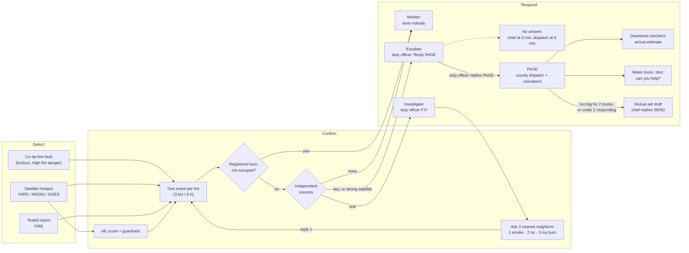

# Firewatch

**Detect → Confirm → Respond** for rural Kansas volunteer fire districts, built around SMS so it works on one bar of cell.

Built for [Firewatch 2026](https://wsuinnovationworks.com/) (WSU Innovation Works × Lockheed Martin Skunk Works, Nov 6–8, 2026).

## The problem

In the challenge scenario (Cottonwood Creek Fire District: 450 sq mi, 18 volunteers, one bar of cell), a downed line starts a grass fire at 1:50. Nobody sees it until 2:17, 911 is called at 2:21, and the first truck arrives at 2:52, when the fire is 2–3 miles long. The 31 minutes before anyone knows are the ones that matter. Satellites alone don't win them: across 10 years of Kansas wildfires, they saw the fire a median 8 minutes *after* it was reported. And a system that cries wolf over March pasture burns gets switched off by April.

## What Firewatch does

- **Detect:** combines cheap signals into one event per fire: electric co-op line faults on fire-weather days, satellite hotspots (VIIRS, MODIS, GOES), and texted reports from ranchers and lease pumpers.
- **Confirm without a drive-out:** an ML score separates wildfires from prescribed burns and refinery flares. Escalation needs two independent signals. Registered burns are suppressed. The nearest neighbors are asked by text: "See smoke? 1 yes, 2 no, 3 it's my burn."
- **Respond before the first engine:** the duty officer gets one text and replies PAGE. Paging goes through county dispatch. The downwind rancher, the lease water truck, and disc owners get a text with direction and an arrival estimate from the spread model, and mutual aid is drafted if too few volunteers respond.

Humans decide every page. Every signal, text, and decision is logged on the event.



In the Cottonwood Creek replay this chain pages at T+9 instead of today's 911 call at T+31. The first truck arrives at T+40 to about 220 acres instead of 520 at T+62 (spread model estimate, not field data).

**Status:** the satellite path (ingest, clustering, enrichment, ML scoring, map, 3D spread, logged actions) is built and evaluated on real Kansas data. The whole chain also runs end to end in the **Cottonwood Creek replay**: line fault, neighbor texts, two-source confirmation, PAGE by text, downwind warnings with arrival estimates, mutual aid, and a registered burn that texts nobody. Texts go to a simulated outbox. Twilio sending is written but not yet tried on a real phone. The plan, honest cost numbers, and failure modes are in [docs/PLAN.md](docs/PLAN.md).

## Docs

- [Build plan](docs/PLAN.md): the scenario in minutes, whole-chain design, constraints, failure modes, cost and who pays, evidence, weekend scope, next step.
- [Design](docs/DESIGN.md): data model, pipeline, signals and confirmation rules, scoring, response planner and messaging, spread model, API, UI.

## Stack

| Layer | Tech |
|---|---|
| Backend / ML | Python, FastAPI, pandas, scikit-learn, XGBoost, SQLite |
| Frontend | React, Vite, TypeScript, MapLibre GL JS, deck.gl, Tailwind |
| 3D | MapLibre terrain (AWS Terrain Tiles) + deck.gl overlays |
| Data | NASA FIRMS, Open-Meteo, NWS, NIFC WFIGS, OpenStreetMap |

No paid services or map tokens are required. The only key is a free [FIRMS MAP_KEY](https://firms.modaps.eosdis.nasa.gov/api/map_key/).

## Repository layout

```
backend/app/   FastAPI app: ingestion, clustering, enrichment, scoring, spread simulation
backend/ml/    Historical download, training-set builder, model training, evaluation report
frontend/      React dashboard and 3D spread preview
docs/          Plan and design
```

## Getting started

Requires Python 3.12+ and Node 22+.

```bash
cp .env.example .env            # add FIRMS_MAP_KEY for MODE=live; MODE=sample works without it

# backend (http://127.0.0.1:8000, API under /api)
cd backend
python3 -m venv .venv && .venv/bin/pip install -r requirements.txt
.venv/bin/uvicorn app.main:app --reload --port 8000
.venv/bin/pytest                 # tests

# frontend (http://localhost:5173)
cd frontend
npm install && npm run dev
```

The Vite dev server proxies `/api` to `http://127.0.0.1:8000` (override with `API_PROXY_TARGET`). It uses `127.0.0.1` rather than `localhost` so it can't hit some other service bound to IPv6 port 8000.

`MODE=sample` replays historical and synthetic Kansas events through the full pipeline offline, so it's the default for development and demos. On first start the backend loads all fixtures from `backend/data/samples/`; **Replay sample** in the top bar re-feeds them pass by pass over 60 seconds. Fixture weather was backfilled from the Open-Meteo archive with `.venv/bin/python -m scripts.backfill_sample_weather`.

**Run scenario** in the top bar replays the Cottonwood Creek incident (1:50 pm line fault on a High fire-danger Saturday) at 2 seconds per scenario minute. A strip under the top bar compares today's timeline (on scene at T+62) with Firewatch's as it happens, and the drawer shows the evidence, the response, and every text. The district (a 450 sq mi stand-in boundary in Butler County, its settings, and a fictional roster) lives in `backend/data/districts/cottonwood-creek/`, and the script in `backend/data/scenarios/cottonwood-creek.json`.

On macOS, XGBoost needs OpenMP: `brew install libomp`.

### Mesh radios (Meshtastic)

Firewatch can send its texts over a Meshtastic LoRa mesh, for volunteers and trucks out of cell coverage, and take replies and GPS positions back. It's built for the SenseCAP T1000-E, but any Meshtastic radio works. See [DESIGN.md section 5.7](docs/DESIGN.md#57-mesh-radios-meshtastic).

1. On each radio, use the Meshtastic phone app to set the LoRa region to **US** and put both radios on the same primary channel. A real district would use a private channel with its own key. On the field radio, shorten the position broadcast interval so the map stays current.
2. Plug the station radio into the server with its USB cable. Run `backend/.venv/bin/meshtastic --info` to confirm it's connected and read its node ID. Keep phones off the station radio while the server is using it.
3. Put the field radio's node ID (`!a1b2c3d4`, shown in the Meshtastic app) in the `mesh_id` column of `backend/data/districts/cottonwood-creek/roster.csv`, on the row of whoever carries it. For the demo, use the duty officer. The radio also appears at `GET /api/mesh/nodes` once the station has heard it.
4. Set `MESH_GATEWAY=serial` in `.env` (and `MESH_DEVICE=/dev/cu.usbmodem…` if the server has more than one serial device), then restart the backend. **MESH** appears in the top bar.
5. Run the scenario. The field radio buzzes with the duty officer's texts. Reply `PAGE` in the Meshtastic app's direct-message thread from the station radio. Each mesh text in the drawer shows **DELIVERED** once that radio acknowledges it.

### Tower sensor nodes (temperature, humidity, smoke)

Mesh relays on elevators and water towers can report temperature, humidity, and PM2.5/PM10, and raise a smoke-sensor signal. See [DESIGN.md section 5.8](docs/DESIGN.md#58-tower-sensor-nodes). Rough parts list per node:

| Part | ~Cost |
|---|---|
| RAK WisBlock starter kit (RAK19007 base with solar charger + RAK4631 nRF52840/LoRa core), from a US distributor | $35 |
| Weatherproof junction box + 2–3 W, 6 V solar panel | $25 |
| Two 18650 cells | $10 |
| Outdoor 915 MHz antenna + pigtail adapter | $27 |
| RAK12039 particulate sensor (Plantower PMSA003I, I²C; Meshtastic doesn't read the cheaper serial version) | $38 |
| RAK1901 temperature/humidity sensor (SHTC3) | $9 |
| Vented radiation shield for the sensors (they can't sit inside the sealed box) | $5 |
| Mount, cable, wiring | $8 |
| **Per node** | **~$157** |

A county: 6 nodes ($942) + a station radio (~$45) + an optional duty-officer T1000-E ($51) ≈ **$1,040**, about $1,140 with spares. No monthly fees. Costs, coverage, grants, and a comparison with Dryad Silvanet are in [docs/research/hardware-pricing.txt](docs/research/hardware-pricing.txt).

1. Flash Meshtastic, set region **US** and the district's channel, role **Router**.
2. Enable telemetry: environment metrics and air quality, both on a 5-minute interval.
3. Set a **fixed position** at the tower's coordinates. Without one, the node's readings are stored but it raises no smoke signals.
4. Mount the sensors in the shield, facing open air, with the antenna as high as the structure allows.

The map shows each node's latest PM2.5, °C, and RH. Thresholds are in `backend/data/districts/<district>/settings.json` (`smoke_pm25_rise`, `smoke_fine_ratio`, `smoke_regional_share`, `smoke_repeat_min`).

### Map layers and the scorer

`backend/data/layers/` holds real Kansas data: transmission lines ≥ 115 kV, transmission substations, and towns from OpenStreetMap (counties from Census boundaries), plus persistent industrial heat sources derived from ten years of FIRMS detections. `backend/data/model/` holds the trained scorer. Both are committed, so the app runs without rebuilding them. To rebuild:

```bash
cd backend
.venv/bin/pip install -r requirements-ml.txt
.venv/bin/python -m scripts.fetch_osm_layers          # OSM lines, substations, towns (~1 min)
.venv/bin/python -m ml.download                        # FIRMS Kansas archive 2016–2025 + WFIGS incidents (~5 min)
.venv/bin/python -m ml.build_dataset --rebuild-history # replay history, derive heat sources, label, build features (~15 min)
.venv/bin/python -m ml.train                           # evaluate, export data/model/, write ml/report.md
.venv/bin/python -m ml.analyze                         # deeper analyses + figures for the research report (~2 min)
```

Results are in [backend/ml/report.md](backend/ml/report.md); the full analysis of the v1 training run is in [docs/research/scorer-v1-training-run.md](docs/research/scorer-v1-training-run.md). `SCORER=auto` (default) uses the model when it's present and weather is available, and falls back to the rules scorer otherwise.

| Path | What it is |
|---|---|
| `backend/app/ingest/` | FIRMS CSV fetch and parse, Open-Meteo weather |
| `backend/app/features/` | Event clustering (2 km / 12 h) and feature enrichment |
| `backend/app/scoring/` | XGBoost scorer v1 with per-alert reasons, rules fallback, guardrails, suppression reasons |
| `backend/ml/` | Training pipeline and evaluation report |
| `backend/app/sim/` | Grass-fire spread estimate (arrival-time grid → isochrones, impacts) |
| `backend/app/signals.py`, `confirm.py` | Line faults and texted reports on events; the two-source level rules and burn registry |
| `backend/app/notify.py` | SMS gateway (outbox / Twilio), templates, neighbor asks, no-answer ladder, PAGE / NO / SEND, downwind warnings, mutual aid, inbound keywords |
| `backend/app/mesh.py` | Meshtastic bridge: texts out as acknowledged direct messages, replies in, radio positions and crew distances |
| `backend/app/sensors.py` | Tower sensor telemetry: readings, the smoke rule (baseline, dust check, regional check), local temperature and humidity |
| `backend/app/scenario.py` | Scenario replay on its own clock |
| `backend/app/main.py` | FastAPI routes: alerts, actions, decisions, signals, SMS, simulate, layers, district, scenario, health, sample replay |
| `frontend/src/pages/Dashboard.tsx` | Alert list, map, detail drawer, actions, scenario strip |
| `frontend/src/pages/Spread3D.tsx` | 3D terrain spread preview with wind override |

## Data attribution

NASA FIRMS (LANCE) · Open-Meteo (CC BY 4.0) · NOAA / National Weather Service · NIFC WFIGS / IRWIN · © OpenStreetMap contributors (ODbL) · AWS Terrain Tiles · US Census TIGER · EPA ecoregions.
