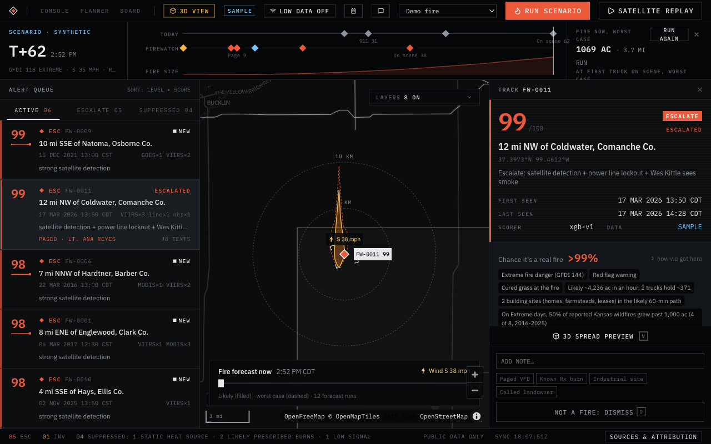
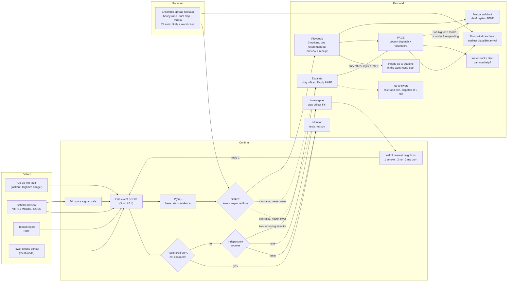
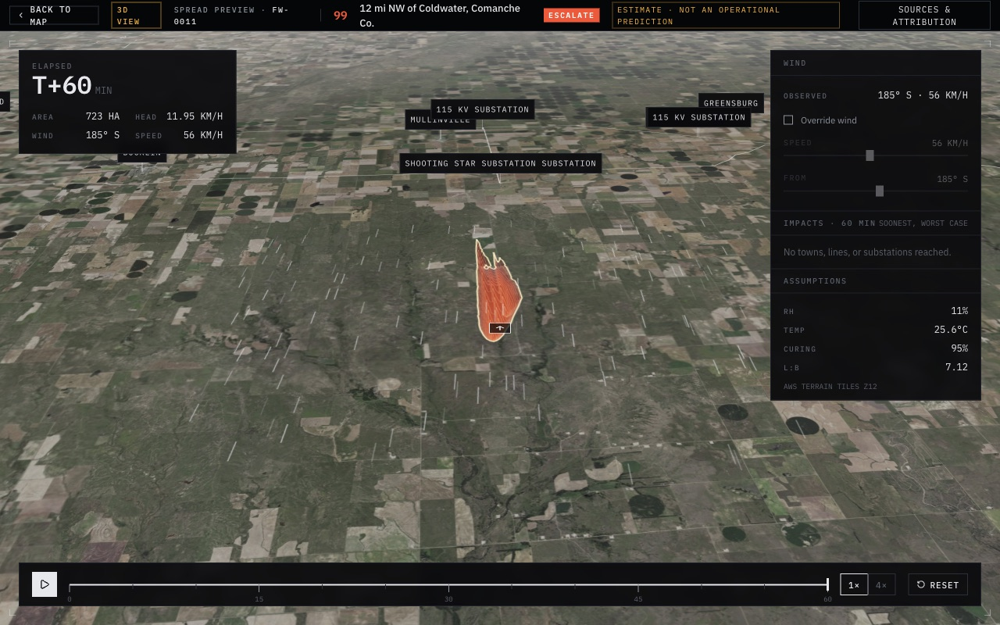
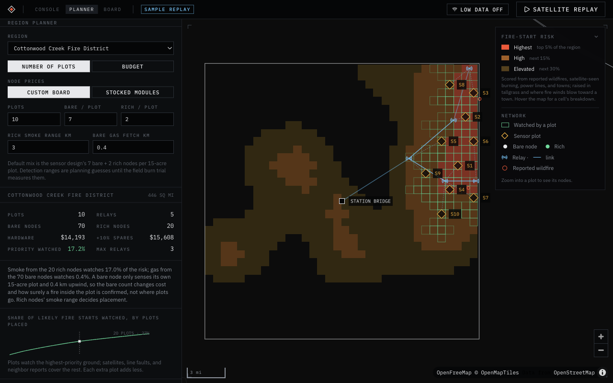
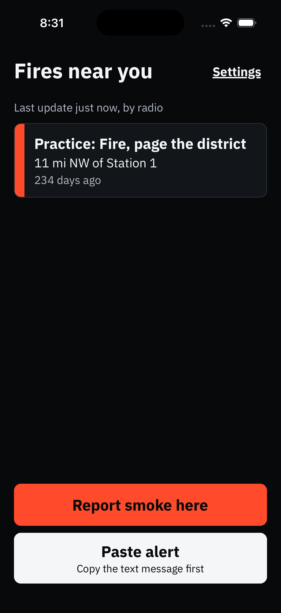
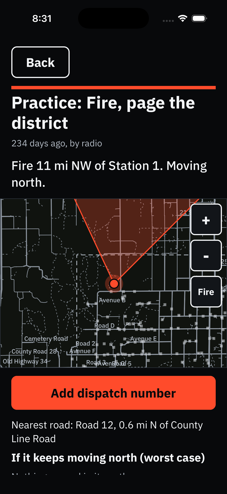
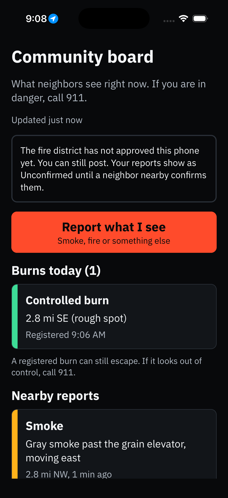

<div align="center">


# Firewatch

**Detect → Confirm → Respond** for rural Kansas volunteer fire districts.<br/>Built around SMS and a LoRa mesh, so it works on one bar of cell.

       

[How it works](#how-it-works) · [Screens](#screens) · [Quick start](#quick-start) · [Run the demo](#run-the-demo) · [Pitch deck](docs/pitch/Firewatch-Pitch.pdf) · [Sensor video](https://youtu.be/OYTUxd2nSDk) · [Docs](#docs) · [Data sources](#data-sources-and-apis)

Built for [Firewatch 2026](https://wsuinnovationworks.com/) · WSU Innovation Works × Lockheed Martin Skunk Works · Nov 6–8, 2026

<br/>



</div>

## The 31 minutes that matter

In the challenge scenario (Cottonwood Creek Fire District: 450 sq mi, 18 volunteers, one bar of cell), a downed line starts a grass fire at 1:50 pm on a red-flag Tuesday. Nobody sees it until 2:17, 911 is called at 2:21, and the first truck arrives at 2:52 to a fire 2–3 miles long.

Satellites alone don't win those minutes back: across 10 years of Kansas wildfires, they saw the fire a median 8 minutes *after* it was reported. And a system that cries wolf over March pasture burns gets switched off by April.

```mermaid
gantt
    title Cottonwood Creek replay, line down at 1:50 pm
    dateFormat HH:mm
    axisFormat %H:%M
    section Today
    Nobody knows               :crit, t1, 13:50, 14:21
    911 call to trucks rolling :t2, 14:21, 14:34
    Driving                    :t3, 14:34, 14:52
    On scene, about 1070 acres :milestone, t4, 14:52, 0m
    section Firewatch
    Line fault, neighbors asked :f1, 13:50, 13:58
    Confirmed and paged         :f2, 13:58, 13:59
    Turnout                     :f3, 13:59, 14:10
    Driving                     :f4, 14:10, 14:28
    On scene, about 360 acres   :milestone, f5, 14:28, 0m
```



<table>
<tr>
<td align="center" width="33%"><h3>T+9</h3>district paged<br/><sub>today: 911 call at T+31</sub></td>
<td align="center" width="33%"><h3>T+38</h3>first truck on scene<br/><sub>today: T+62</sub></td>
<td align="center" width="33%"><h3>~360 acres</h3>at first truck<br/><sub>today: ~1,070 acres</sub></td>
</tr>
</table>

Fire sizes are the spread forecast's median, not field data; the forecast's [back-test](docs/research/spread-backtest-v1.md) is the evidence for it.

## How it works

<table>
<tr>
<th width="33%">Detect</th>
<th width="33%">Confirm</th>
<th width="33%">Respond</th>
</tr>
<tr valign="top">
<td>

Combines cheap signals into **one event per fire**:
- electric co-op line faults on fire-weather days
- satellite hotspots (VIIRS, MODIS, GOES, NGFS)
- texted reports from ranchers and lease pumpers
- tower smoke sensors on the mesh

</td>
<td>

**No drive-out needed:**
- an ML score separates wildfires from prescribed burns and refinery flares
- escalation needs two independent signals
- registered burns are suppressed
- the nearest neighbors get a text: *"See smoke? 1 yes, 2 no, 3 it's my burn."*

</td>
<td>

**Before the first engine:**
- the duty officer gets one text and replies **PAGE**
- paging goes through county dispatch
- downwind ranchers, the lease water truck and disc owners get direction and an arrival estimate
- mutual aid is drafted if too few volunteers respond

</td>
</tr>
</table>

> [!IMPORTANT]
> **Humans decide every page.** Every signal, text, and decision is logged on the event.

The **forecast** and the **playbook** sit beside the confirmation rules:
- P(fire) and the forecast's acres feed an expected-loss comparison of the options.
- That comparison can raise a level (a weak signal on an Extreme day gets an Investigate and a heads-up) but never lower one; two sources always escalate.
- The playbook shows the dispatcher three options, one recommended with the reason, and does what's chosen.
- Downwind warnings use the forecast's earliest plausible arrival. See [How Firewatch recommends actions](docs/RECOMMENDATIONS.md).

<details>
<summary><b>The full decision flow</b> (diagram)</summary>



</details>

For the whole system, open the [system map](docs/system-map.html) or read the [system flows](docs/SYSTEM-FLOWS.md).

## Screens

<table>
<tr>
<td width="50%"></td>
<td width="50%"></td>
</tr>
<tr>
<td><b>3D spread preview.</b> The forecast fire over USGS aerial imagery and terrain, with wind override and the towns, lines, and substations in its path.</td>
<td><b>Region planner.</b> Where to put a sensor network in a district or county: fire-start risk, sensor plots, relays with terrain line of sight, and the bill of materials.</td>
</tr>
</table>

<table>
<tr>
<td align="center" width="33%"></td>
<td align="center" width="33%"></td>
<td align="center" width="33%"></td>
</tr>
<tr>
<td align="center"><sub>Alerts arrive by text or by mesh radio</sub></td>
<td align="center"><sub>Where it is, where it's heading, the nearest road</sub></td>
<td align="center"><sub>Community board: neighbors report and confirm</sub></td>
</tr>
</table>

## Status

| Piece | State |
|---|---|
| Satellite path: ingest, clustering, enrichment, ML scoring, map, 3D spread, logged actions | Built, evaluated on real Kansas data |
| Cottonwood Creek replay: line fault, neighbor texts, two-source confirmation, PAGE by text, downwind warnings, mutual aid, a registered burn that texts nobody | Runs end to end |
| Mesh radios (Meshtastic): texts out, replies and GPS positions back | Built |
| Tower sensor nodes: temperature, humidity, smoke signal | Built |
| Region planner | Built |
| Phone app (Expo, iOS and Android): region packs, alert codes, built-in radio, community board | Built |
| Community board ([evidence](docs/board-evidence.md)) | Built and tested on the backend; see below |
| Live texting | Not yet live: texts go to a simulated outbox; Twilio sending is written but not yet tried on a real phone |

The plan, honest cost numbers, and failure modes are in [docs/PLAN.md](docs/PLAN.md).

<details>
<summary><b>Community board details</b></summary>

Evidence, commands and gaps are in [docs/board-evidence.md](docs/board-evidence.md).

| Piece | State |
|---|---|
| Member and anonymous posts, confirms, ladder, acknowledge | Built, tested |
| Abuse limits (100 anonymous posts send 0 pages, no self-confirm, no far confirm) | Built, tested |
| Public location rounding, photo limits and EXIF strip | Built, tested |
| Offline posting and compass | Built, server-tested only |
| Replay A/B (`python -m scripts.replay_board_ab`) | Run; board minutes are ASSUMED |
| Keyword spot check, outdoor compass, real Twilio phone | Not tested yet |

</details>

## Quick start

Requires **Python 3.12+** and **Node 22+**. On macOS, XGBoost needs OpenMP: `brew install libomp`.

```bash
cp .env.example .env            # MODE=sample works offline; add FIRMS_MAP_KEY for MODE=live

# backend → http://127.0.0.1:8000 (API under /api)
cd backend
python3 -m venv .venv && .venv/bin/pip install -r requirements.txt
.venv/bin/uvicorn app.main:app --reload --port 8000
.venv/bin/pytest                # tests

# frontend → http://localhost:5173
cd ../frontend
npm install && npm run dev
```

The Vite dev server proxies `/api` to `http://127.0.0.1:8000` (override with `API_PROXY_TARGET`). It uses `127.0.0.1` rather than `localhost` so it can't hit some other service bound to IPv6 port 8000.

> [!TIP]
> Every data source is free and needs no map token. The only data key is a free [FIRMS MAP_KEY](https://firms.modaps.eosdis.nasa.gov/api/map_key/). Twilio is the one paid service (about 1 cent per text), used only for live texting.

<details>
<summary><b>Public board server</b> (for a tunnel)</summary>

The public board is the only thing a tunnel may point at. The tunnel points at port 8012 and never at the main API or Vite. The main server must also run for timers and alerts. Set `FORWARDED_IP_HEADER` (for example `cf-connecting-ip`) so rate limits see the visitor, not the tunnel. Run `npm run build` in frontend first.

```bash
.venv/bin/uvicorn app.public_app:app --host 127.0.0.1 --port 8012
```

</details>

## Run the demo

| Button | What it does |
|---|---|
| **Run scenario** | Replays the scenario picked beside it at 2 seconds per scenario minute: the Cottonwood Creek incident (1:50 pm line fault, south wind 30–40 mph, gusts past 55, RH 11%) or one of the three packet replays. While it plays, the button becomes **Stop scenario**. |
| **Satellite replay** | Re-feeds the historical and synthetic Kansas fixtures pass by pass over 60 seconds (sample mode). |
| **3D view** | Opens the 3D spread preview for the selected alert. |
| **Planner** | Opens the region planner. |
| **Low data** | No map pictures, slower updates. Switches on by itself after slow fetches; turn it off from the top bar. |

During a scenario, a strip under the top bar compares today's timeline (on scene at T+62) with Firewatch's as it happens, and the drawer shows the evidence, the response, and every text.

`MODE=sample` replays historical and synthetic Kansas events through the full pipeline offline, so it's the default for development and demos. On first start the backend loads all fixtures from `backend/data/samples/`. Fixture weather was backfilled from the Open-Meteo archive with `.venv/bin/python -m scripts.backfill_sample_weather`.

The district (a 450 sq mi stand-in boundary centered on Coldwater in Comanche County, per the packet's Clark/Comanche/Barber model, its settings, and a fictional roster) lives in `backend/data/districts/cottonwood-creek/`. The scripts are in `backend/data/scenarios/` (`cottonwood-creek.json` and the `cottonwood-creek-packet*.json` replays).

> [!NOTE]
> Replays record SMS in the outbox and never send a real text, in any mode. A radio linked in the roster still gets its mesh message, so a demo can show one. The packet replays use the packet's facts: nobody answers, the driver has no signal until minute 31, and nobody is within 4 miles.

## Hardware and field setup

<a href="https://youtu.be/OYTUxd2nSDk"></a>

**Sensor node intro video (2 min):** [watch on YouTube](https://youtu.be/OYTUxd2nSDk). Every part in the exploded view, the node in a Kansas field, and what it costs. Design, parts and costs are in [sensors/README.md](sensors/README.md).

<details>
<summary><b>Mesh radios (Meshtastic)</b>: texts for volunteers and trucks out of cell coverage</summary>

Firewatch can send its texts over a Meshtastic LoRa mesh, for volunteers and trucks out of cell coverage, and take replies and GPS positions back. It's built for the SenseCAP T1000-E, but any Meshtastic radio works. See [DESIGN.md section 5.7](docs/DESIGN.md#57-mesh-radios-meshtastic).

1. On each radio, use the Meshtastic phone app to set the LoRa region to **US** and put both radios on the same primary channel. A real district would use a private channel with its own key. On the field radio, shorten the position broadcast interval so the map stays current.
2. Plug the station radio into the server with its USB cable. Run `backend/.venv/bin/meshtastic --info` to confirm it's connected and read its node ID. Keep phones off the station radio while the server is using it.
3. Put the field radio's node ID (`!a1b2c3d4`, shown in the Meshtastic app) in the `mesh_id` column of `backend/data/districts/cottonwood-creek/roster.csv`, on the row of whoever carries it. For the demo, use the duty officer. The radio also appears at `GET /api/mesh/nodes` once the station has heard it.
4. Set `MESH_GATEWAY=serial` in `.env` (and `MESH_DEVICE=/dev/cu.usbmodem…` if the server has more than one serial device), then restart the backend. **MESH** appears in the top bar.
   If the server's replies never arrive and the field radio gets a `NO_CHANNEL` routing error, the radios haven't exchanged encryption keys yet (common with new radios, or when one had no region set while the other booted). With both radios on and in range, reboot the station radio (`backend/.venv/bin/meshtastic --port <station port> --reboot`, with the backend stopped). It announces its key within about a minute.
5. Run the scenario. When a scripted reply comes from someone whose roster row has a radio (the duty officer's minute-9 `PAGE`), the replay holds its clock and waits up to 90 s for the real reply from that radio; the strip shows **CLOCK HELD**. With no reply it plays the scripted one. The field radio buzzes with the duty officer's texts. Each mesh text goes to the person's radio as a direct message and is copied once to the district channel, so the channel chat shows the whole incident (turn off with `MESH_CHANNEL_FEED=false`). Reply `PAGE` in either the direct-message thread or the channel chat. On the channel, a reply word must be the whole message, and `FIRE`/`BURN`/`JOIN` with details must be in capitals; anything else there is treated as people talking and ignored. Each mesh text in the drawer shows **DELIVERED** once that radio acknowledges it.

</details>

<details>
<summary><b>Tower sensor nodes</b>: temperature, humidity, smoke (~$157 a node)</summary>

Mesh relays on elevators and water towers can report temperature, humidity, and PM2.5/PM10, and raise a smoke-sensor signal. See [DESIGN.md section 5.8](docs/DESIGN.md#58-tower-sensor-nodes). Rough parts list per node:

| Part | ~Cost |
|---|---|
| RAK WisBlock starter kit (RAK19007 base with solar charger + RAK4631 nRF52840/LoRa core), from a US distributor | $35 |
| Weatherproof junction box + 2–3 W, 6 V solar panel | $25 |
| Two 18650 cells | $10 |
| Outdoor 915 MHz antenna + pigtail adapter | $27 |
| RAK12039 particulate sensor (Plantower PMSA003I, I²C; Meshtastic doesn't read the cheaper serial version) | $38 |
| RAK1901 temperature/humidity sensor (SHTC3) | $9 |
| Vented radiation shield for the sensors (they can't sit inside the sealed box) | $5 |
| Mount, cable, wiring | $8 |
| **Per node** | **~$157** |

A county: 6 nodes ($942) + a station radio (~$45) + an optional duty-officer T1000-E ($51) ≈ **$1,040**, about $1,140 with spares. No monthly fees. Costs, coverage, grants, and a comparison with Dryad Silvanet are in [docs/research/hardware-pricing.txt](docs/research/hardware-pricing.txt).

1. Flash Meshtastic, set region **US** and the district's channel, role **Router**.
2. Enable telemetry: environment metrics and air quality, both on a 5-minute interval.
3. Set a **fixed position** at the tower's coordinates. Without one, the node's readings are stored but it raises no smoke signals.
4. Mount the sensors in the shield, facing open air, with the antenna as high as the structure allows.

The map shows each node's latest PM2.5, °C, and RH. Thresholds are in `backend/data/districts/<district>/settings.json` (`smoke_pm25_rise`, `smoke_fine_ratio`, `smoke_regional_share`, `smoke_repeat_min`).

</details>

<details>
<summary><b>Region planner</b>: where to put a sensor network</summary>

Open **Planner** in the top bar (`/planner`) and pick a fire district or any Kansas county. It lays out the mixed bare/rich design from [sensors/README.md](sensors/README.md):
- where each 15-acre plot of 7 bare and 2 rich nodes goes;
- where the nodes sit inside the plot;
- which elevators, substations, or high ground relay them to the station bridge;
- what it costs, at the custom-board prices by default or the stocked-module prices.

It's built from the region's geography and climate:
- reported wildfires and ten years of satellite-detected burning;
- power lines, substations, towns, and Flint Hills tallgrass;
- terrain line of sight for every radio link;
- ten years of hourly fire-weather winds, so sensors sit downwind of what they watch;
- winter and fire-season sun, to check the solar budget.

Change the plot count or switch to a budget, the nodes per plot, and the assumed detection ranges, and the plan updates. Each plot lists why it was chosen and what to check on site. The method and its limits are in [DESIGN.md section 5.10](docs/DESIGN.md#510-region-planner).

Climate summaries are cached per 0.25° cell in `backend/data/climate/`. A county that isn't cached yet is fetched once from the Open-Meteo archive, which takes a few seconds. Terrain tiles are fetched once and cached. The planner's history layers (`wildfire_history.geojson`, `burn_activity.json`, `counties.geojson`) are rebuilt from the ML downloads with `.venv/bin/python -m ml.planner_layers`.

</details>

## Under the hood

| Layer | Tech |
|---|---|
| Backend / ML | Python, FastAPI, pandas, scikit-learn, XGBoost, SQLite |
| Frontend | React 19, Vite, TypeScript, MapLibre GL JS, TanStack Query, Tailwind |
| 3D | MapLibre terrain (AWS Terrain Tiles) with USGS aerial imagery |
| Phone app | Expo (React Native), iOS and Android |
| Radios | Meshtastic (LoRa), SenseCAP T1000-E and RAK WisBlock |
| Data | NASA FIRMS, NOAA GOES and NGFS, Open-Meteo, NWS, NIFC WFIGS, OpenStreetMap |

```
backend/app/   FastAPI app: ingestion, clustering, enrichment, scoring, spread simulation, planner
backend/ml/    Historical download, training-set builder, model training, evaluation report
frontend/      React console, 3D spread preview, region planner, community board
mobile/        Expo phone app
sensors/       Sensor node designs and costed BOMs
docs/          Plan, design, research
```

<details>
<summary><b>Code map</b></summary>

| Path | What it is |
|---|---|
| `backend/app/ingest/` | FIRMS, GOES, NGFS, HMS, NWS, METAR, RTMA and other feeds; Open-Meteo weather |
| `backend/app/features/` | Event clustering (2 km / 12 h) and feature enrichment |
| `backend/app/scoring/` | XGBoost scorer v1 with per-alert reasons, rules fallback, guardrails, suppression reasons |
| `backend/ml/` | Training pipeline and evaluation report |
| `backend/app/sim/` | Grass-fire spread: fuel map (NLCD/CDL), changing weather, 24-member ensemble forecast |
| `backend/app/decision.py`, `playbook.py` | Expected-loss recommendation model and the playbook it drives (options, previews, receipts) |
| `backend/ml/backtest.py` | Spread back-test against FIRMS archive detections of real fires |
| `backend/ml/fire_day.py` | Fire-day model: ignition rate and large-fire share by fire danger, from WFIGS + archive weather |
| `frontend/src/components/FireForecast.tsx` | The selected fire's forecast outline, its wind, and the time slider on the console map |
| `backend/app/situation.py` | `Situation` contract between ingestion and forecast/recommendations; builds one from a scenario |
| `backend/app/signals.py`, `confirm.py` | Line faults and texted reports on events; the two-source level rules and burn registry |
| `backend/app/notify.py` | SMS gateway (outbox / Twilio), templates, neighbor asks, no-answer ladder, PAGE / NO / SEND, downwind warnings, mutual aid, inbound keywords |
| `backend/app/mesh.py` | Meshtastic bridge: texts out as acknowledged direct messages, replies in, radio positions and crew distances |
| `backend/app/sensors.py` | Tower sensor telemetry: readings, the smoke rule (baseline, dust check, regional check), local temperature and humidity |
| `backend/app/planner.py`, `climate.py` | Region planner: priority grid, wind-weighted plot siting, plot layout, relay routing with terrain line of sight, power check, bill of materials; fire-weather climatology |
| `backend/app/scenario.py` | Scenario replay on its own clock: run, stop, instant load |
| `backend/app/main.py` | FastAPI routes: alerts, actions, decisions, signals, SMS, simulate, layers, district, scenario, planner, health, sample replay |
| `frontend/src/pages/Dashboard.tsx` | Alert list, map, detail drawer, actions, scenario strip |
| `frontend/src/pages/Spread3D.tsx` | 3D terrain spread preview with wind override |
| `frontend/src/pages/Planner.tsx` | Region planner page: controls, climate, power, plots, relays, bill of materials, map |

</details>

<details>
<summary><b>Map layers and rebuilding the scorer</b></summary>

`backend/data/layers/` holds real Kansas data: transmission lines ≥ 115 kV, transmission substations, and towns from OpenStreetMap (counties from Census boundaries), plus persistent industrial heat sources derived from ten years of FIRMS detections. `backend/data/model/` holds the trained scorer. Both are committed, so the app runs without rebuilding them. To rebuild:

```bash
cd backend
.venv/bin/pip install -r requirements-ml.txt
.venv/bin/python -m scripts.fetch_osm_layers          # OSM lines, substations, towns (~1 min)
.venv/bin/python -m ml.download                        # FIRMS Kansas archive 2016–2025 + WFIGS incidents (~5 min)
.venv/bin/python -m ml.build_dataset --rebuild-history # replay history, derive heat sources, label, build features (~15 min)
.venv/bin/python -m ml.train                           # evaluate, export data/model/, write ml/report.md
.venv/bin/python -m ml.analyze                         # deeper analyses + figures for the research report (~2 min)
```

Spread forecasts use NLCD land cover, downloaded on first use. To cache the scenario areas ahead of a demo (and the slower USDA CDL cropland detail), run `.venv/bin/python -m scripts.fetch_fuels`.

Results are in [backend/ml/report.md](backend/ml/report.md); the full analysis of the v1 training run is in [docs/research/scorer-v1-training-run.md](docs/research/scorer-v1-training-run.md). `SCORER=auto` (default) uses the model when it's present and weather is available, and falls back to the rules scorer otherwise.

</details>

## Docs

| Doc | What's in it |
|---|---|
| [5-minute pitch deck](docs/pitch/Firewatch-Pitch.pptx) ([PDF](docs/pitch/Firewatch-Pitch.pdf)) | Ten slides with timed speaker notes: the 31-minute problem, how it works, the console, results, false alarms, one bar of cell, the planner, status and next steps |
| [Build plan](docs/PLAN.md) | The scenario in minutes, whole-chain design, constraints, failure modes, cost and who pays, evidence, weekend scope, next step, plus Shane's research additions and open questions |
| [Design](docs/DESIGN.md) | Data model, pipeline, signals and confirmation rules, scoring, response planner and messaging, spread model, API, UI |
| [How Firewatch recommends actions](docs/RECOMMENDATIONS.md) | The decision model end to end: probability of fire, acres at stake, false-alarm costs, expected loss, every weight and why, a worked example, limits |
| [Spread forecast back-test v1](docs/research/spread-backtest-v1.md) | The forecast started from the first satellite look of Anderson Creek 2016 and Starbuck 2017, scored against later looks (v2 55% vs v1 29% of later detections; Starbuck runs too slow overnight) |
| [Fire-day model v1](docs/research/fire-day-model-v1.md) | Kansas wildfire starts and large-fire share by fire-danger level, 2016–2025, which sets the danger multiplier |
| [Research](docs/RESEARCH.md) | Verified landscape and resource research (Lockheed, satellites, tools, prices, grants), each fact with its source, and what is not confirmed |
| [Concept screens and scenario art](design/SCENARIO.md) | The story, the screens and decks (the map positions in them still need a redraw) |
| [Competitor packet](docs/COMPETITOR_PACKET.md) | Official brief, Cottonwood Creek scenario (canonical), judging criteria, schedule |
| [Faultline research brief](docs/FAULTLINE_RESEARCH.md) | Power-line faults on high-danger days as the ignition trigger: evidence, data sources, and build plan |
| [Sensor nodes](sensors/README.md) | The mixed bare/rich node design, hardware, power, and costed BOMs |

## Data sources and APIs

Every data source is free with no paid tier. Twilio is the one paid service, but it's a texting service, not a data source. The free Open-Meteo tier is for non-commercial use only; a commercial product would self-host Open-Meteo (AGPLv3) instead.

<details>
<summary><b>All sources</b>: what each provides, how fresh it is, license, and status</summary>

"Fresh" figures are single readings taken on 2026-11-07 unless noted, not guarantees.

Status values:
- `on map`: fetched and shown behind a toggle in the Layers panel.
- `background`: used by the app, no toggle.
- `needs key`: built but off until a free FIRMS MAP_KEY is set.
- `script`: fetched once by a script in `backend/scripts`, not polled.
- `training only`: used by `backend/ml` or build scripts.
- `planned`: not wired yet.

| API | What it provides | Why we use it | How fresh | Key needed | Cost and license | Status |
|---|---|---|---|---|---|---|
| NASA FIRMS Area API | VIIRS and MODIS fire detections (plus `LANDSAT_NRT` and the real-time `*_RT` feeds) | Core detection stream | Real time, under 60 seconds after overpass (NASA figure) | Yes (free MAP_KEY) | Free, NASA open data | needs key |
| NASA FIRMS yearly CSVs | US detections back to 2016 | Model training history | Yearly | No | Free, NASA open data | training only |
| Open-Meteo forecast | Hourly wind, humidity, temperature, gusts, dew point, pressure, VPD | Fire weather for alerts and the dry-air grid | Hourly model run, about 2 hours behind | No | Free tier is non-commercial only, CC BY 4.0. A sold product would self-host it (AGPLv3) | on map |
| Open-Meteo archive | Historical hourly weather | Model training features | Days behind | No | Same as above | training only |
| AWS Terrain Tiles | Terrarium elevation tiles | Terrain, slope, 3D view | Static | No | Free, open data (USGS and other sources) | background |
| OSM Overpass (`overpass-api.de` and `overpass.kumi.systems`) | Power lines, substations, towns, distribution lines | Line exposure and context layers | Fetched once by script | No | Free, ODbL, (c) OpenStreetMap contributors | script |
| Plotly counties GeoJSON | US county boundaries (Census) | County names | Static | No | Free, public domain Census data | script |
| NIFC WFIGS incident locations (training copy) | Historical reported wildfires and prescribed burns | Training labels | Static download | No | Free, public domain | training only |
| OpenFreeMap | Dark vector basemap | Base map | Continuous | No | Free, no limits, OpenStreetMap data (ODbL) | background |
| USGS Imagery Only (The National Map) | Aerial imagery tiles | 3D view imagery | Imagery 2017 to 2021, zoom 16 max | No | Free, public domain | background |
| NASA FIRMS Landsat NRT (`LANDSAT_NRT`) | 30 m fire detections from Landsat overpasses | Fine-resolution cross-check | A few hours after overpass | Yes (same free MAP_KEY) | Free, NASA open data | needs key |
| OSM distribution lines (`power=minor_line`) | Lower-voltage lines, partial coverage in Kansas | Context layer only, never used for the model's line distance | Fetched once by script | No | Free, ODbL, (c) OpenStreetMap contributors | script |
| NWS alerts (`api.weather.gov`) | Fire, wind, smoke and dust warnings for Kansas | Official hazard alerts | Real time | No (User-Agent required) | Free, US government | on map |
| Iowa Mesonet storm reports (LSR) | Human reports of fires and downed lines or poles | Ground truth hints | As issued | No | Free | on map |
| NIFC WFIGS incidents, current | Currently known incident points | New known incidents | Last edit 14 min old when sampled | No | Free, public domain | on map |
| NIFC WFIGS perimeters, current | Known fire footprints | Avoid re-alerting on known fires | Last edit 38 min old when sampled | No | Free, public domain | on map |
| METAR via aviationweather.gov (backup: Iowa Mesonet ASOS) | Temperature, dew point, pressure, wind at 54 Kansas stations | Measured humidity | Hourly plus specials, about 6 min old when sampled | No | Free, US government | on map |
| NOAA SPC fire weather outlooks | Official dry thunderstorm and wind/RH risk areas | Official risk areas | A few issues a day | No | Free, NOAA does not endorse this app | on map |
| NOAA HMS fire points | Analyst-checked fire detections | Most sensitive free fire source found: most of its points come from NOAA's NGFS system, which we also pull directly (see the NGFS row). Slower than raw GOES | Last update 80 min old when sampled | No | Free, NOAA open data | on map |
| GOES-19 and GOES-18 fire detection (`ABI-L2-FDCC`, `noaa-goes19`, `noaa-goes18` on S3) | Geostationary fire pixels | Fast signal for large, hot fires. Less sensitive than NGFS: on 2026-11-06 it showed 0 Kansas pixels in about 24 sampled afternoon scans while HMS logged 7 Kansas sites, mostly from NGFS. Locations matched HMS within 0.1 km (median) | Every 5 min, 3.5 min after scan start when sampled (fetch about 1 s) | No | Free, NOAA open data | on map |
| NOAA NGFS detections (`fire.data.nesdis.noaa.gov/api/ogc/detections`, six `ngfs_schema.ngfs_detections_scene_*` collections) | GOES East and West fire detections with type (`Possible Wildland Fire`, `Industrial`, Oil/Gas and others), county and FRP | Off by default on the map. Never fed to the model, the 27 features, gfdi or scoring (the model trained on VIIRS and MODIS only). It can add one signal to the confirmation rule: a tracked feature labeled `Possible Wildland Fire`, seen in two separate scans and not covered by a registered burn. That signal counts as a satellite, so NGFS alone reaches Investigate (an FYI text to the duty officer) and never escalates alone; a person decides every page. It catches fires GOES FDC misses. NOAA beta, informational only. Data may be delayed or unavailable. Not for operational decisions. | NOAA states every 5 minutes. Newest GOES East row nationwide was 5.2 and 8.9 minutes behind the clock (2 samples, 2026-11-07). Kansas rows appear only when Kansas has a detection | No | Free NOAA service, no key. The portal states the data is provided as is, for information only; no license is asserted here | on map (off by default) |
| GOES lightning (`GLM-L2-LCFA`, `noaa-goes19`) | Lightning flashes | Near-instant ignition clue | 20-second files, 15 newest (5 min window) polled every 60 s; cold fetch about 5 s, cached 0.4 s | No | Free, NOAA open data | on map |
| GOES smoke (`ABI-L2-ADPC`, `noaa-goes19`) | Smoke mask | Smoke detection, daytime only | Every 5 min, polled every 300 s; scan start about 4.4 min old at fetch, fetch about 1 s; night returns 0 points with a notice | No | Free, NOAA open data | on map |
| RTMA-RU 2.5 km (`noaa-rtma-pds`) | Gridded near-surface analysis | Freshest dry-air map, blends real observations | `2dvaranl` file read by `.idx` byte range (3 messages, about 19 MB); polled every 900 s; file valid 01:45 UTC was listed by about 02:03 (about 18 min lag), fetch about 3 s; feeds `/api/risk/grid` when under 2 h old, else Open-Meteo | No | Free, NOAA open data | on map |
| NOAA HMS smoke polygons (`satepsanone.nesdis.noaa.gov/pub/FIRE/web/HMS/Smoke_Polygons/`) | Analyst-drawn smoke, KML or shapefile | Smoke context | 1 to 2 updates a day | No | Free, NOAA open data | planned |
| gridMET | ERC and fuel moisture, daily NetCDF | Fire danger and fuel state | Daily | No | Free, CC0 | planned |
| US Drought Monitor | Weekly drought GeoJSON | Long-term dryness | Weekly | No | Free, credit required: "courtesy of NDMC, via https://droughtmonitor.unl.edu" | planned |
| MRLC NLCD 2021 land cover (WCS) | 30 m land cover | Fuel map for spread (grass vs. cropland vs. town vs. water) | Static (2021) | No | Free, public domain | live |
| USDA CropScape Cropland Data Layer | 30 m crop types | Splits cropland into green wheat, residue and fallow for spread; could also tell pasture from stubble for false alarms | Yearly | No | Free, public domain | live (spread, prefetched by script; service is slow) |
| LANDFIRE fuels | Fuel type | Fuel type for spread | Versioned releases | No | Free, public domain | planned |
| NOAA Storm Events | Reported storm and fire events, monthly CSV | Validation | 2 to 3 month lag | No | Free, US government | planned |
| Iowa Mesonet ASOS history | Historical station CSV | Wind history for validation | Archive | No | Free | planned |
| Twilio SMS (service, not a data source) | Sends texts to contacts | Neighbor asks, PAGE, downwind warnings | On send | Yes (account SID, token, number) | Paid, about 1 cent per message. Only used when `MODE=live` and `SMS_GATEWAY=twilio`; otherwise simulated outbox (`backend/app/notify.py` `gateway_for`) | background |

NGFS vs GOES, measured: NGFS GOES East CONUS, 24 hours ending 2026-11-07 02:28 UTC, returned 84 Kansas rows in 3 tracked features (Sumner County 35, Sedgwick County 34, Riley County 15); 50 were `Possible Wildland Fire` and 34 `Industrial`. The HMS file for 2026-11-06 in a Kansas box had 56 rows: 50 with the NGFS method and 6 VIIRS. The two windows differ by a few hours, so read this as scale, not an exact match. Field note: the NGFS rows carry `feature_detection_duration`; earlier notes called it `feature_tracking_duration`.

Later (all free): NEXRAD radar, HRRR-Smoke, AirNow, OpenAQ, Copernicus.

Not used, on purpose: Kansas Mesonet, Synoptic, restricted MADIS and PurpleAir (each needs a key, a paid tier, or terms that block this use).

</details>

## Data attribution

<sub>NASA FIRMS (LANCE) · Open-Meteo (CC BY 4.0), including ERA5 reanalysis (Copernicus Climate Change Service) · NOAA / National Weather Service · NIFC WFIGS / IRWIN · © OpenStreetMap contributors (ODbL) · OpenFreeMap · AWS Terrain Tiles · USGS The National Map · US Census TIGER · MRLC NLCD · USDA NASS Cropland Data Layer · EPA ecoregions.</sub>
