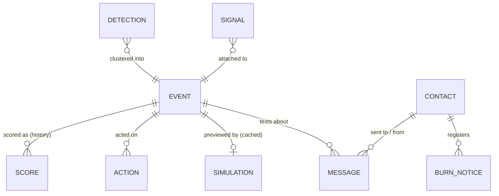
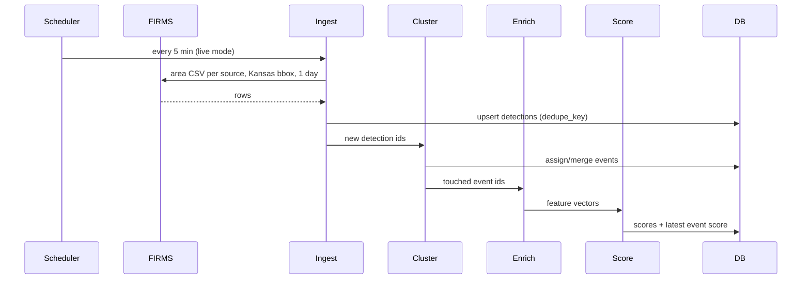

# Firewatch — Design

Companion to [PLAN.md](PLAN.md). The plan says *what* we build and *why*; this document says *how*, precisely enough that each workstream can build its piece without waiting on the others.

**Decided:** the customer is the chief of a rural volunteer district (the Cottonwood Creek scenario: 450 sq mi, 18 volunteers, one bar of cell). Field interaction is SMS; the React + MapLibre console serves the station, the county, and the pitch.

---

## 1. Design principles

1. **One alert per fire.** Every signal (satellite pixel, line fault, text) attaches to one event; people see events.
2. **Every decision explains itself.** No score or level appears without its reasons ("Line fault 1:50 on a High fire-danger day").
3. **SMS first.** Anything a person in the field must do fits in a 160-character text and a one-digit reply. Nothing in the field needs data service.
4. **No page on one weak signal.** Escalation needs two independent signals, or a strong multi-pass satellite score. False pages have a budget, and we measure it.
5. **Fail visible.** Missing data degrades the decision and says so; a silent source shows as "no data," never "no fire."
6. **Humans decide.** The system confirms, explains, and drafts; a person replies PAGE. Paging goes through county dispatch, not around it.
7. **Same code path for live and sample.** Sample mode feeds fixtures (satellite passes, line faults, texts, replies) into the real pipeline.
8. **Same features in training and serving** for the ML score.

## 2. Users and jobs

| Persona | Situation | Job to be done |
|---|---|---|
| **Duty officer / chief** (primary) | Volunteer, at a day job, phone in pocket, one bar | "Text me only when it's probably real, tell me where and why, and let me page with one reply." |
| **Volunteers** (18; ~5 free on a weekday) | Paged through county dispatch or a paging app | "Tell me where to go and what's coming." |
| **Ranchers, lease pumpers, water-truck driver, disc owners** | Already in the district, often closest to the fire | Signal: "I can report smoke or a burn by text." Recipient: "Tell me early if it's coming my way and what would help." |
| **County dispatcher** | Tones the district, handles all call types | "Give me a clear request to tone out, with a location." |
| **Electric co-op** | Sees feeder faults and outages first | "Share lockouts on fire-weather days; it lowers our line-caused ignition risk." |
| **Kansas Forest Service** | Statewide; grants and mutual aid | "One hosted instance for many districts; a statewide view on red-flag days." |

## 3. Domain model



- **Detection:** one satellite hotspot pixel from one overpass.
- **Signal:** any non-satellite evidence with a place and time: line fault, texted report, neighbor reply, camera smoke (section 4.5).
- **Event:** detections and signals believed to be one fire. This is the unit people see and act on (the "alert").
- **Contact:** a person in the district roster with a phone, a role, and usually a location.
- **Message:** one SMS in or out, linked to an event when it's about one.
- **Burn notice:** a registered controlled burn (area, day, who); a negative signal.
- **Score:** a timestamped scoring of an event. Kept as history so the UI can show score trend.
- **Action:** an operator's acknowledge / dismiss / escalate with a note.
- **Simulation:** cached spread output for an event under a given wind.

### SQLite schema

```sql
CREATE TABLE detections (
  id            INTEGER PRIMARY KEY,
  dedupe_key    TEXT UNIQUE NOT NULL,      -- source|lat4|lon4|acq_datetime
  source        TEXT NOT NULL,             -- VIIRS_SNPP_NRT, GOES_NRT, ...
  satellite     TEXT,                      -- N, N20, N21, Terra, Aqua, G18, G19
  lat           REAL NOT NULL,
  lon           REAL NOT NULL,
  acq_time      TEXT NOT NULL,             -- ISO 8601 UTC
  brightness_k  REAL,                      -- bright_ti4 (VIIRS) or brightness (MODIS)
  frp_mw        REAL,
  confidence    TEXT,                      -- normalized: low | nominal | high
  scan_km       REAL,
  track_km      REAL,
  daynight      TEXT,                      -- D | N
  event_id      INTEGER REFERENCES events(id),
  ingested_at   TEXT NOT NULL
);

CREATE TABLE events (
  id               INTEGER PRIMARY KEY,
  lat              REAL NOT NULL,          -- FRP-weighted centroid
  lon              REAL NOT NULL,
  first_seen       TEXT NOT NULL,
  last_seen        TEXT NOT NULL,
  county           TEXT,
  nearest_town     TEXT,
  place_label      TEXT,                   -- "8 mi SW of Ashland, Clark Co."
  status           TEXT NOT NULL DEFAULT 'new',  -- new | acknowledged | escalated | dismissed | closed
  is_sample        INTEGER NOT NULL DEFAULT 0,
  features_json    TEXT,                   -- latest feature vector
  score            INTEGER,                -- latest 0..100
  recommendation   TEXT,                   -- monitor | investigate | escalate
  degraded         INTEGER NOT NULL DEFAULT 0,
  updated_at       TEXT NOT NULL
);

CREATE TABLE scores (
  id            INTEGER PRIMARY KEY,
  event_id      INTEGER NOT NULL REFERENCES events(id),
  scored_at     TEXT NOT NULL,
  score         INTEGER NOT NULL,
  recommendation TEXT NOT NULL,
  scorer        TEXT NOT NULL,             -- rules-v0 | xgb-v1 ...
  reasons_json  TEXT NOT NULL,             -- [{feature, label, contribution}]
  guardrail     TEXT                       -- set when a rule overrode the model
);

CREATE TABLE actions (
  id          INTEGER PRIMARY KEY,
  event_id    INTEGER NOT NULL REFERENCES events(id),
  action      TEXT NOT NULL,               -- acknowledge | dismiss | escalate | reopen
  operator    TEXT NOT NULL,
  note        TEXT,
  created_at  TEXT NOT NULL
);

CREATE TABLE source_health (
  source        TEXT PRIMARY KEY,           -- firms_viirs, firms_goes, open_meteo, nws, coop, sms
  last_ok       TEXT,
  last_error    TEXT,
  last_error_at TEXT
);

CREATE TABLE signals (
  id           INTEGER PRIMARY KEY,
  event_id     INTEGER REFERENCES events(id),
  kind         TEXT NOT NULL,              -- line_fault | report | neighbor_reply | camera_smoke
  lat          REAL NOT NULL,
  lon          REAL NOT NULL,
  observed_at  TEXT NOT NULL,              -- when it happened (fault time, text received)
  source       TEXT NOT NULL,              -- coop:<feeder id>, sms:<contact id or number>, camera:<node>
  value        TEXT,                       -- reply digit, report text, fault type (lockout | momentary)
  contact_id   INTEGER REFERENCES contacts(id),
  is_sample    INTEGER NOT NULL DEFAULT 0,
  created_at   TEXT NOT NULL
);

CREATE TABLE contacts (
  id            INTEGER PRIMARY KEY,
  name          TEXT NOT NULL,
  phone         TEXT UNIQUE NOT NULL,      -- E.164
  role          TEXT NOT NULL,             -- duty_officer | chief | volunteer | rancher | pumper | water_truck | disc | dispatch | mutual_aid
  lat           REAL,                      -- home, pasture, or lease location
  lon           REAL,
  weekday_avail INTEGER NOT NULL DEFAULT 0,
  ladder_rank   INTEGER,                   -- order in the duty escalation ladder
  opted_in      INTEGER NOT NULL DEFAULT 1, -- STOP sets 0
  registered    INTEGER NOT NULL DEFAULT 1, -- 0 for unknown numbers that texted in
  mesh_id       TEXT UNIQUE                -- Meshtastic node ID (!a1b2c3d4) of the radio they carry
);

CREATE TABLE messages (
  id           INTEGER PRIMARY KEY,
  event_id     INTEGER REFERENCES events(id),
  contact_id   INTEGER REFERENCES contacts(id), -- null for a number not in the roster
  phone        TEXT NOT NULL,              -- phone number, or mesh node ID on the mesh channel
  direction    TEXT NOT NULL,              -- out | in
  purpose      TEXT,                       -- ask_neighbor | duty_fyi | duty_escalate | ladder | ladder_dispatch | page | page_dispatch | downwind | helper | mutual_aid_draft | mutual_aid | reply
  body         TEXT NOT NULL,              -- ≤ 160 chars for outbound
  status       TEXT NOT NULL,              -- sent | failed | received; mesh adds relayed | delivered
  gateway_id   TEXT,                       -- Twilio SID; outbox-… in sample mode; mesh-<packet id>
  is_sample    INTEGER NOT NULL DEFAULT 0,
  created_at   TEXT NOT NULL,              -- the response clock (the scenario's own time during a replay)
  channel      TEXT NOT NULL DEFAULT 'sms' -- sms | mesh
);

CREATE TABLE mesh_nodes (                  -- every Meshtastic radio the server's radio has heard
  node_id      TEXT PRIMARY KEY,           -- !a1b2c3d4; contacts.mesh_id links a radio to a person
  long_name    TEXT,
  short_name   TEXT,
  hw_model     TEXT,
  lat          REAL,                       -- last GPS fix
  lon          REAL,
  position_at  TEXT,                       -- wall-clock time the fix arrived
  battery_pct  INTEGER,
  snr          REAL,
  last_heard   TEXT NOT NULL
);

CREATE TABLE sensor_readings (             -- telemetry from mesh sensor nodes (5.8)
  id       INTEGER PRIMARY KEY,
  node_id  TEXT NOT NULL,
  at       TEXT NOT NULL,                  -- wall-clock arrival time
  temp_c   REAL,
  rh_pct   REAL,
  pm25     REAL,                           -- µg/m³, "environmental" (outdoor) correction
  pm10     REAL
);

CREATE TABLE burn_notices (
  id          INTEGER PRIMARY KEY,
  contact_id  INTEGER NOT NULL REFERENCES contacts(id),
  lat         REAL NOT NULL,
  lon         REAL NOT NULL,
  radius_km   REAL NOT NULL DEFAULT 1.5,
  burn_date   TEXT NOT NULL,              -- local date
  is_sample   INTEGER NOT NULL DEFAULT 0,
  created_at  TEXT NOT NULL
);
```

Status transitions: `new → acknowledged | escalated | dismissed`; `acknowledged → escalated | dismissed`; any → `reopen` → `new`. An event auto-closes after 24 h with no new detections. A dismissed event that later rises to a higher recommendation is reopened automatically and flagged "re-raised."

## 4. Pipeline



### 4.1 Ingestion

| Source | Interval | Request | Notes |
|---|---|---|---|
| FIRMS VIIRS (SNPP, NOAA-20, NOAA-21), MODIS | 5 min | `/api/area/csv/{KEY}/{SOURCE}/-102.05,36.99,-94.59,40.00/1` | One call per source per poll ≈ 5 calls / 5 min; far under 5000 / 10 min |
| FIRMS GOES | 5 min | same, `GOES_NRT` | Stretch; same parser with a GOES column map |
| Open-Meteo | On demand per event, cached 1 h by 0.1° cell | forecast API `current` + `past_days=3` hourly | Archive API for training and sample fixtures |
| NWS alerts | 15 min | `/alerts/active?area=KS&event=Red Flag Warning` | Display only |

Normalization: VIIRS confidence `l/n/h` and MODIS numeric confidence (`<30` low, `30–79` nominal, `≥80` high) map to one `low | nominal | high` field. All times stored UTC; displayed in Central.

Dedupe key: `source|round(lat,4)|round(lon,4)|acq_date+acq_time`. FIRMS replaces ultra-real-time rows with near-real-time rows for the same observation; the key makes that an upsert rather than a duplicate.

### 4.2 Clustering detections into events

For each new detection `d`:

1. Candidate events: status not `closed`, `last_seen` within 12 h of `d.acq_time`.
2. Match radius `r = max(2 km, 0.5 × max(scan_km, track_km) + 1 km)`, which widens to ~2.5 km for GOES pixels.
3. If any detection of a candidate event lies within `r` of `d` (haversine) **and within 12 h of `d`**, join it. If `d` matches several events, merge them into the oldest. Requiring the time match per detection keeps a week of neighboring Flint Hills pasture burns from chaining into one event.
4. Otherwise create a new event.
5. Recompute centroid (FRP-weighted), `first_seen`, `last_seen`, and place label.

Place label: nearest town from the OSM `place=town|village|city` layer, bearing from town to event, distance in miles, county from Census TIGER Kansas county polygons. Example: `8 mi SW of Ashland, Clark Co.`

### 4.3 Enrichment: feature specification

Every feature has a defined fallback, and every fallback sets `degraded = 1` on the event.

| Feature | Unit | Computation | Fallback |
|---|---|---|---|
| `frp_max` | MW | max over detections | 0 |
| `frp_sum` | MW | sum over detections | 0 |
| `brightness_max` | K | max over detections | median of training set |
| `conf_high_frac` | 0–1 | share of detections with `high` confidence | 0 |
| `pixel_km2_min` | km² | min `scan × track` | 0.14 (VIIRS nadir) |
| `n_detections` | count | detections in event | — |
| `n_satellites` | count | distinct `satellite` values | — |
| `minutes_active` | min | `last_seen − first_seen` | 0 |
| `frp_growth` | ratio | latest-pass FRP ÷ first-pass FRP (1 if single pass) | 1 |
| `is_night` | 0/1 | any detection with `daynight = N` | 0 |
| `local_hour` | 0–23 | Central hour of `first_seen` | — |
| `doy_sin`, `doy_cos` | — | day-of-year encoded on a circle | — |
| `wind_kmh` | km/h | Open-Meteo 10 m wind at event hour | missing → degraded |
| `gust_kmh` | km/h | Open-Meteo 10 m gusts | `wind_kmh × 1.5` |
| `wind_dir_deg` | ° from | Open-Meteo | missing → degraded |
| `rh_pct` | % | Open-Meteo 2 m RH | missing → degraded |
| `temp_c` | °C | Open-Meteo 2 m temperature | missing → degraded |
| `precip_72h_mm` | mm | sum of prior 72 h hourly precipitation | 0 |
| `gfdi` | index | grassland fire danger index (section 4.4) | computed from fallbacks |
| `thunder_24h` | 0/1 | any weather code 95–99 in prior 24 h within 0.25° | 0 |
| `elevation_m` | m | terrain tile sample at centroid | 0 |
| `slope_deg` | ° | max slope within 500 m from terrain tiles | 0 |
| `dist_line_km` | km | to nearest OSM `power=line` ≥ 115 kV | 50 (cap) |
| `dist_substation_km` | km | to nearest `power=substation` | 50 (cap) |
| `dist_town_km` | km | to nearest town/village/city | 50 (cap) |
| `dist_static_km` | km | to nearest static heat source | 50 (cap) |
| `in_flint_hills` | 0/1 | point-in-polygon, EPA Level III ecoregion "Flint Hills" | 0 |
| `nearby_events_24h` | count | other events within 25 km in the prior 24 h | 0 |

`nearby_events_24h` matters in Kansas: a cluster of many simultaneous small events on a calm April day is the signature of a prescribed-burn day, while a single isolated event on a red-flag day is not.

### 4.4 Grassland fire danger index

McArthur Mk 4 grassland fire danger index (Noble et al., 1980), used both as a model feature and in the rules scorer:

\[
\text{GFDI} = 2\exp\left(-23.6 + 5.01\ln C + 0.0281\,T - 0.226\sqrt{RH} + 0.633\sqrt{U}\right)
\]

- \(C\): degree of curing, %. Default 95 Nov–Apr (dormant grass), 50 Jun–Aug, linear in between; configurable.
- \(T\): °C, \(RH\): %, \(U\): 10 m wind in km/h.
- Bands used for display: < 12 low/moderate, 12–24 high, 25–49 very high, 50–99 severe, ≥ 100 extreme.

*Verify constants against the source before relying on exact values.* NWS Wichita publishes its own grassland fire danger product; we display theirs when available but always compute ours for the model so historical and live values match.

### 4.5 Signals and confirmation

Satellite detections go through 4.1–4.4 and get an ML score (section 5). Every other kind of evidence arrives as a **signal** and attaches to an event the same way detections do: within 3 km and 6 h of the event's detections or signals. Otherwise it opens a new event at the signal's location.

| Signal | Arrives via | Counts as independent evidence when |
|---|---|---|
| `line_fault` | Co-op adapter: `POST /api/signals` from a feed, or a poller on the co-op's public outage map (sample mode: fixture) | Fault type is a lockout (not a momentary), the location is in grass (not in town), **and** fire danger at the location is High or above (GFDI ≥ 12) |
| `report` | Inbound SMS `FIRE <where>` (place text geocoded against roads and towns; the sender's roster location as fallback) | Always for Investigate; for Escalate only from a registered number |
| `neighbor_reply` | Inbound SMS reply to an ask-the-neighbor text | Reply `1` (smoke). Reply `3` from the contact who registered a burn here today makes the event a registered burn. Reply `2` is recorded but doesn't lower the level, because the neighbor may not have a view. |
| `camera_smoke` | Phase 3 camera node | Detector confidence above its threshold on two consecutive frames |
| `sensor_smoke` | Mesh sensor node telemetry (5.8) | Always: the smoke rule already ran before the signal was raised. All sensors together count as one kind. A sensor joins events within 8 km, not 3, because smoke drifts downwind; it doesn't move the event's location when a line fault or report has placed it, and it can't show a burn has escaped. |
| Satellite | Section 4.1 | ML score ≥ 40 |

**Level rules** (evaluated after every new detection, signal, or reply; each rule that fires becomes a reason):

```
independent = distinct kinds among qualifying evidence (satellite counts once however many passes)
if registered_burn(event) and not escaped(event):      level = monitor     reason "Registered burn by <name> today"
elif sat_score >= 70 or independent >= 2:              level = escalate
elif independent >= 1:                                 level = investigate
else:                                                  level = monitor
then apply guardrails (5.4): near a town or line → at least investigate; known heat source, not growing → monitor
```

- `registered_burn`: the event lies within a burn notice's radius on the notice's local date.
- `escaped`: a detection or report more than 1 km outside the notice radius, GFDI ≥ 25 (Very High), or a `report` / `neighbor_reply 1` from someone other than the burner saying it's spreading.
- The event's `score` column stays the satellite ML score (null when there is no satellite evidence). `recommendation` is the level above.

**Ask the neighbor.** When an event first reaches Investigate, text up to 3 opted-in contacts with a location within 3 miles of the event, nearest first. Duty officers are skipped because they're already being told. Each contact gets at most one ask per event and at most 3 per day. Replies are matched to the open ask from that number in the last 2 hours.

**Burn notices.** Inbound `BURN` registers a burn for today at the sender's roster location. `BURN <where>` registers it at a geocoded place, and `BURN TOMORROW` registers it for the next day. Firewatch confirms the registration by text, including the place it understood. This digitizes the "call dispatch before you burn" practice many Kansas counties already have.

## 5. Scoring

### 5.1 Output contract

```json
{
  "score": 87,
  "recommendation": "escalate",
  "scorer": "xgb-v1",
  "degraded": false,
  "guardrail": null,
  "reasons": [
    {"feature": "gust_kmh", "label": "Gusts 72 km/h (45 mph)", "contribution": 18},
    {"feature": "rh_pct", "label": "Humidity 14%", "contribution": 12},
    {"feature": "n_satellites", "label": "Seen by 3 satellites", "contribution": 9}
  ]
}
```

Contributions are in score points and may be negative ("−9 · Flint Hills burn season"). The UI shows the top 3 by absolute value.

Recommendation: `escalate` if score ≥ 70, `investigate` if 40–69, `monitor` if < 40. Thresholds live in config.

### 5.2 Rules scorer (v0, and permanent fallback)

Start at 30, add points, clip to 0–100. Each line becomes a reason.

| Condition | Points |
|---|---|
| Any `high` confidence detection | +10 |
| `frp_max` ≥ 50 MW / ≥ 10 MW | +12 / +6 |
| `n_satellites` ≥ 2 / ≥ 3 | +8 / +14 |
| `frp_growth` ≥ 2 between passes | +8 |
| `gfdi` ≥ 50 / 25–49 / 12–24 | +20 / +12 / +5 |
| `gust_kmh` ≥ 64 (40 mph) | +8 |
| `rh_pct` ≤ 20 | +6 |
| `dist_town_km` ≤ 3 or `dist_line_km` ≤ 1 | +8 |
| `dist_static_km` ≤ 1 | −45 |
| `in_flint_hills` and Mar–Apr and `gfdi` < 12 | −20 |
| `nearby_events_24h` ≥ 5 and `gfdi` < 12 | −10 |
| `precip_72h_mm` ≥ 10 | −10 |

### 5.3 Model (v1)

Built by `backend/ml/` (`download` → `build_dataset` → `train`); results in `backend/ml/report.md`.

- **Target:** `1` = matched to a WFIGS `WF` incident; `0` = matched to `RX`, or an unreported Flint Hills fire in March–April (weak label, weighted so the weak set counts as much as the reported burns). Other unmatched events are excluded.
- **Heat sources are not a model input.** Training on them with `dist_static_km` as a feature taught the model "far from a refinery = wildfire". They're handled by the guardrail below and only used to evaluate the full pipeline.
- **Model:** `xgboost.XGBClassifier`, `max_depth` 3, 300 rounds, learning rate 0.05, weighted for class balance; logistic regression and rules-v0 as baselines on the same rows.
- **Calibration:** Platt scaling on grouped out-of-fold margins, to an even wildfire/burn prior; `score = round(100 × p)`.
- **Split:** train ≤ 2022, test 2023–2025; plus leave-one-year-out over the training years as a second view.
- **Reasons:** `booster.predict(dmatrix, pred_contribs=True)` gives log-odds contributions per feature. Each is shown as points = contribution × Platt slope × 25 (the sigmoid's slope at 50), so one point ≈ one score point mid-scale. `doy_sin` + `doy_cos` are merged into one "time of year" reason.
- **Artifact:** `backend/data/model/xgb_v1.json` + `meta.json` (ordered features, Platt a/b, evaluation, importance). `SCORER=auto|model|rules`; `auto` uses the model when present and the event isn't degraded.

### 5.4 Guardrails (applied after the model)

| Rule | Effect |
|---|---|
| `dist_town_km` ≤ 1 or `dist_line_km` ≤ 0.5, and not a static source | Floor at `investigate` |
| `dist_static_km` ≤ 1 and `frp_growth` < 2 | Cap at `monitor` |
| Event degraded (weather missing) | Score from rules scorer; badge "degraded" |

When a guardrail changes the recommendation, `guardrail` is set and shown in the UI ("Raised to Investigate: within 1 km of Ashland").

### 5.5 Re-scoring and notification

Rescore an event when a detection or signal joins it, when a reply arrives, or hourly while open (weather changes). Notify only when the level **rises** (monitor → investigate → escalate), or when an escalated fire's direction or threatened contacts change. Never notify on a falling level.

### 5.6 Response planner and messaging

**Escalation ladder** (timers in config):

| Trigger | Message | If no reply |
|---|---|---|
| Event reaches Investigate | `duty_fyi` to the duty officer; ask-the-neighbor texts | Nothing; the duty officer may reply PAGE anyway |
| Event reaches Escalate | `duty_escalate` to the duty officer: place, signals, wind, `Reply PAGE or NO` | After 3 min: the next contact by `ladder_rank` (chief). After 6 min: automated voice call to county dispatch with the same text. |
| Reply `PAGE` | `page` request to county dispatch (SMS + email; voice in live mode), plus the district's paging app by email-to-page if configured; `downwind` texts | — |
| 5 min after PAGE with fewer than 2 volunteers replying `R` (responding), or the 60-min footprint exceeds the district's capacity setting | `mutual_aid` draft to the chief: `Reply SEND to request <neighbor district> + county EM` | — |

**Who gets a downwind text.** Run the spread estimate for 60 minutes at the event's observed wind. Text any opted-in rancher, pumper, water-truck driver, or disc owner whose location the fire reaches within 60 minutes, or who is within 2 miles. Order the texts by arrival time. The text includes direction, distance, and the estimated arrival rounded to 5 minutes, and always "Only if safe." Water-truck and disc owners get an ask (`Reply 1 if you can help`); ranchers get a heads-up.

**Message templates** (≤ 160 characters, plain text, no links required):

```
duty_escalate  FIREWATCH ESC: grass fire likely {dist} mi {dir} of {town}. {signals}. Wind {wdir} {wmph} mph. Reply PAGE or NO
duty_fyi       FIREWATCH: possible fire {dist} mi {dir} of {town} ({signal}). Asking neighbors. Reply PAGE to page now
ask_neighbor   Firewatch: possible fire near {place}. See smoke? Reply 1 yes, 2 no, 3 it's my burn
page           FIREWATCH PAGE for {district}: grass fire {dist} mi {dir} of {town}, {lat},{lon}. Wind {wdir} {wmph}. Confirmed by {signals}
downwind       FIREWATCH: grass fire {dist} mi {dir} of you, wind {wdir} {wmph} mph, could reach you in ~{eta} min. {ask} Only if safe.
mutual_aid     FIREWATCH: {n} responding for {district} fire {dist} mi {dir} of {town}. Reply SEND to request {neighbor} + county EM
health         FIREWATCH 7AM: satellites OK, co-op feed {coop_status}, SMS OK. {n_burns} burns registered today
```

**Inbound parsing** (case-insensitive, first word): `FIRE` → report; `BURN` → burn notice; `1` / `2` / `3` → neighbor reply; `PAGE` / `NO` / `SEND` → duty decisions, accepted only from the ladder; `R` → responding; `STOP` / `START` → opt-out and opt-in (carrier requirement). Anything else gets a one-line help reply.

**Gateway.** One `SmsGateway` interface with two implementations: `OutboxGateway` (sample mode: writes `messages` rows and shows them in the console's outbox) and `TwilioGateway` (live: sends, and receives on `POST /api/sms/inbound`, with the webhook signature verified). Outbound is rate-limited per contact (at most 1 message a minute; batched FYIs at most once every 15 minutes).

### 5.7 Mesh radios (Meshtastic)

For the places with no cell bar at all, volunteers and trucks can carry a Meshtastic LoRa radio (SenseCAP T1000-E: ~$51, card-sized, GPS, buzzer, IP65). One radio plugged into the server by USB (or reachable over TCP) is the gateway. Code: `backend/app/mesh.py`.

- **Out.** `notify.send` texts a contact by SMS and, if the roster gives them a `mesh_id` and the gateway radio is connected, also sends the same text over the mesh as a direct message with an ACK requested. That's one `messages` row per channel. Mesh rows go from `sent` to `relayed` (another radio rebroadcast it), `delivered` (the recipient's radio acknowledged it), or `failed` (the firmware gave up). SMS has no equivalent "delivered to the device" signal. Mesh sends happen in sample mode too, since they only reach radios the roster links to a contact.
- **In.** A direct message to the gateway radio goes through the same `handle_inbound` parser as an SMS (`PAGE`, `R`, `1`/`2`/`3`, `FIRE`, `BURN`, `STOP`). The reply goes back on the mesh only. Broadcast channel chatter is ignored. A radio with no roster contact counts like an unregistered number: it can open an Investigate, never an Escalate.
- **Positions.** Position, node-info, and telemetry packets update `mesh_nodes`. A `FIRE` from a radio with a fix from the last 30 minutes is located at the radio, not at a roster address. So a volunteer or lease truck can report from the field, and volunteers, who have no roster location, show on the map. Each alert's response lists `crew`: roster contacts with a fresh fix, nearest the fire first.
- **Health.** `/api/health` reports `mesh` as a source: `ok` if a packet arrived in the last 15 minutes, `stale` if connected but quiet, `down` if no radio is attached. The server retries the connection every 30 s.
- **Range, honestly.** A body-worn T1000-E reaches about 2–5 km on flat ground and further from height. 450 sq mi needs relay radios (router role, solar) on the same elevators and water towers as the phase 3 cameras. Until then the mesh covers the station area and wherever radios happen to chain.

### 5.8 Tower sensor nodes

The tower relays carry sensors: a PMSA003I particulate sensor and an SHTC3 or BME280 temperature and humidity sensor on a RAK4631, in a vented radiation shield. Meshtastic firmware reads them and sends telemetry packets; `mesh.handle_packet` passes them to `backend/app/sensors.py`, which stores `sensor_readings`. Each tower node needs a fixed position set in Meshtastic: a node with no position records readings but raises no signals.

- **Smoke rule.** For each PM2.5 reading: rise = PM2.5 − the node's baseline (median of its readings from 3 h to 20 min ago, or 10 µg/m³ with fewer than 3). It's smoke if rise ≥ `smoke_pm25_rise` (50), PM2.5/PM10 ≥ `smoke_fine_ratio` (0.6; dust is coarse), and, when at least 2 sensors more than 15 km away reported in the last 30 minutes, fewer than `smoke_regional_share` (50%) of them rose by half the threshold (otherwise it's regional haze). Then `add_signal("sensor_smoke", node position, source "mesh:<node>")`, at most once per node per `smoke_repeat_min` (60). Thresholds live in the district's `settings.json`.
- **Local weather.** On live (non-sample) events, temperature and humidity from the nearest sensor within 15 km with a reading in the last 30 minutes replace the forecast's values before fire danger is computed; `weather.local_sensor` names the node. Sample events keep the scenario's weather, so a sensor on the demo table can't change the replay.
- **Map.** `GET /api/mesh/nodes` includes each node's latest `sensors` readings; the map label shows PM2.5, °C, and RH, amber at PM2.5 ≥ 35.
- **Power.** The PMSA003I fan draws 60–120 mA, more than a small panel supplies running nonstop. Set the air-quality telemetry interval to 5 minutes. Whether the firmware sleeps the fan between readings (through the sensor's SET pin) is unverified; check it on the first node before buying six.

### 5.9 Playbook: a dynamic run card (`backend/app/playbook.py`)

The full explanation of the decision model is in [How Firewatch recommends actions](RECOMMENDATIONS.md); the fitted danger multiplier in [Fire-day model v1](research/fire-day-model-v1.md). This section is the summary.

A fire department's run card is a fixed table: "a grass fire in zone 4 gets Brush 1 and Tanker 1". The playbook makes it dynamic. For the decision in front of the dispatcher it shows three options side by side, one recommended, each with what it costs and exactly what it will do. After a choice it shows a receipt.

**How the recommendation is chosen: expected loss** (`backend/app/decision.py`). Every candidate option is scored:

> expected loss = P(fire) × acres burned before enough help is on scene + (1 − P(fire)) × false-alarm cost

Everything is in acres, so the trade reads plainly: "a false page costs us about as much as 100 acres burned". The three lowest-loss options are shown, the lowest is recommended, and the card says at what P(fire) the runner-up would win (the break-even point).

- **P(fire)** starts from a base rate set by the earliest signal, then multiplies the odds by a likelihood ratio for each piece of evidence:
  - a line lockout: 3% (PG&E outage-to-ignition rate) × a danger multiplier from the fire-day model (per-day rate ratio ^0.5: Low-Mod ×0.52, High ×1, Very High ×1.6, Severe ×2.4, Extreme ×4.2)
  - a satellite detection: 15% real-world prior; scorer v1's score `s` then counts as a factor of s/(100−s), because its scores are calibrated to an even wildfire/burn prior
  - a neighbor seeing smoke ×20, "no smoke" ×0.4, "my burn" ×0.1; a registered text report ×10; an unregistered one ×2; camera smoke ×8; inside a registered burn that hasn't escaped ×0.05
- **Acres if it is a fire** comes from the median ensemble forecast at the time enough help is on scene:
  - two trucks if the fire stays under `capacity_ha_60min` for 30 min after they arrive
  - otherwise when mutual aid arrives: requested 5 min after the page, 35 min travel, or 25 min if the downwind stations got a heads-up
- **False-alarm costs** in acre-equivalents: a page 100, a mutual-aid request 250, a heads-up text 3, a neighbor text 1.
- **Candidates for "How should we respond?":** page now (it also sends the downwind heads-up), ask neighbors or wait for their answers, heads-up + ask, heads-up + recheck on the next pass, and watch. Once two sources agree, the wait-to-confirm options drop out and "heads-up only" takes their place.
- **Candidates for "Do we need mutual aid?":** request now, wait for Brush 1's size-up, or don't.
- **Every weight** is listed with its source in `decision.DEFAULTS`, returned as `model` by the API, and shown under "How this is decided". A district overrides any of them under `"decision"` in its `settings.json`. The weights are planning assumptions until outcomes are logged and the ratios re-fitted.
- **On the scenario:**
  - At minute 0 (line lockout on an Extreme day, P = 13%), heads-up + wait for neighbors wins.
  - At minute 8 a neighbor sees smoke (P = 74%), and paging wins; that flips back below 33%.
  - At minute 9, after the page, requesting mutual aid now wins (expected loss ~413 vs ~1,230 for waiting for the size-up).

**What each option shows:**
- when the district would be paged
- acres if it is a fire, and when enough help is there
- what it costs if it isn't
- the expected loss
- how many stations are warned ahead of the fire

**Doing it:**
- `POST /api/alerts/{id}/options/{option_id}` runs the option through the real paths (`notify.decide` for page and mutual aid, `ask_neighbors`, and heads-up texts).
- It records `{option, by, at, followed_recommendation, texts sent by purpose}` in the response state.
- A chosen option is marked done and can't be repeated.
- `GET /api/alerts/{id}/options` returns the assessment, the current decision and the receipts. The receipts include automatic steps and decisions made by text (PAGE / SEND).
- The console drawer shows this panel at the top. The old Acknowledge / Escalate buttons, which only changed a status label, are gone; "Not a fire: dismiss" remains.

## 6. Spread simulation

### 6.1 Inputs and outputs

Input: event centroid, wind speed (km/h) and direction (from, °), temperature, RH, curing, duration (default 60 min). Wind can be overridden by the user.

Output:

```json
{
  "event_id": 42,
  "assumptions": {"wind_kmh": 48, "wind_from_deg": 200, "rh_pct": 14, "temp_c": 24, "curing_pct": 95, "fuel": "grassland", "model": "CSIRO grassland + elliptical + slope"},
  "head_ros_kmh": 6.1,
  "isochrones": {"type": "FeatureCollection", "features": [
    {"type": "Feature", "properties": {"minutes": 5, "area_ha": 12.4}, "geometry": {"type": "Polygon", "coordinates": []}}
  ]},
  "impacts": [
    {"kind": "power_line", "id": "way/171460121", "name": "Post Rock - South Hays", "minutes": 22},
    {"kind": "town", "id": "node/151906796", "name": "Ashland", "minutes": 38}
  ],
  "wind_vector": {"from_deg": 200, "kmh": 48}
}
```

### 6.2 Fire behavior

The CSIRO grassland rate below is the rate for cured natural grass; each grid cell scales it by a fuel multiplier from land cover (6.4). On screen: *"Simplified grass-fire estimate for planning. Not an operational fire behavior prediction."*

1. **Dead fuel moisture** (McArthur): \(MC = 9.58 - 0.205\,T + 0.138\,RH\) (%).
2. **Moisture factor** (Cheney et al., 1998): \(\phi_M = e^{-0.108\,MC}\) for \(MC < 12\%\); for \(MC \ge 12\%\), \(\phi_M = 0.684 - 0.0342\,MC\) if \(U \le 10\) km/h, else \(0.547 - 0.0228\,MC\). Clamp at ≥ 0.
3. **Curing factor**: \(\phi_C = \dfrac{1.12}{1 + 59.2\,e^{-0.124(C - 50)}}\).
4. **Head-fire rate of spread** (natural pasture), km/h:
   - \(U < 5\): \(R = (0.054 + 0.269\,U)\,\phi_M\,\phi_C\)
   - \(U \ge 5\): \(R = (1.4 + 0.838\,(U - 5)^{0.844})\,\phi_M\,\phi_C\)
5. **Fire shape**: length-to-breadth \(LB = 1.1\,U^{0.464}\) for \(U \ge 1\), else 1 (grass, Canadian FBP O-1). Eccentricity \(e = \sqrt{1 - 1/LB^2}\). Spread rate in a direction at angle \(\theta\) from the downwind direction: \(R(\theta) = R\,\dfrac{1 - e}{1 - e\cos\theta}\).
6. **Slope**: multiply by \(e^{0.069\,s}\), where \(s\) is the slope in degrees along the direction of travel (positive upslope), clamped to ±20°. This doubles spread per 10° upslope and halves it per 10° downslope.

*Verify all constants against the cited sources while implementing; they are written from memory.*

### 6.3 Arrival-time grid

- Grid: square, sized so the fastest plausible run stays in frame (half-width ≥ 6 km), shifted toward the mean downwind side. 200 × 200 cells for a single run, 400 × 400 for the ensemble.
- Elevation sampled from Terrarium tiles at zoom 12 and resampled to the grid; slope computed per neighbor step.
- Ignition: cells within the event's detection footprint set to arrival time 0.
- Propagation: Dijkstra over a 16-neighbor stencil. Edge cost = step distance ÷ \(R(\theta, s) \times\) fuel multiplier of the destination cell. Cells with multiplier 0 never burn. Stop at 60 min (or the requested duration).
- Isochrones every 5 min: threshold the arrival grid, trace contours (`skimage.measure.find_contours` or `contourpy`), convert grid coordinates to lon/lat, simplify to ~20 m tolerance.
- Impacts: intersect each isochrone with towns, lines, and substations (`shapely`); report the first minute each asset is reached.
- Performance target: < 500 ms per call. Cache by `(event_id, wind_kmh rounded to 2, wind_dir rounded to 5°)`.

Sanity tests: zero wind on flat ground produces near-circular isochrones; doubling wind lengthens the head run; flipping wind direction mirrors the shape.

### 6.4 Fuel map (`backend/app/sim/fuels.py`)

- **Base layer:** NLCD 2021 land cover, 30 m, from the MRLC WCS, cached in `data/cache/nlcd/` as 15 km tiles (EPSG:5070).
- **Cropland refinement:** where a USDA CDL tile has been prefetched (`python -m scripts.fetch_fuels`), NLCD cropland is split into winter wheat, row-crop residue and fallow. CDL is never fetched during a forecast: its service is slow and often returns 502.
- **Multipliers** relative to cured natural grass, by season (dormant Nov–Apr / growing May–Jul / late Aug–Oct). These are planning assumptions, not measured values:

| Class | Dormant | Growing | Late |
|---|---|---|---|
| Grass, pasture, CRP | 1.0 | 1.0 | 1.0 |
| Shrub and sand sage | 0.9 | 0.9 | 0.9 |
| Cropland, unrefined | 0.3 | 0.3 | 0.3 |
| Winter wheat | 0.15 | 0.6 | 0.3 |
| Row-crop residue | 0.4 | 0.1 | 0.3 |
| Fallow | 0.25 | 0.25 | 0.25 |
| Trees | 0.5 | 0.5 | 0.5 |
| Wetland | 0.4 | 0.3 | 0.4 |
| Roads, open developed | 0.3 | 0.3 | 0.3 |
| Town | 0.05 | 0.05 | 0.05 |
| Water, barren | 0 | 0 | 0 |

- Each grid cell averages 3 × 3 land-cover samples.
- Neither dataset separates CRP from grazed range, so all grass is treated as ungrazed (the worst case).
- A 1-cell (100–200 m) gap can still be crossed by the stencil's knight moves, which roughly stands in for spotting across roads and creeks on a windy day.
- If tiles are unavailable, the missing area is assumed to be grass, and `assumptions.fuel` says so.

### 6.5 Changing weather and new ignitions

- Weather is a series of hourly (or finer) values. Rates are recomputed every 10 minutes from the weather interpolated at the middle of the block, so a wind shift turns a flank into a new head.
- **New point ignition** (`fire_age_min = 0`, e.g. a line fault): the fire accelerates toward its equilibrium rate, \(R(t) = R\,(1 - e^{-0.115\,t})\), with t in minutes (Canadian FBP open fuels). At 15 minutes the head has run about half as far as an established fire's.
- **Established fire** (`fire_age_min = None`, e.g. first seen by satellite): it spreads at the full rate from the start.

### 6.6 Ensemble forecast (`backend/app/sim/ensemble.py`)

- 24 members on one domain. Each member scales the whole weather series by:
  - a wind-speed factor (lognormal, σ 0.15)
  - a direction offset (σ 15°)
  - an RH offset (σ 3 pts)
  - a fuel-load factor (lognormal, σ 0.15)
  
  Member 0 is unperturbed. The seed is fixed, so results are reproducible.
- These spreads are assumptions sized to typical hourly forecast error, not calibrated values.
- Outputs:
  - `isochrones`: median arrival
  - `isochrones_early`: 10th-percentile arrival, i.e. "could be there this soon"
  - `probability`: burned-by-end outlines at 10/50/90 % of members
  - `checkpoints`: area and head distance at 15/30/60/90/120 min as p10/p50/p90
  - `impacts`: per asset, the probability of being reached and arrival p10/p50/p90
  - `fuel_mix`
  - `provenance`: every input labeled observed / forecast / inferred / simulated / assumed
- Runtime is about 0.7 s for 24 members at 400 × 400.

### 6.6b Back-test

`backend/ml/backtest.py` starts the forecast from a real fire's first FIRMS look, with the archive's hourly weather, and scores it against later looks. v1 results are in [Spread forecast back-test v1](research/spread-backtest-v1.md): on Anderson Creek 2016, 70–81% of the detections 15 h later fell inside the forecast (median / worst case), against 25% for the original constant-wind model. Starbuck 2017 was under-predicted by about 2× overnight.

### 6.6c Wind and fire forecast on the 2D map

The console map's **Wind + fire forecast** layer (on by default) draws wind arrows on a grid, colored and lengthened by speed, and a time slider from now to +6 h in 15-minute steps.

- **Wind** (`GET /api/wind[?event_id=]`, `backend/app/wind.py`):
  - No alert selected: the live Open-Meteo HRRR forecast on a 0.6° grid over Kansas.
  - An alert selected: the wind around its fire on a 0.25° grid. For historical samples that's the Open-Meteo archive from the fire's last detection, i.e. what the wind actually did (Starbuck's cold front swings through). For the scenario it's the scenario's hourly weather, drawn the same everywhere and labeled simulated.
  - Every field carries `source` and `kind`, and the slider shows which one it is.
- **Fire** (`GET /api/alerts/{id}/forecast`): the ensemble's likely (median, filled) and worst-case (10th-percentile, dashed) outline at each slider step, from the fire's own "now" (the scenario clock, a sample's last detection, or the wall clock). It uses 12 runs rather than the playbook's 24, because a 6-hour run costs ~10 s cold; results are cached per alert.
- Non-scenario alerts now forecast with Open-Meteo's **hourly** weather at the fire (archive for past fires, forecast for live ones) instead of one reading held constant, so the fire outline turns when the arrows do. If the fetch fails, the one reading is held constant and the provenance says so.

### 6.7 Situation contract (`backend/app/situation.py`)

The forecast and the recommendation layer read only a `Situation`, a pydantic model that ingestion fills in. Every block carries a `Provenance {source, kind, as_of}`.

| Field | Required | Fallback |
|---|---|---|
| `ignition {lat, lon, time, points?, fire_age_min}` | yes | |
| `weather {hours: [{time, wind_kmh, wind_from_deg, temp_c, rh_pct, gust_kmh?}]}` | yes | `from_open_meteo()` builds it from Open-Meteo |
| `curing {pct}` | no | seasonal table (assumed) |
| `red_flag` | no | unknown |
| `burn_permits [{id, lat, lon, acres, start, end, status}]` | no | none |
| `resources [{id, name, kind, lat, lon, crew, available, ready_min}]` | no | none |
| `use_fuel_map`, `use_terrain` | no | true |

API:
- `GET /api/scenario/{slug}/situation[?weather=front]`: the replay scenario and its district, as a `Situation`
- `GET /api/scenario/{slug}/forecast?minutes=120&members=24[&weather=front]`
- `POST /api/forecast`, with a `Situation` as the JSON body

`scenario_situation()` builds the `Situation` from the replay scenario (section 10) and its district:
- ignition, `weather_hourly`, `curing_pct`, `red_flag` and the packet's weekend `burn_permits` come from the scenario
- texted BURN notices in the timeline also become permits
- apparatus at the station and mutual aid come from the district `settings.json`
- the water truck and disc owners come from the roster

`weather_variants.front` is a what-if in which a cold front swings the wind to the northwest at 4 pm.

## 7. API contract

Base URL `/api`. JSON everywhere. Times ISO 8601 UTC.

### `GET /api/alerts`

Query: `min_score` (default 0), `status` (comma list, default `new,acknowledged,escalated`), `since` (default 24 h ago), `include_monitor` (default `false`).

```json
{
  "mode": "live",
  "generated_at": "2026-11-07T18:05:00Z",
  "alerts": [
    {
      "id": 42,
      "lat": 37.12, "lon": -99.84,
      "place_label": "8 mi SW of Ashland, Clark Co.",
      "first_seen": "2026-11-07T17:41:00Z",
      "last_seen": "2026-11-07T18:01:00Z",
      "status": "new",
      "score": 87,
      "recommendation": "escalate",
      "score_trend": [52, 71, 87],
      "degraded": false,
      "guardrail": null,
      "sources": {"VIIRS": 2, "GOES": 5},
      "top_reason": "Gusts 72 km/h (45 mph)",
      "is_sample": false
    }
  ]
}
```

### `GET /api/alerts/{id}`

Alert summary fields plus `detections[]`, `features{}`, `reasons[]`, `weather{}`, `nearest_assets[]`, `actions[]`, `score_history[]`.

### `POST /api/alerts/{id}/actions`

Body `{"action": "escalate", "operator": "Dispatch 2", "note": "Paged Ashland VFD"}`. Returns the updated alert. `400` on an invalid transition.

### `GET /api/alerts/{id}/simulate`

Query: `minutes` (default 60, max 120), optional `wind_kmh`, `wind_from_deg`. Returns the section 6.1 payload.

### Others

- `GET /api/layers/{power_lines|substations|towns|static_sources|counties}` → GeoJSON (cached files).
- `GET /api/health` → `{"mode": "live", "sources": {"firms_viirs": {"last_ok": "...", "age_min": 4, "status": "ok"}, "open_meteo": {...}}}`. Status is `ok` (< 15 min), `stale` (< 60 min), or `down`.
- `POST /api/ingest/run` → runs one poll immediately.
- `POST /api/sample/replay` → clears sample events and streams fixtures in over `duration_s` (default 60).
- `POST /api/signals` → `{kind, lat, lon, observed_at, source, value}`; used by the co-op adapter and by tests. Returns the event it attached to.
- `POST /api/sms/inbound` → Twilio webhook (form-encoded `From`, `Body`); signature-checked when `SMS_GATEWAY=twilio`. `POST /api/sms/simulate` (`{from, body}`) does the same without a signature, in sample mode only, so the console can play a reply without texting anyone real.
- `GET /api/messages?event_id=&limit=` → outbox and inbox, oldest first.
- `GET /api/contacts` → the roster (phone numbers masked except the last 4 digits).
- `GET /api/district` → district settings and boundary GeoJSON (drawn on the map).
- `POST /api/alerts/{id}/decision` → `{action: page | no | send, operator}`; the console's equivalent of a duty officer's reply.
- `GET /api/scenario/{slug}` → scenario timeline: baseline milestones, Firewatch milestones as they happen, the fire's growth curve, and size at first truck on scene. `POST /api/scenario/{slug}/run` replays it; `POST /api/scenario/{slug}/load` runs it instantly.

When `API_TOKEN` is set, the endpoints that can text people (`/signals`, `/sms/simulate`, `/alerts/{id}/decision`) require it in `X-Firewatch-Token`.

## 8. Frontend design

### 8.1 Stack

React 18 + Vite + TypeScript · `react-map-gl/maplibre` + `maplibre-gl` · `@deck.gl/react` + `@deck.gl/mapbox` (`MapboxOverlay`, interleaved) · TanStack Query (polling every 30 s) · Zustand for UI state · Tailwind CSS · `lucide-react` icons · React Router (`/`, `/alerts/:id`, `/alerts/:id/3d`).

### 8.2 Visual language

Dispatch centers run dim rooms and long shifts, so the UI is a near-black operations console in the style of defense mission software: hairline borders, square corners, uppercase monospace labels, and color reserved for threat level. Color is never the only signal: every recommendation also has a map symbol and a text label.

| Token | Value | Use |
|---|---|---|
| `void` / `bg` | `#050607` / `#08090B` | Chrome bars, map background / app background |
| `panel` / `raised` | `#0C0E11` / `#181C21` | Side panels / selected rows, hover |
| `line` / `line-2` | `#1D2127` / `#2A3038` | Hairline dividers / control borders |
| `text` / `muted` / `dim` | `#E6E8EB` / `#8B939D` / `#565E68` | Body / secondary / labels |
| `escalate` | `#FF4B2B`, filled diamond | Score ≥ 70 |
| `investigate` | `#FFB21A`, open diamond with dot | 40–69 |
| `monitor` | `#6B7684`, open square | < 40 (suppressed) |
| `degraded` | `#B18CFF` + `alert-triangle` icon | Missing data badge |
| `sample` | `#5CC8FF` | SAMPLE REPLAY tag, AOI outline |
| Isochrones | `#FFD166` → `#FF7A2B` → `#C81E1E` | 5 min → 60 min |

Typography: IBM Plex Sans for prose, IBM Plex Mono for every number, label, ID, and timestamp. Both are bundled with the app (`@fontsource`) so the UI renders correctly offline. Events get track IDs (`FW-0001`), times are 24-hour Central, and the top bar shows a UTC clock. Basemap: CARTO Dark Matter (monochrome). Keyboard: `A` acknowledge, `E` escalate, `D` dismiss, `R` reopen, `V` 3D preview, `Esc` close.

### 8.3 Main dashboard (`/`)

```
┌────────────────────────────────────────────────────────────────────────────────────┐
│ FIREWATCH   ● LIVE   VIIRS 4m ✓  GOES 6m ✓  Weather 12m ✓  ⚑ Red Flag: 9 counties │
│                                               [Replay sample] [Run ingest]  Dispatch 2 ▾│
├──────────────────────────┬─────────────────────────────────────────────────────────┤
│ ALERTS (3)   Score ≥ [40]│                                                         │
│ ☐ Show suppressed (14)   │                                                         │
│ Status [New ▾] Last [24h]│                    MAP (Kansas)                         │
│──────────────────────────│                                                         │
│ (87) ESCALATE        NEW │      ● escalate events (large, pulsing if new)          │
│ 8 mi SW of Ashland,      │      ● investigate (medium)                             │
│ Clark Co. · 24 min ago   │      · monitor (small, only when toggled)               │
│ VIIRS×2 GOES×5  ▁▄█      │      ─ 115+ kV lines (thin, toggle)                     │
│ ↑ Gusts 45 mph           │      ▢ county boundaries                                │
│──────────────────────────│                                                         │
│ (58) INVESTIGATE     ACK │                                     [Layers ▾]          │
│ 3 mi E of Medicine Lodge │                                                         │
│ ...                      │                                                         │
│──────────────────────────│                                                         │
│ (41) INVESTIGATE  ⚠ DEGR │                                                         │
├──────────────────────────┴─────────────────────────────────────────────────────────┤
│ 14 detections suppressed today: 9 likely prescribed burns · 5 static heat sources │
└────────────────────────────────────────────────────────────────────────────────────┘
```

Behavior:
- The list is sorted by recommendation, then score, then recency. Hovering a card highlights its map marker; clicking either opens the detail drawer and flies the map to the event (zoom 11).
- New escalations get a pulsing marker, a toast, and an optional sound until acknowledged.
- The bottom strip is the "we filtered the noise" message: the count of suppressed detections and why. Clicking it enables "Show suppressed."
- Source chips turn amber when `stale` and red when `down`, with a tooltip giving the last successful pull.

### 8.4 Alert detail drawer (`/alerts/:id`)

Slides in from the right (420 px), map stays interactive.

```
┌──────────────────────────────────────────┐
│ (87) ESCALATE                         ✕  │
│ 8 mi SW of Ashland, Clark Co.            │
│ First seen 11:41 · Last 12:01 · NEW      │
│──────────────────────────────────────────│
│ WHY THIS SCORE                           │
│ +18  Gusts 72 km/h (45 mph)      ████▌   │
│ +12  Humidity 14%                ███     │
│ +9   Seen by 3 satellites        ██▎     │
│ Score trend  52 → 71 → 87                │
│──────────────────────────────────────────│
│ CONDITIONS                               │
│ Wind 48 km/h from SSW ↗ · Temp 24°C      │
│ GFDI 63 (Severe) · No rain in 72 h       │
│──────────────────────────────────────────│
│ NEARBY                                   │
│ Ashland (town) 12.9 km NE                │
│ 345 kV line 1.8 km E                     │
│──────────────────────────────────────────│
│ DETECTIONS  ● VIIRS N20 11:41  14 MW     │
│             ● GOES-19   11:46… ×5        │
│──────────────────────────────────────────│
│ [▶ Open 3D spread preview]               │
│──────────────────────────────────────────│
│ Note: [_____________________________]    │
│ [Acknowledge] [Escalate] [Dismiss]       │
│──────────────────────────────────────────│
│ HISTORY                                  │
│ 11:52 Dispatch 2 acknowledged            │
└──────────────────────────────────────────┘
```

- Escalate and Dismiss ask for a one-line note (optional, prefilled suggestions such as "Paged VFD," "Known prescribed burn," "Industrial site").
- If degraded, a purple banner at the top lists which inputs were missing.
- If a guardrail fired, a line under the score explains it.

### 8.5 3D spread preview (`/alerts/:id/3d`)

Full-screen view. Map uses satellite imagery with Terrarium terrain (`exaggeration` 1.5 so Kansas relief is visible), camera pitched 60° looking downwind at the event.

```
┌────────────────────────────────────────────────────────────────────────────────────┐
│ ← Back to alert   (87) 8 mi SW of Ashland        Simplified grass-fire estimate ⓘ │
├────────────────────────────────────────────────────────────────┬───────────────────┤
│                                                                │ WIND              │
│          3D terrain + imagery                                  │ Observed 48 km/h  │
│                                                                │ from 200° (SSW)   │
│     ~ ~ ~ wind particles drifting downwind ~ ~ ~               │ ☐ Override        │
│                                                                │ Speed  [====|--]  │
│          ◜‾‾‾‾‾‾‾‾‾◝  isochrone rings, yellow → red            │ From   ( dial )   │
│        ◜  ◜‾‾‾‾◝    ◝                                          │                   │
│        ◟  ◟____◞    ◞  → elongated downwind                    │ IMPACTS           │
│          ◟_________◞                                           │ 345 kV line 22 min│
│                         ▲ Ashland                              │ Ashland    38 min │
│   ═══ 345 kV line ═══════════════                              │                   │
│                                                                │ Head ROS 6.1 km/h │
│                                                                │ Area @60m 1,240 ha│
├────────────────────────────────────────────────────────────────┴───────────────────┤
│ ▶  0 ──────●──────────────────── 60 min    [1×] [4×] [Reset to observed]           │
└────────────────────────────────────────────────────────────────────────────────────┘
```

Rendering:
- Isochrones: MapLibre `fill` layers draped on terrain (fill-extrusion breaks on terrain), plus a brighter `line` layer for the current-time front. The time slider filters by `minutes ≤ t`; play animates `t` from 0 to 60 over ~15 s at 1×.
- Wind: deck.gl animated particle layer (or a `TripsLayer` with short looping trails) seeded on a grid and advected by the single wind vector. Big arrow at the ignition point.
- Assets: towns as labeled pins, lines as `line` layers; an asset turns red when the current front reaches it.
- Wind override: debounced 250 ms, calls `/simulate` with the new wind, cross-fades the new isochrones. "Reset to observed" restores the original.

### 8.6 Sample mode

- A cyan `SAMPLE` badge replaces `● LIVE` in the header, and every sample card shows a small "sample" tag.
- "Replay sample" clears sample events and streams the fixtures in over 60 s so the demo shows alerts arriving and scores rising.

### 8.7 Respond panel, scenario clock, and the field page

- **Signals in the drawer:** the reasons list includes non-satellite evidence with its time ("Co-op lockout, Feeder 4 · 1:50"; "Rancher J. Miller: smoke · 1:57"). Each line has its own glyph (bolt for line fault, speech bubble for a text, satellite for a pass).
- **Message log in the drawer:** every text in and out for the event, in time order, with delivery status. In sample mode, inbound replies can be played from here.
- **Decision bar:** PAGE / NO / SEND MUTUAL AID, mirroring the duty officer's text replies; disabled until the level allows it.
- **Contacts on the map:** roster locations as small glyphs by role (only for the selected event, to keep the map quiet). In the 3D view, a contact turns red when the front reaches it, with its ETA in the impacts list.
- **Scenario clock (sample mode):** a strip under the top bar showing `T+08 min since ignition`, the brief's baseline milestones (2:17 seen, 2:21 911, 2:34 roll, 2:52 on scene) as ghost ticks, Firewatch milestones as solid ticks as they happen, and fire size at the current time from the spread estimate.
- **Phone mockups (pitch only):** a side panel rendering the outbox as three phone screens (duty officer, downwind rancher, water truck), so judges see exactly what lands on one bar of cell.
- **Field page `/m/{token}`:** linked from texts when data works. Plain HTML under 50 KB: level, place, reasons, wind, and a static map image. No JavaScript is required.

### 8.8 Component map

```
App
├── TopBar (ModeBadge, SourceHealthChips, RedFlagChip, ReplayButton, OperatorSelect)
├── DashboardPage
│   ├── AlertList (Filters, AlertCard[])
│   ├── MapView (BaseMap, EventMarkers, AssetLayers, CountyLayer)
│   ├── SuppressedStrip
│   └── AlertDrawer (ScoreHeader, ReasonBars, Conditions, NearbyAssets, DetectionTimeline, ActionBar, History)
└── Spread3DPage
    ├── TerrainMap (IsochroneLayers, WindParticles, AssetLayers)
    ├── WindPanel (Override toggle, SpeedSlider, DirectionDial)
    ├── ImpactsPanel
    └── TimeBar (Play, Scrubber, SpeedToggle, Reset)
```

## 9. Configuration

`.env` (copy from `.env.example`):

```
FIRMS_MAP_KEY=
MODE=sample                # sample | live
BBOX=-102.05,36.99,-94.59,40.00
POLL_MINUTES=5
THRESHOLD_ESCALATE=70
THRESHOLD_INVESTIGATE=40
CURING_PCT_OVERRIDE=       # blank = seasonal default
NWS_USER_AGENT=firewatch-demo (you@example.com)
VITE_API_BASE=http://localhost:8000/api

SCORER=auto                # auto | model | rules
DISTRICT=cottonwood-creek  # backend/data/districts/<slug>/: boundary.geojson, roster.csv, settings.json
SMS_GATEWAY=outbox         # outbox (records only) | twilio; sample events always use the outbox
TWILIO_ACCOUNT_SID=
TWILIO_AUTH_TOKEN=
TWILIO_FROM=
PUBLIC_BASE_URL=           # used to check Twilio signatures and in console links
API_TOKEN=                 # when set, required on endpoints that can text people
MESH_GATEWAY=off           # off | serial | tcp: a Meshtastic radio attached to the server
MESH_DEVICE=               # serial port (first Meshtastic port when blank) or the radio's host for tcp
MESH_CHANNEL_INDEX=0
```

`backend/data/districts/<slug>/settings.json` holds what a chief tunes:

```json
{
  "name": "Cottonwood Creek Fire District",
  "neighbor_district": "<neighboring district>",
  "capacity_ha_60min": 150,
  "ask_neighbor_radius_mi": 3,
  "ladder_minutes": [3, 6],
  "mutual_aid_after_min": 5,
  "min_responding": 2,
  "line_fault_min_gfdi": 12,
  "false_page_budget_per_month": 2
}
```

The roster is a CSV the chief already has in some form (`name, phone, role, lat, lon, weekday_avail, ladder_rank, mesh_id`). `mesh_id` is the Meshtastic node ID (`!a1b2c3d4`) of the radio the person carries, blank if none. Ranchers and pumpers can also join by texting `JOIN` plus a road or landmark.

## 10. Sample fixture format

`backend/data/samples/<slug>.json`:

```json
{
  "slug": "starbuck-2017",
  "title": "Starbuck fire ignition, Clark County",
  "expected": "escalate",
  "story": "Extreme wind-driven grass fire; largest in Kansas history.",
  "approximate": true,
  "synthetic": false,
  "replay_offset_s": 0,
  "weather": {"wind_kmh": 0, "gust_kmh": 0, "wind_dir_deg": 0, "rh_pct": 0, "temp_c": 0, "precip_72h_mm": 0, "thunder_24h": 0, "source": "open-meteo-archive", "valid_time": "2017-03-06T18:00Z"},
  "passes": [
    {"offset_s": 0, "detections": [
      {"source": "VIIRS_SNPP_NRT", "satellite": "N", "lat": 0, "lon": 0, "acq_time": "2017-03-06T...", "frp_mw": 0, "confidence": "nominal", "brightness_k": 0, "scan_km": 0.4, "track_km": 0.4, "daynight": "D"}
    ]}
  ]
}
```

Each pass is one satellite overpass; during replay a pass is fed in at `replay_offset_s + offset_s` (scaled to the replay duration), so scores visibly change as passes arrive. `approximate` marks fixtures whose locations and detections are reconstructed rather than copied from the FIRMS archive; `synthetic` marks invented scenarios. Weather is stored in the fixture so the demo runs offline; for non-synthetic fixtures it comes from the Open-Meteo archive (`scripts/backfill_sample_weather.py`).

**Scenario fixtures** (`data/scenarios/<slug>.json`) add timed signals and inbound texts alongside passes, plus the baseline timeline. Times are minutes after ignition (`t0`), so the scenario clock and the spread estimate share one axis. The packet is canonical: 1:50 pm CDT on Tuesday 17 March 2026 is 18:50Z (daylight time starts 8 March). The district is placed at Coldwater, KS (Comanche County), and the ignition is 11 mi NW of the station. Turnout and drive minutes come from the district settings.

```json
{
  "slug": "cottonwood-creek",
  "title": "Cottonwood Creek: red-flag Tuesday line-down grass fire",
  "synthetic": true,
  "district": "cottonwood-creek",
  "t0": "2026-03-17T18:50:00Z",
  "duration_min": 62,
  "ignition": {"lat": 37.3821, "lon": -99.4681, "cause": "downed distribution line (lease service)"},
  "weather": {"wind_kmh": 56, "gust_kmh": 90, "wind_dir_deg": 185, "rh_pct": 11, "temp_c": 25.6, "precip_72h_mm": 0, "thunder_24h": 0},
  "weather_hourly": [{"time": "2026-03-17T17:00:00Z", "wind_kmh": 50, "wind_from_deg": 175, "temp_c": 24.0, "rh_pct": 14}],
  "weather_variants": {"front": {"note": "...", "hours": []}},
  "red_flag": true,
  "curing_pct": 98,
  "burn_permits": [{"id": "permit-sat", "lat": 37.384, "lon": -99.585, "status": "extinguished"}],
  "baseline": {"milestones": [{"key": "visual", "t": 27}, {"key": "call", "t": 31}, {"key": "roll", "t": 44}, {"key": "on_scene", "t": 62}]},
  "timeline": [
    {"t": 0,  "type": "signal", "kind": "line_fault", "lat": 37.3821, "lon": -99.4681, "source": "coop:feeder-4", "value": "lockout"},
    {"t": 8,  "type": "sms", "from": "+13165550131", "body": "1"},
    {"t": 9,  "type": "sms", "from": "+13165550101", "body": "PAGE"},
    {"t": 12, "type": "sms", "from": "+13165550102", "body": "SEND"},
    {"t": 38, "type": "detections", "detections": [{"source": "VIIRS_NOAA20_NRT", "...": "..."}]}
  ]
}
```

Texts name a roster phone number (the reserved 555-01xx range). The packet's two pasture burns were over the weekend, so they are extinguished permits, not same-day BURN notices. A same-day burn on this red-flag day would count as escaped anyway (GFDI ≥ `burn_escape_gfdi`). The "registered burn texts nobody" rule is covered by unit tests on a milder day. The replay runs each scenario minute through the real code (`add_signal`, `handle_inbound`, `process_detections`, then `notify.tick`) on the scenario's clock: `POST /api/scenario/{slug}/run` animates it at 2 s per minute, and `POST /api/scenario/{slug}/load` runs it instantly.

## 11. Testing

Kept small and aimed at the things that would embarrass us in a demo:

- **Clustering:** two detections 1 km apart merge; 5 km apart don't; a GOES pixel overlapping a VIIRS event joins it.
- **Rules scorer:** each sample fixture produces its `expected` recommendation.
- **Spread:** zero-wind symmetry, wind elongation, direction mirroring, < 500 ms runtime.
- **API:** invalid action transition returns 400; `/health` reports `down` when a source has never succeeded.
- **End to end:** `MODE=sample`, replay, and assert all fixtures appear with expected recommendations.
- **Confirmation rules:** a line fault alone on a High day → Investigate; on a Low day → Monitor; line fault + neighbor `1` → Escalate; a satellite hotspot inside today's burn notice → Monitor; the same hotspot 2 km outside → escalates normally.
- **Response planner:** downwind contacts are chosen by spread arrival and ordered by ETA; an upwind contact gets nothing; no contact gets two asks for one event; STOP is honored.
- **Ladder:** no PAGE reply in 3 min → the chief is texted; PAGE from a number outside the ladder is ignored.
- **Messages:** every rendered template is ≤ 160 characters for the longest town name in the district.
- **Scenario:** the Cottonwood Creek replay reaches Escalate at T+8 and PAGE at T+9, and the first truck is on scene at T+38 (packet: T+62).

## 12. Data attribution (shown in the app footer and slides)

NASA FIRMS (LANCE) · Open-Meteo (CC BY 4.0) · NOAA/NWS · NIFC WFIGS / IRWIN · © OpenStreetMap contributors (ODbL) · AWS Terrain Tiles (Mapzen, SRTM and others) · US Census TIGER · EPA ecoregions.
