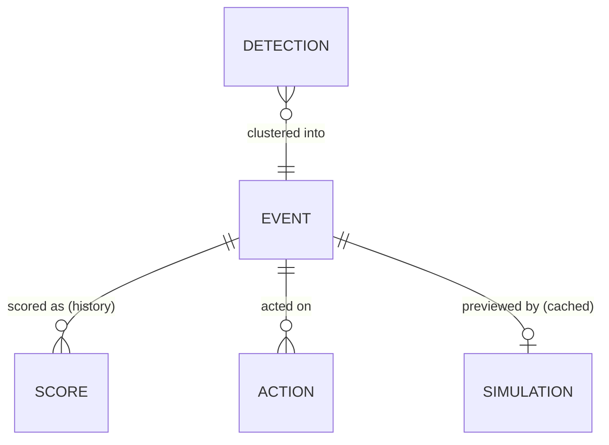
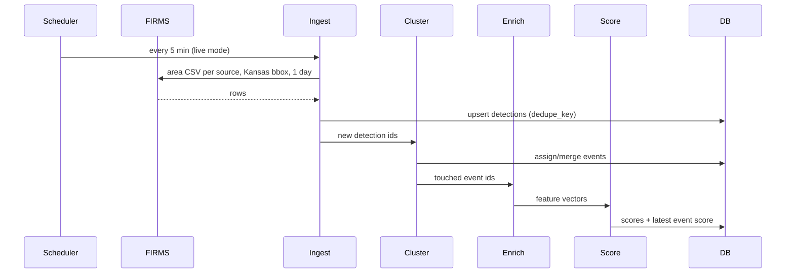

# Firewatch Confirmation Layer — Design

Companion to [PLAN.md](PLAN.md). The plan says *what* we build and *when*; this document says *how*, precisely enough that each workstream can build its piece without waiting on the others.

**Decided:** primary customer is a Kansas rural fire district dispatcher (Kansas Forest Service as statewide operator; utilities secondary). Frontend is React + MapLibre + deck.gl.

---

## 1. Design principles

1. **One alert per fire.** Operators see events, not pixels.
2. **Every score explains itself.** No number appears without its top reasons.
3. **Fail visible.** Missing data degrades the score and says so; it never hides an event.
4. **Humans decide.** The system ranks, explains, and previews. It never dispatches.
5. **Same code path for live and sample.** Sample mode feeds fixtures into the real pipeline, so the demo exercises the real system.
6. **Same features in training and serving.** Every feature is computable from historical data, so the model sees in production what it saw in training.

## 2. Users and jobs

| Persona | Situation | Job to be done |
|---|---|---|
| **County dispatcher** (primary) | Rural Kansas 911/dispatch center, handles all call types, fire is a fraction of the work | "Tell me, within minutes, which satellite detections in my county are worth a call to the chief, and why." |
| **Fire chief / duty officer** | Volunteer district, decides whether to page out a crew | "Show me where this could be in an hour so I know who to page and what to protect." |
| **Kansas Forest Service duty officer** | Statewide view, coordinates mutual aid on red-flag days | "Rank everything in the state; show me what my districts are doing with it." |
| **Utility monitor** (secondary) | Watches transmission corridors | "Alert me when a likely wildfire is near or heading toward my lines." |

## 3. Domain model



- **Detection:** one satellite hotspot pixel from one overpass.
- **Event:** a cluster of detections believed to be one fire. This is the unit the user sees and acts on (the "alert").
- **Score:** a timestamped scoring of an event. Kept as history so the UI can show score trend.
- **Action:** an operator's acknowledge / dismiss / escalate with a note.
- **Simulation:** cached spread output for an event under a given wind.

### SQLite schema

```sql
CREATE TABLE detections (
  id            INTEGER PRIMARY KEY,
  dedupe_key    TEXT UNIQUE NOT NULL,      -- source|lat4|lon4|acq_datetime
  source        TEXT NOT NULL,             -- VIIRS_SNPP_NRT, GOES_NRT, ...
  satellite     TEXT,                      -- N, N20, N21, Terra, Aqua, G18, G19
  lat           REAL NOT NULL,
  lon           REAL NOT NULL,
  acq_time      TEXT NOT NULL,             -- ISO 8601 UTC
  brightness_k  REAL,                      -- bright_ti4 (VIIRS) or brightness (MODIS)
  frp_mw        REAL,
  confidence    TEXT,                      -- normalized: low | nominal | high
  scan_km       REAL,
  track_km      REAL,
  daynight      TEXT,                      -- D | N
  event_id      INTEGER REFERENCES events(id),
  ingested_at   TEXT NOT NULL
);

CREATE TABLE events (
  id               INTEGER PRIMARY KEY,
  lat              REAL NOT NULL,          -- FRP-weighted centroid
  lon              REAL NOT NULL,
  first_seen       TEXT NOT NULL,
  last_seen        TEXT NOT NULL,
  county           TEXT,
  nearest_town     TEXT,
  place_label      TEXT,                   -- "8 mi SW of Ashland, Clark Co."
  status           TEXT NOT NULL DEFAULT 'new',  -- new | acknowledged | escalated | dismissed | closed
  is_sample        INTEGER NOT NULL DEFAULT 0,
  features_json    TEXT,                   -- latest feature vector
  score            INTEGER,                -- latest 0..100
  recommendation   TEXT,                   -- monitor | investigate | escalate
  degraded         INTEGER NOT NULL DEFAULT 0,
  updated_at       TEXT NOT NULL
);

CREATE TABLE scores (
  id            INTEGER PRIMARY KEY,
  event_id      INTEGER NOT NULL REFERENCES events(id),
  scored_at     TEXT NOT NULL,
  score         INTEGER NOT NULL,
  recommendation TEXT NOT NULL,
  scorer        TEXT NOT NULL,             -- rules-v0 | xgb-v1 ...
  reasons_json  TEXT NOT NULL,             -- [{feature, label, contribution}]
  guardrail     TEXT                       -- set when a rule overrode the model
);

CREATE TABLE actions (
  id          INTEGER PRIMARY KEY,
  event_id    INTEGER NOT NULL REFERENCES events(id),
  action      TEXT NOT NULL,               -- acknowledge | dismiss | escalate | reopen
  operator    TEXT NOT NULL,
  note        TEXT,
  created_at  TEXT NOT NULL
);

CREATE TABLE source_health (
  source        TEXT PRIMARY KEY,           -- firms_viirs, firms_goes, open_meteo, nws
  last_ok       TEXT,
  last_error    TEXT,
  last_error_at TEXT
);
```

Status transitions: `new → acknowledged | escalated | dismissed`; `acknowledged → escalated | dismissed`; any → `reopen` → `new`. An event auto-closes after 24 h with no new detections. A dismissed event that later rises to a higher recommendation is reopened automatically and flagged "re-raised."

## 4. Pipeline



### 4.1 Ingestion

| Source | Interval | Request | Notes |
|---|---|---|---|
| FIRMS VIIRS (SNPP, NOAA-20, NOAA-21), MODIS | 5 min | `/api/area/csv/{KEY}/{SOURCE}/-102.05,36.99,-94.59,40.00/1` | One call per source per poll ≈ 5 calls / 5 min; far under 5000 / 10 min |
| FIRMS GOES | 5 min | same, `GOES_NRT` | Stretch; same parser with a GOES column map |
| Open-Meteo | On demand per event, cached 1 h by 0.1° cell | forecast API `current` + `past_days=3` hourly | Archive API for training and sample fixtures |
| NWS alerts | 15 min | `/alerts/active?area=KS&event=Red Flag Warning` | Display only |

Normalization: VIIRS confidence `l/n/h` and MODIS numeric confidence (`<30` low, `30–79` nominal, `≥80` high) map to one `low | nominal | high` field. All times stored UTC; displayed in Central.

Dedupe key: `source|round(lat,4)|round(lon,4)|acq_date+acq_time`. FIRMS replaces ultra-real-time rows with near-real-time rows for the same observation; the key makes that an upsert rather than a duplicate.

### 4.2 Clustering detections into events

For each new detection `d`:

1. Candidate events: status not `closed`, `last_seen` within 12 h of `d.acq_time`.
2. Match radius `r = max(2 km, 0.5 × max(scan_km, track_km) + 1 km)`, which widens to ~2.5 km for GOES pixels.
3. If any detection of a candidate event lies within `r` of `d` (haversine), join it. If `d` matches several events, merge them into the oldest.
4. Otherwise create a new event.
5. Recompute centroid (FRP-weighted), `first_seen`, `last_seen`, and place label.

Place label: nearest town from the OSM `place=town|village|city` layer, bearing from town to event, distance in miles, county from Census TIGER Kansas county polygons. Example: `8 mi SW of Ashland, Clark Co.`

### 4.3 Enrichment: feature specification

Every feature has a defined fallback, and every fallback sets `degraded = 1` on the event.

| Feature | Unit | Computation | Fallback |
|---|---|---|---|
| `frp_max` | MW | max over detections | 0 |
| `frp_sum` | MW | sum over detections | 0 |
| `brightness_max` | K | max over detections | median of training set |
| `conf_high_frac` | 0–1 | share of detections with `high` confidence | 0 |
| `pixel_km2_min` | km² | min `scan × track` | 0.14 (VIIRS nadir) |
| `n_detections` | count | detections in event | — |
| `n_satellites` | count | distinct `satellite` values | — |
| `minutes_active` | min | `last_seen − first_seen` | 0 |
| `frp_growth` | ratio | latest-pass FRP ÷ first-pass FRP (1 if single pass) | 1 |
| `is_night` | 0/1 | any detection with `daynight = N` | 0 |
| `local_hour` | 0–23 | Central hour of `first_seen` | — |
| `doy_sin`, `doy_cos` | — | day-of-year encoded on a circle | — |
| `wind_kmh` | km/h | Open-Meteo 10 m wind at event hour | missing → degraded |
| `gust_kmh` | km/h | Open-Meteo 10 m gusts | `wind_kmh × 1.5` |
| `wind_dir_deg` | ° from | Open-Meteo | missing → degraded |
| `rh_pct` | % | Open-Meteo 2 m RH | missing → degraded |
| `temp_c` | °C | Open-Meteo 2 m temperature | missing → degraded |
| `precip_72h_mm` | mm | sum of prior 72 h hourly precipitation | 0 |
| `gfdi` | index | grassland fire danger index (section 4.4) | computed from fallbacks |
| `thunder_24h` | 0/1 | any weather code 95–99 in prior 24 h within 0.25° | 0 |
| `elevation_m` | m | terrain tile sample at centroid | 0 |
| `slope_deg` | ° | max slope within 500 m from terrain tiles | 0 |
| `dist_line_km` | km | to nearest OSM `power=line` ≥ 115 kV | 50 (cap) |
| `dist_substation_km` | km | to nearest `power=substation` | 50 (cap) |
| `dist_town_km` | km | to nearest town/village/city | 50 (cap) |
| `dist_static_km` | km | to nearest static heat source | 50 (cap) |
| `in_flint_hills` | 0/1 | point-in-polygon, EPA Level III ecoregion "Flint Hills" | 0 |
| `nearby_events_24h` | count | other events within 25 km in the prior 24 h | 0 |

`nearby_events_24h` matters in Kansas: a cluster of many simultaneous small events on a calm April day is the signature of a prescribed-burn day, while a single isolated event on a red-flag day is not.

### 4.4 Grassland fire danger index

McArthur Mk 4 grassland fire danger index (Noble et al., 1980), used both as a model feature and in the rules scorer:

\[
\text{GFDI} = 2\exp\left(-23.6 + 5.01\ln C + 0.0281\,T - 0.226\sqrt{RH} + 0.633\sqrt{U}\right)
\]

- \(C\): degree of curing, %. Default 95 Nov–Apr (dormant grass), 50 Jun–Aug, linear in between; configurable.
- \(T\): °C, \(RH\): %, \(U\): 10 m wind in km/h.
- Bands used for display: < 12 low/moderate, 12–24 high, 25–49 very high, 50–99 severe, ≥ 100 extreme.

*Verify constants against the source before relying on exact values.* NWS Wichita publishes its own grassland fire danger product; we display theirs when available but always compute ours for the model so historical and live values match.

## 5. Scoring

### 5.1 Output contract

```json
{
  "score": 87,
  "recommendation": "escalate",
  "scorer": "xgb-v1",
  "degraded": false,
  "guardrail": null,
  "reasons": [
    {"feature": "gust_kmh", "label": "Gusts 72 km/h (45 mph)", "contribution": 18},
    {"feature": "rh_pct", "label": "Humidity 14%", "contribution": 12},
    {"feature": "n_satellites", "label": "Seen by 3 satellites", "contribution": 9}
  ]
}
```

Contributions are in score points and may be negative ("−9 · Flint Hills burn season"). The UI shows the top 3 by absolute value.

Recommendation: `escalate` if score ≥ 70, `investigate` if 40–69, `monitor` if < 40. Thresholds live in config.

### 5.2 Rules scorer (v0, and permanent fallback)

Start at 30, add points, clip to 0–100. Each line becomes a reason.

| Condition | Points |
|---|---|
| Any `high` confidence detection | +10 |
| `frp_max` ≥ 50 MW / ≥ 10 MW | +12 / +6 |
| `n_satellites` ≥ 2 / ≥ 3 | +8 / +14 |
| `frp_growth` ≥ 2 between passes | +8 |
| `gfdi` ≥ 50 / 25–49 / 12–24 | +20 / +12 / +5 |
| `gust_kmh` ≥ 64 (40 mph) | +8 |
| `rh_pct` ≤ 20 | +6 |
| `dist_town_km` ≤ 3 or `dist_line_km` ≤ 1 | +8 |
| `dist_static_km` ≤ 1 | −45 |
| `in_flint_hills` and Mar–Apr and `gfdi` < 12 | −20 |
| `nearby_events_24h` ≥ 5 and `gfdi` < 12 | −10 |
| `precip_72h_mm` ≥ 10 | −10 |

### 5.3 Model (v1)

- **Target:** `1` = matched to a WFIGS `WF` incident; `0` = matched to `RX` or inside the static-source mask. Unmatched events excluded (see PLAN section 5).
- **Model:** `xgboost.XGBClassifier`, shallow trees (`max_depth` 3–4, ~200 rounds), class weights for imbalance; logistic regression baseline for comparison.
- **Calibration:** isotonic or Platt on a validation fold; `score = round(100 × p)`.
- **Split:** train on events through 2022, validate on 2023, test on 2024.
- **Reasons:** `booster.predict(dmatrix, pred_contribs=True)` gives log-odds contributions per feature. Convert to score points by distributing `score − base_score` across features in proportion to their log-odds contributions, then map feature values to human labels.
- **Artifact:** `backend/data/model/xgb-v1.json` + `features.json` (ordered feature list, fallbacks, training medians) + `metrics.json`.

### 5.4 Guardrails (applied after the model)

| Rule | Effect |
|---|---|
| `dist_town_km` ≤ 1 or `dist_line_km` ≤ 0.5, and not a static source | Floor at `investigate` |
| `dist_static_km` ≤ 0.5 and `frp_growth` < 2 | Cap at `monitor` |
| Event degraded (weather missing) | Score from rules scorer; badge "degraded" |

When a guardrail changes the recommendation, `guardrail` is set and shown in the UI ("Raised to Investigate: within 1 km of Ashland").

### 5.5 Re-scoring and notification

Rescore an event when a detection joins it, or hourly while open (weather changes). Notify (toast + sound in UI; SMS/email stretch) only when the recommendation **rises**: monitor → investigate, investigate → escalate. Never notify on a falling score.

## 6. Spread simulation

### 6.1 Inputs and outputs

Input: event centroid, wind speed (km/h) and direction (from, °), temperature, RH, curing, duration (default 60 min). Wind can be overridden by the user.

Output:

```json
{
  "event_id": 42,
  "assumptions": {"wind_kmh": 48, "wind_from_deg": 200, "rh_pct": 14, "temp_c": 24, "curing_pct": 95, "fuel": "grassland", "model": "CSIRO grassland + elliptical + slope"},
  "head_ros_kmh": 6.1,
  "isochrones": {"type": "FeatureCollection", "features": [
    {"type": "Feature", "properties": {"minutes": 5, "area_ha": 12.4}, "geometry": {"type": "Polygon", "coordinates": []}}
  ]},
  "impacts": [
    {"kind": "town", "name": "Ashland", "minutes": 38, "distance_km": 3.9},
    {"kind": "power_line", "name": "345 kV", "minutes": 22}
  ],
  "wind_vector": {"from_deg": 200, "kmh": 48}
}
```

### 6.2 Fire behavior

Treat all fuel as cured grassland (true for most of Kansas in the dormant season). On screen: *"Simplified grass-fire estimate for planning. Not an operational fire behavior prediction."*

1. **Dead fuel moisture** (McArthur): \(MC = 9.58 - 0.205\,T + 0.138\,RH\) (%).
2. **Moisture factor** (Cheney et al., 1998): \(\phi_M = e^{-0.108\,MC}\) for \(MC < 12\%\); for \(MC \ge 12\%\), \(\phi_M = 0.684 - 0.0342\,MC\) if \(U \le 10\) km/h, else \(0.547 - 0.0228\,MC\). Clamp at ≥ 0.
3. **Curing factor**: \(\phi_C = \dfrac{1.12}{1 + 59.2\,e^{-0.124(C - 50)}}\).
4. **Head-fire rate of spread** (natural pasture), km/h:
   - \(U < 5\): \(R = (0.054 + 0.269\,U)\,\phi_M\,\phi_C\)
   - \(U \ge 5\): \(R = (1.4 + 0.838\,(U - 5)^{0.844})\,\phi_M\,\phi_C\)
5. **Fire shape**: length-to-breadth \(LB = 1.1\,U^{0.464}\) for \(U \ge 1\), else 1 (grass, Canadian FBP O-1). Eccentricity \(e = \sqrt{1 - 1/LB^2}\). Spread rate in a direction at angle \(\theta\) from the downwind direction: \(R(\theta) = R\,\dfrac{1 - e}{1 - e\cos\theta}\).
6. **Slope**: multiply by \(e^{0.069\,s}\), where \(s\) is the slope in degrees along the direction of travel (positive upslope), clamped to ±20°. This doubles spread per 10° upslope and halves it per 10° downslope.

*Verify all constants against the cited sources while implementing; they are written from memory.*

### 6.3 Arrival-time grid

- Grid: 12 × 12 km centered on the event (shift the center 3 km downwind so the head fire stays in frame), 60 m cells (200 × 200).
- Elevation sampled from Terrarium tiles at zoom 12 and resampled to the grid; slope computed per neighbor step.
- Ignition: cells within the event's detection footprint set to arrival time 0.
- Propagation: Dijkstra over a 16-neighbor stencil. Edge cost = step distance ÷ \(R(\theta, s)\). Stop at 60 min (or the requested duration).
- Isochrones every 5 min: threshold the arrival grid, trace contours (`skimage.measure.find_contours` or `contourpy`), convert grid coordinates to lon/lat, simplify to ~20 m tolerance.
- Impacts: intersect each isochrone with towns, lines, and substations (`shapely`); report the first minute each asset is reached.
- Performance target: < 500 ms per call. Cache by `(event_id, wind_kmh rounded to 2, wind_dir rounded to 5°)`.

Sanity tests: zero wind on flat ground produces near-circular isochrones; doubling wind lengthens the head run; flipping wind direction mirrors the shape.

## 7. API contract

Base URL `/api`. JSON everywhere. Times ISO 8601 UTC.

### `GET /api/alerts`

Query: `min_score` (default 0), `status` (comma list, default `new,acknowledged,escalated`), `since` (default 24 h ago), `include_monitor` (default `false`).

```json
{
  "mode": "live",
  "generated_at": "2026-11-07T18:05:00Z",
  "alerts": [
    {
      "id": 42,
      "lat": 37.12, "lon": -99.84,
      "place_label": "8 mi SW of Ashland, Clark Co.",
      "first_seen": "2026-11-07T17:41:00Z",
      "last_seen": "2026-11-07T18:01:00Z",
      "status": "new",
      "score": 87,
      "recommendation": "escalate",
      "score_trend": [52, 71, 87],
      "degraded": false,
      "guardrail": null,
      "sources": {"VIIRS": 2, "GOES": 5},
      "top_reason": "Gusts 72 km/h (45 mph)",
      "is_sample": false
    }
  ]
}
```

### `GET /api/alerts/{id}`

Alert summary fields plus `detections[]`, `features{}`, `reasons[]`, `weather{}`, `nearest_assets[]`, `actions[]`, `score_history[]`.

### `POST /api/alerts/{id}/actions`

Body `{"action": "escalate", "operator": "Dispatch 2", "note": "Paged Ashland VFD"}`. Returns the updated alert. `400` on an invalid transition.

### `GET /api/alerts/{id}/simulate`

Query: `minutes` (default 60, max 120), optional `wind_kmh`, `wind_from_deg`. Returns the section 6.1 payload.

### Others

- `GET /api/layers/{power_lines|substations|towns|static_sources|counties}` → GeoJSON (cached files).
- `GET /api/health` → `{"mode": "live", "sources": {"firms_viirs": {"last_ok": "...", "age_min": 4, "status": "ok"}, "open_meteo": {...}}}`. Status is `ok` (< 15 min), `stale` (< 60 min), or `down`.
- `POST /api/ingest/run` → runs one poll immediately.
- `POST /api/sample/replay` → clears sample events and streams fixtures in over `duration_s` (default 60).

## 8. Frontend design

### 8.1 Stack

React 18 + Vite + TypeScript · `react-map-gl/maplibre` + `maplibre-gl` · `@deck.gl/react` + `@deck.gl/mapbox` (`MapboxOverlay`, interleaved) · TanStack Query (polling every 30 s) · Zustand for UI state · Tailwind CSS · `lucide-react` icons · React Router (`/`, `/alerts/:id`, `/alerts/:id/3d`).

### 8.2 Visual language

Dispatch centers run dim rooms and long shifts, so the UI is dark by default with high-contrast status colors. Color is never the only signal: every recommendation also has an icon and a text label.

| Token | Value | Use |
|---|---|---|
| `bg` | `#0B0F14` | App background |
| `panel` | `#121821` | Side panels, cards |
| `border` | `#243041` | Dividers |
| `text` / `muted` | `#E6EDF3` / `#8B98A5` | Body / secondary |
| `escalate` | `#EF4444` + `flame` icon | Score ≥ 70 |
| `investigate` | `#F59E0B` + `eye` icon | 40–69 |
| `monitor` | `#64748B` + `circle` icon | < 40 |
| `degraded` | `#A78BFA` + `alert-triangle` icon | Missing data badge |
| `sample` | `#38BDF8` | SAMPLE mode banner and badges |
| Isochrones | `#FDE68A` → `#F97316` → `#B91C1C` | 5 min → 60 min |

Typography: Inter; tabular numerals for scores and times. Score badge: 40 px circle, recommendation color, bold number.

### 8.3 Main dashboard (`/`)

```
┌────────────────────────────────────────────────────────────────────────────────────┐
│ FIREWATCH   ● LIVE   VIIRS 4m ✓  GOES 6m ✓  Weather 12m ✓  ⚑ Red Flag: 9 counties │
│                                               [Replay sample] [Run ingest]  Dispatch 2 ▾│
├──────────────────────────┬─────────────────────────────────────────────────────────┤
│ ALERTS (3)   Score ≥ [40]│                                                         │
│ ☐ Show suppressed (14)   │                                                         │
│ Status [New ▾] Last [24h]│                    MAP (Kansas)                         │
│──────────────────────────│                                                         │
│ (87) ESCALATE        NEW │      ● escalate events (large, pulsing if new)          │
│ 8 mi SW of Ashland,      │      ● investigate (medium)                             │
│ Clark Co. · 24 min ago   │      · monitor (small, only when toggled)               │
│ VIIRS×2 GOES×5  ▁▄█      │      ─ 115+ kV lines (thin, toggle)                     │
│ ↑ Gusts 45 mph           │      ▢ county boundaries                                │
│──────────────────────────│                                                         │
│ (58) INVESTIGATE     ACK │                                     [Layers ▾]          │
│ 3 mi E of Medicine Lodge │                                                         │
│ ...                      │                                                         │
│──────────────────────────│                                                         │
│ (41) INVESTIGATE  ⚠ DEGR │                                                         │
├──────────────────────────┴─────────────────────────────────────────────────────────┤
│ 14 detections suppressed today: 9 likely prescribed burns · 5 static heat sources │
└────────────────────────────────────────────────────────────────────────────────────┘
```

Behavior:
- The list is sorted by recommendation, then score, then recency. Hovering a card highlights its map marker; clicking either opens the detail drawer and flies the map to the event (zoom 11).
- New escalations get a pulsing marker, a toast, and an optional sound until acknowledged.
- The bottom strip is the "we filtered the noise" message: the count of suppressed detections and why. Clicking it enables "Show suppressed."
- Source chips turn amber when `stale` and red when `down`, with a tooltip giving the last successful pull.

### 8.4 Alert detail drawer (`/alerts/:id`)

Slides in from the right (420 px), map stays interactive.

```
┌──────────────────────────────────────────┐
│ (87) ESCALATE                         ✕  │
│ 8 mi SW of Ashland, Clark Co.            │
│ First seen 11:41 · Last 12:01 · NEW      │
│──────────────────────────────────────────│
│ WHY THIS SCORE                           │
│ +18  Gusts 72 km/h (45 mph)      ████▌   │
│ +12  Humidity 14%                ███     │
│ +9   Seen by 3 satellites        ██▎     │
│ Score trend  52 → 71 → 87                │
│──────────────────────────────────────────│
│ CONDITIONS                               │
│ Wind 48 km/h from SSW ↗ · Temp 24°C      │
│ GFDI 63 (Severe) · No rain in 72 h       │
│──────────────────────────────────────────│
│ NEARBY                                   │
│ Ashland (town) 12.9 km NE                │
│ 345 kV line 1.8 km E                     │
│──────────────────────────────────────────│
│ DETECTIONS  ● VIIRS N20 11:41  14 MW     │
│             ● GOES-19   11:46… ×5        │
│──────────────────────────────────────────│
│ [▶ Open 3D spread preview]               │
│──────────────────────────────────────────│
│ Note: [_____________________________]    │
│ [Acknowledge] [Escalate] [Dismiss]       │
│──────────────────────────────────────────│
│ HISTORY                                  │
│ 11:52 Dispatch 2 acknowledged            │
└──────────────────────────────────────────┘
```

- Escalate and Dismiss ask for a one-line note (optional, prefilled suggestions such as "Paged VFD," "Known prescribed burn," "Industrial site").
- If degraded, a purple banner at the top lists which inputs were missing.
- If a guardrail fired, a line under the score explains it.

### 8.5 3D spread preview (`/alerts/:id/3d`)

Full-screen view. Map uses satellite imagery with Terrarium terrain (`exaggeration` 1.5 so Kansas relief is visible), camera pitched 60° looking downwind at the event.

```
┌────────────────────────────────────────────────────────────────────────────────────┐
│ ← Back to alert   (87) 8 mi SW of Ashland        Simplified grass-fire estimate ⓘ │
├────────────────────────────────────────────────────────────────┬───────────────────┤
│                                                                │ WIND              │
│          3D terrain + imagery                                  │ Observed 48 km/h  │
│                                                                │ from 200° (SSW)   │
│     ~ ~ ~ wind particles drifting downwind ~ ~ ~               │ ☐ Override        │
│                                                                │ Speed  [====|--]  │
│          ◜‾‾‾‾‾‾‾‾‾◝  isochrone rings, yellow → red            │ From   ( dial )   │
│        ◜  ◜‾‾‾‾◝    ◝                                          │                   │
│        ◟  ◟____◞    ◞  → elongated downwind                    │ IMPACTS           │
│          ◟_________◞                                           │ 345 kV line 22 min│
│                         ▲ Ashland                              │ Ashland    38 min │
│   ═══ 345 kV line ═══════════════                              │                   │
│                                                                │ Head ROS 6.1 km/h │
│                                                                │ Area @60m 1,240 ha│
├────────────────────────────────────────────────────────────────┴───────────────────┤
│ ▶  0 ──────●──────────────────── 60 min    [1×] [4×] [Reset to observed]           │
└────────────────────────────────────────────────────────────────────────────────────┘
```

Rendering:
- Isochrones: MapLibre `fill` layers draped on terrain (fill-extrusion breaks on terrain), plus a brighter `line` layer for the current-time front. The time slider filters by `minutes ≤ t`; play animates `t` from 0 to 60 over ~15 s at 1×.
- Wind: deck.gl animated particle layer (or a `TripsLayer` with short looping trails) seeded on a grid and advected by the single wind vector. Big arrow at the ignition point.
- Assets: towns as labeled pins, lines as `line` layers; an asset turns red when the current front reaches it.
- Wind override: debounced 250 ms, calls `/simulate` with the new wind, cross-fades the new isochrones. "Reset to observed" restores the original.

### 8.6 Sample mode

- A cyan `SAMPLE` badge replaces `● LIVE` in the header, and every sample card shows a small "sample" tag.
- "Replay sample" clears sample events and streams the fixtures in over 60 s so the demo shows alerts arriving and scores rising.

### 8.7 Component map

```
App
├── TopBar (ModeBadge, SourceHealthChips, RedFlagChip, ReplayButton, OperatorSelect)
├── DashboardPage
│   ├── AlertList (Filters, AlertCard[])
│   ├── MapView (BaseMap, EventMarkers, AssetLayers, CountyLayer)
│   ├── SuppressedStrip
│   └── AlertDrawer (ScoreHeader, ReasonBars, Conditions, NearbyAssets, DetectionTimeline, ActionBar, History)
└── Spread3DPage
    ├── TerrainMap (IsochroneLayers, WindParticles, AssetLayers)
    ├── WindPanel (Override toggle, SpeedSlider, DirectionDial)
    ├── ImpactsPanel
    └── TimeBar (Play, Scrubber, SpeedToggle, Reset)
```

## 9. Configuration

`.env` (copy from `.env.example`):

```
FIRMS_MAP_KEY=
MODE=sample                # sample | live
BBOX=-102.05,36.99,-94.59,40.00
POLL_MINUTES=5
THRESHOLD_ESCALATE=70
THRESHOLD_INVESTIGATE=40
CURING_PCT_OVERRIDE=       # blank = seasonal default
NWS_USER_AGENT=firewatch-demo (you@example.com)
VITE_API_BASE=http://localhost:8000/api
```

## 10. Sample fixture format

`backend/data/samples/<slug>.json`:

```json
{
  "slug": "starbuck-2017",
  "title": "Starbuck fire ignition, Clark County",
  "expected": "escalate",
  "story": "Extreme wind-driven grass fire; largest in Kansas history.",
  "replay_offset_s": 10,
  "detections": [
    {"source": "VIIRS_SNPP_NRT", "satellite": "N", "lat": 0, "lon": 0, "acq_time": "2017-03-06T...", "frp_mw": 0, "confidence": "nominal", "brightness_k": 0, "scan_km": 0.4, "track_km": 0.4, "daynight": "D"}
  ],
  "weather": {"wind_kmh": 0, "gust_kmh": 0, "wind_dir_deg": 0, "rh_pct": 0, "temp_c": 0, "precip_72h_mm": 0, "thunder_24h": 0}
}
```

Coordinates, times, and weather come from the FIRMS archive and Open-Meteo archive during data prep; placeholders above are zeros on purpose. Weather is stored in the fixture so the demo runs offline.

## 11. Testing

Kept small and aimed at the things that would embarrass us in a demo:

- **Clustering:** two detections 1 km apart merge; 5 km apart don't; a GOES pixel overlapping a VIIRS event joins it.
- **Rules scorer:** each sample fixture produces its `expected` recommendation.
- **Spread:** zero-wind symmetry, wind elongation, direction mirroring, < 500 ms runtime.
- **API:** invalid action transition returns 400; `/health` reports `down` when a source has never succeeded.
- **End to end:** `MODE=sample`, replay, and assert all fixtures appear with expected recommendations.

## 12. Data attribution (shown in the app footer and slides)

NASA FIRMS (LANCE) · Open-Meteo (CC BY 4.0) · NOAA/NWS · NIFC WFIGS / IRWIN · © OpenStreetMap contributors (ODbL) · AWS Terrain Tiles (Mapzen, SRTM and others) · US Census TIGER · EPA ecoregions.
