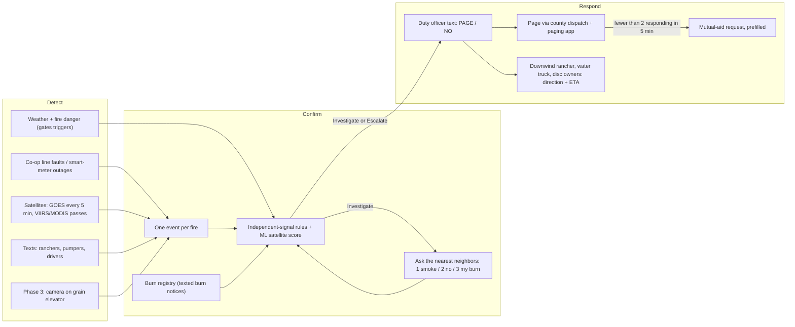

# Firewatch — Build Plan

Weekend build for [Firewatch 2026](https://wsuinnovationworks.com/) (WSU Innovation Works × Lockheed Martin Skunk Works, Nov 6–8, Woolsey Hall).

**Customer:** the chief of the Cottonwood Creek Fire District: 450 sq mi, 18 volunteers (5 who can leave work on a weekday), 2+1 trucks, secondhand equipment, mill-levy budget, one bar of cell at best, no fiber.

**What we build:** a **Detect → Confirm → Respond** chain that turns the first cheap signals of a grass fire (a power line faulting on a red-flag afternoon, a satellite hotspot, a rancher's text) into a confirmed alert. The alert goes to the duty officer's phone, and the right neighbors get a targeted text, minutes before anyone would otherwise call 911. Everything the district touches works over SMS.

Software design details live in [DESIGN.md](DESIGN.md).

---

## 1. The problem in minutes

The brief's timeline, with our spread model's estimate of the fire at each point. Assumptions: grass fully cured (March), 16 mph south wind, 18% RH, flat terrain. At those settings the model reproduces the brief's "2–3 miles by 2:52" on its own, which is a useful check on both.

| Time | What happens | Minutes since ignition | Fire (our model) |
|---|---|---|---|
| 1:50 | Line down, grass ignites | 0 | — |
| 2:17 | First person sees smoke | 27 | 1.1 mi long, ~110 acres |
| 2:21 | 911 call | 31 | 1.4 mi, ~150 acres |
| 2:34 | First truck rolls | 44 | 1.8 mi, ~300 acres |
| 2:52 | First truck on scene | 62 | **2.7 mi, ~600 acres** |

Where the 62 minutes go: **31 min before anyone knows**, 13 min turnout, 18 min drive. Turnout and drive are set by volunteers and distance; we can't buy those down cheaply. The first 31 minutes are where a system can win.

**The same afternoon with Firewatch** (same turnout, same drive):

| Time | What happens | Fire |
|---|---|---|
| 1:50 | Co-op recloser locks out on the feeder; red-flag weather → Firewatch opens an event, texts the duty officer (Investigate) and asks the two nearest signed-up ranchers "see smoke?" | — |
| ~1:58 | A rancher replies "1" (smoke) → second independent signal → **Escalate**; duty officer replies PAGE | 0.3 mi, ~15 acres |
| ~1:59 | Page goes out through county dispatch; the downwind rancher, the lease water-truck driver, and two disc owners get a text with direction and arrival estimate | |
| ~2:10 | Rancher starts a disc line ahead of the head (if safe) | 0.9 mi, ~65 acres |
| ~2:11 | Brush 1 rolls | |
| ~2:29 | Brush 1 on scene | **1.7 mi, ~240 acres (60% less than 600)** |

These numbers are from our model, not field data, and the 8-minute confirmation assumes a line-fault feed and a rancher who answers. Section 8 says how we'd test both.

## 2. What the judges will probe, and where we answer it

| Requirement | Our answer | Section |
|---|---|---|
| Whole chain | Detect (line faults, satellites, texts) → Confirm (independent signals, burn registry, ask-the-neighbor, ML score) → Respond (duty officer, page via dispatch, targeted texts with spread ETAs) on one event record | 4 |
| Field reality | SMS-first, nothing to install in phase 1, explicit cry-wolf budget, weather-gated triggers | 5 |
| Built for this district | 5 weekday volunteers → targeted, not mass, paging; neighbors and the lease water truck act before Brush 1; works on one bar | 4.3, 5 |
| Honest numbers | ~$300–500/yr for phase 1; who pays per phase; stand-up in a week; failure table | 6, 7 |
| Evidence | ML evaluated on 10 years of Kansas fires; satellite timing measured (and it's not fast enough alone); spread model checked against the brief; scenario replay | 8 |
| Next step | One burn-season pilot measuring signal-to-page minutes and false pages per month | 10 |

## 3. Constraints we design for

| Constraint | Design rule it produces |
|---|---|
| **One bar of cell, no fiber** | Every field interaction is a 160-character SMS (works on one bar, carrier store-and-forward). Replies are single digits or one word. The web console is for the station and county, never required in the field. |
| **Power** | Phase 1 puts no hardware in the district: the server runs in the cloud, the district needs phones. Phase 3 camera nodes are solar + battery, send stills not video, and store-and-forward. |
| **False alarms** (dust, haze, March burns, neighbors' smoke) | No single weak signal pages anyone. Pages need two independent signals, or a strong multi-pass satellite score. Registered burns are suppressed inside their area and day. Line faults only count on fire-weather days. Rate limits and batching. A measured **cry-wolf budget**: at most 2 non-fire pages a month in burn season. |
| **Rural cost and scale** | Free public data, one small cloud VM, pay-per-message SMS. No full-time operator: the system texts a human only when it needs a decision. |
| **5 people who can leave work** | Page the duty officer first, then targeted volunteers, then mutual aid. The people closest to the fire (ranchers, pumpers, the lease water truck) get the earliest, most specific text, because they're already there. |
| **Time** | Every step is measured in minutes since first signal, and the demo shows that clock. |

## 4. System design



**How the pieces talk:** every signal, whatever its source, attaches to one **event** (a place and a time window). Confirmation reads the event's signals; response reads the event's location, the wind, and the spread estimate. Messages in and out go through one SMS gateway, and every message, reply, and decision is logged on the event. That log is the audit trail and the training data.

### 4.1 Detect

| Signal | Latency | Cost to district | Works on one bar? | Notes |
|---|---|---|---|---|
| **Electric co-op line fault / outage** | Seconds (feeder lockout, smart-meter "last gasp") to ~15 min (public outage map) | $0; needs a data-sharing agreement with the co-op | Server-side, yes | The scenario's ignition is a line down. A lockout on a fire-weather day in grass is the earliest signal that exists. Many Kansas co-ops already publish outage maps; a direct feed is better. |
| **GOES-East fire detection** | Scans every 5 min; ~2 km pixels | Free | Server-side | Sees growing fires between polar passes; can't see small ones. NOAA's Next Generation Fire System builds alerts on this (public access to verify). Latency for Kansas grass fires to be measured. |
| **VIIRS / MODIS** (FIRMS) | <1 min to ~3 h after an overpass; ~6–8 looks a day, clustered early afternoon and around 1–2 am | Free | Server-side | Sharp (375 m) but sparse in time. Day passes land around 12:30–2:30 pm, which overlaps afternoon fire weather. Our ML score runs on these. |
| **Texted reports** | Human speed | ~1¢ per message | Yes (SMS) | Keyword `FIRE` plus a road or landmark. Ranchers and lease pumpers drive the district daily. Reports from unregistered numbers count, but can't page alone. |
| **Burn notices** | Before the burn | Same | Yes | Keyword `BURN` registers a burn area and day. This is a *negative* signal that cuts false alarms; many Kansas counties already expect a call to dispatch before a burn. |
| **Weather and fire danger** | Hourly | Free | Server-side | Not a detection. It gates the others: a line fault on a humid day is an outage, not a fire. |
| **Phase 3: camera on a tall structure** | 1–5 min (stills) | ~$1.5–4k per node + ~$20–40/mo data (rough) | Stills fit on one bar | A grain elevator or water tower sees smoke 10–15 miles out on flat ground. 2–3 nodes for 450 sq mi. Next step, not this weekend. |

### 4.2 Confirm (without sending a person)

An event's level comes from explicit, tunable rules over its signals. The ML model scores the satellite evidence (section 11).

| Level | Rule (initial, tuned per district) | Who hears about it |
|---|---|---|
| **Escalate** | Two independent signals agree (any two of: satellite score ≥ 40, line fault on a fire-weather day, texted report, neighbor reply "1", camera smoke), **or** satellite score ≥ 70 | Duty officer gets a PAGE / NO text |
| **Investigate** | Any one signal: satellite score ≥ 40, line fault with fire danger High or above, a texted report | Duty officer gets an FYI text; Firewatch asks the neighbors |
| **Monitor** | Anything else, including a detection inside a registered burn on its day (unless it escapes: detection > 1 km outside the area, fire danger Very High or above, or a neighbor reports it spreading) | Nobody; shown on the console and in an optional evening digest |

**Ask the neighbor** is the cheapest confirmation there is. At Investigate, Firewatch texts up to three signed-up contacts within 3 miles: "Firewatch: possible fire near Rd 40 & Hwy 177. See smoke? Reply 1 yes, 2 no, 3 it's my burn." People who are already there answer in minutes, and nobody drives out. "3" from the registered burner's own number drops the event to Monitor.

**Public imagery:** the alert links the latest GOES visible loop for the area, so the duty officer can look for a plume in daylight (free, 5-minute refresh).

**Drone, honestly:** a $2–7k thermal drone is a good size-up and night-scouting tool for the first arriving volunteer. It doesn't confirm remotely across 450 sq mi, because flying beyond line of sight needs an FAA waiver. It's in the cost table as optional.

### 4.3 Respond

1. **Duty officer first.** One text with place, signals, wind, and a link: `FIREWATCH ESC: grass fire likely 2 mi SW of Rosalia. Line fault 1:50 + rancher saw smoke. Wind S 16 mph. Reply PAGE or NO`. No acknowledgment in 3 min → the chief; then county dispatch by automated call.
2. **Page through the existing path.** PAGE notifies county dispatch, who tone the district as they do today, and posts to the district's paging app if it has one (most accept email-to-page). Firewatch doesn't bypass dispatch.
3. **Targeted texts, before Brush 1 arrives.** The spread estimate picks who is downwind within 60 minutes: ranchers (move stock, open gates), the lease water-truck driver, and disc owners. Example: `FIREWATCH: grass fire 3 mi S of you, wind S 16 mph, could reach your place in ~35 min. Can you disc a line? Reply 1 yes 2 no. Only if safe.`
4. **Mutual aid, prefilled.** If fewer than 2 volunteers reply "responding" within 5 min, or the 60-minute footprint is bigger than 2+1 trucks can hold, the chief gets a ready-to-send request for the neighboring district and county EM.
5. **Updates as evidence arrives.** New satellite passes and replies update the event; recipients get a follow-up only when the threat level or direction changes.

## 5. Field reality

- **Connectivity:** SMS everywhere in the field; the carrier stores and retries messages. Optional links open a text-only page (< 50 KB, static map image). The 3D console is for the station, the county EOC, and the pitch.
- **Power:** none needed in the district in phases 1–2. Camera nodes (phase 3) are sized for 3 cloudy days on battery.
- **False alarms:** the burn registry, two-signal rule, weather gating, and ML suppression of Flint Hills burns and refinery flares (section 11). Investigate is a text, not a page. Batching: one Investigate digest per 15 min at most; one page per 30 min per area unless a new independent signal arrives. Every dismissal is logged and reviewed monthly.
- **People:** the escalation ladder never depends on one person; mutual aid triggers on missing replies, not on someone remembering.

## 6. Failure modes

| Failure | What Firewatch does | What the district does |
|---|---|---|
| Duty officer has no signal | Carrier retries; after 3 min with no reply the ladder moves on (chief, then county dispatch by voice call) | Nothing new; 911 still works |
| Firewatch server down | An external uptime monitor texts the chief within 5 min: "Firewatch offline — 911 is your only detection" | Same as today |
| A source goes quiet (satellite feed late, co-op feed silent, camera offline) | Per-source health; a 7 am health text during burn season; the console says "no data," never "no fire" | Knows which eyes are closed |
| False-alarm storm (calm March afternoon, 30 hotspots) | Registered burns suppressed; satellite-only events can't page below 70; rate limits and batching | Gets one digest, not 30 texts |
| Volunteers unavailable | Mutual-aid prompt after 5 min with < 2 responding | One tap to send |
| Fake or mistaken texted report | Unregistered numbers can trigger Investigate and the neighbor check, never a page alone | Reviews in the log |
| Model wrong | Humans decide every page; rules floor events near towns and lines at Investigate; overrides are logged for retraining | 911 remains primary |

## 7. Honest numbers

Rough figures before vendor quotes. We will say "rough" on the slide.

| Phase | What | Cash cost | Who realistically pays | Time to stand up |
|---|---|---|---|---|
| 1 | Cloud server, SMS number and messages, satellites, weather, texted reports, burn registry, ask-the-neighbor, targeted texts | ~$10–25/mo server + ~$5–20/mo SMS ≈ **$300–500/yr** | District operating budget (mill levy), or **$0 if the Kansas Forest Service hosts one instance for all districts** (one server handles the state) | **About a week:** day 1 boundary, roster import, thresholds; days 2–5 sign-ups by text at a district meeting and through the co-op newsletter; one drill page |
| 2 | Co-op fault and outage feed | $0 hardware; staff time | The co-op: line-caused ignitions are its liability, and a wildfire mitigation plan wants this | 1–3 months (data-sharing agreement) |
| 3 | 2–3 camera nodes on elevators or towers | ~$1.5–4k each + ~$20–40/mo data | Kansas Forest Service Volunteer Fire Assistance grant (cost share), the oil-lease operator, the co-op | Next grant cycle, 6–12 months |
| Optional | Thermal drone + FAA Part 107 certificate | ~$2–7k + ~$175 test | VFA grant or FEMA Assistance to Firefighters | Weeks |

## 8. Evidence

**Built and measured (in the repo now):**

- **The app, end to end on real Kansas data:** ingest → cluster → enrich → score → map → 3D spread → logged actions. It includes real OSM transmission lines, substations, and towns, and industrial heat sources derived from 10 years of satellite data.
- **ML confirmation score evaluated on 2016–2025 Kansas fires** ([report](../backend/ml/report.md)). The test set is 2023–2025, never seen in training. On those years, 76% of reported wildfires reach Investigate or higher (rules baseline: 55%), and 82% of unreported Flint Hills spring burns and 99% of refinery and plant hotspots stay at Monitor.
- **Satellite timing, and why we didn't stop at satellites:** for 209 matched Kansas wildfires, the first polar-orbiter detection came a median **8 minutes after** the reported discovery; only 47% were detected before it. Satellites confirm and track; they don't win the first 31 minutes alone. That result is why the design leads with line faults and people.
- **Spread model against the brief:** with March grass, 18% RH, and a 12–19 mph wind, our model gives 2.3–3.0 miles at 62 minutes, matching the brief's 2–3 miles.

**To build and measure by Saturday 12:30 (section 9):**

- **Cottonwood Creek replay:** the scenario run through the real pipeline, with the minutes-since-ignition clock and every text shown.
- **Alert load for a 450 sq mi stand-in district:** replay every satellite event in past March–Aprils through the scorer and count how many would have texted or paged the duty officer. That's the cry-wolf number.

## 9. Weekend scope

**Tonight (Fri), one slice we can demo: the Cottonwood Creek replay.** It reuses everything built so far (events, scoring, spread, impacts, map) and adds:

1. Non-satellite **signals** on events: line fault, texted report, neighbor reply, burn notice.
2. The **confirmation rules** in section 4.2, with reasons ("Line fault 1:50 on a High fire-danger day").
3. A **contacts roster** (volunteers, ranchers, pumpers, water truck, disc owners) with locations and roles.
4. An **SMS outbox and inbox** (simulated in sample mode, Twilio in live mode) and the **response planner**: who gets which text, using spread arrival times for each contact.
5. A **scenario clock** in the console: minutes since ignition, the baseline timeline beside the Firewatch timeline, and fire size at each point.
6. Same afternoon, a registered burn 6 miles away that never pages anyone.

**Saturday review (12:30):** the 62-minute problem, the whole-chain map with its constraints, the replay demo, the evidence numbers, cost and failure, and the plan to Sunday.

**Saturday afternoon → Sunday 11:00:** alert-load estimate; real SMS to a teammate's phone over Twilio; the text-only page for links; polish the 3D view with contact ETAs; rehearse.

**Cut first if behind:** live Twilio (keep the simulated outbox), GOES ingestion, the evening digest, the text-only page. **Never cut:** the replay with the clock, the two-signal rule, targeted texts, the honest-numbers slide.

## 10. Next step (after the weekend)

**Pilot one district through one March–April burn season.** Sign up ranchers and pumpers by text, take burn notices by text, and get the co-op's outage feed. Measure three things:

1. Minutes from first signal to duty-officer text and to page.
2. Non-fire pages per month against the budget of 2.
3. How often a neighbor answers within 5 minutes.

If the line-fault signal proves out, add camera nodes in season two with a VFA grant. The Kansas Forest Service hosting one instance for every district is the scale path.

## 11. ML confirmation score (built)

The score answers: how likely is it that this **satellite event** is an uncontrolled wildfire rather than a prescribed burn or an industrial heat source? It's one input to the rules in 4.2, not the whole decision.

- **Data:** FIRMS Kansas archive 2016–2025 replayed through the app's own clustering; labels from NIFC WFIGS (224 wildfires, 90 prescribed burns) plus 400 unreported Flint Hills spring fires as weak negatives. Industrial heat sources are handled by a rule, not the model.
- **Features:** fire radiative power, brightness, passes and satellites, growth; wind, gusts, humidity, temperature, rain, grassland fire danger; season, Flint Hills, terrain; distances to lines, substations, towns; nearby fires.
- **Model:** XGBoost with Platt calibration; logistic regression and the rules scorer as baselines; temporal split (train ≤ 2022, test 2023–2025) plus leave-one-year-out. Per-alert reasons from XGBoost contributions.
- **Honest caveats** (in the report): small samples; reported fires skew toward people; weak labels are mostly but not entirely right; logistic regression beat XGBoost on the test years while XGBoost won across the training years.

## 12. Spread estimate (built)

A grass-fire arrival-time grid (CSIRO grassland rate of spread, elliptical shape from wind, slope adjustment) over terrain tiles, well under a second per run. It returns isochrones every 5 minutes and when each town, substation, and line is reached. In the Respond layer, the same arrival times decide which contacts get a text and what ETA it says. On screen it's labeled "Estimate, not an operational prediction."

## 13. Data sources

| Need | Source | Key? | Notes |
|---|---|---|---|
| Hotspots (polar) | NASA FIRMS: VIIRS S-NPP, NOAA-20, NOAA-21, MODIS | Free `MAP_KEY` | Area API; yearly country CSVs for training (no key) |
| Hotspots (geostationary) | FIRMS GOES; NOAA Next Generation Fire System | Free | GOES-East scans the US every 5 min; NGFS public access to verify |
| Line faults / outages | The district's electric co-op: public outage map, or a direct feed | Agreement | Varies by co-op; sample mode uses a synthetic feed |
| Texts in and out | Twilio (or any SMS gateway) | Account | ~1¢ per message; simulated in sample mode |
| Weather, live + historical | Open-Meteo forecast and archive | None | Same variables for training and serving |
| Fire weather alerts | NWS `api.weather.gov` Red Flag Warnings | User-Agent | Display |
| Terrain | AWS Terrain Tiles | None | 3D view and slope |
| Infrastructure | OpenStreetMap via Overpass | None | Lines ≥ 115 kV, substations, towns (cached) |
| Labels | NIFC WFIGS incident locations | None | 891 Kansas incidents (669 WF, 222 RX) |

## 14. Software architecture (summary)

Python FastAPI backend with SQLite; a poller for FIRMS; enrichment, clustering, scoring, and spread in-process; React + MapLibre console. Sample mode feeds fixtures through the same pipeline, so the demo never depends on venue Wi-Fi or a live overpass. New for the Respond layer: a signals table, a contacts roster, an SMS gateway adapter with an outbox, and the response planner. See [DESIGN.md](DESIGN.md).

```
backend/
  app/            FastAPI app: ingest, features, scoring, sim, signals, notify
  ml/             download, build_dataset, train, report.md
  data/           layers, samples, model, district config + roster
frontend/         console: queue, map, alert drawer, 3D spread, scenario clock, SMS outbox
docs/             PLAN.md, DESIGN.md
```

## 15. Demo script (5 minutes)

1. **The 62 minutes (40 s):** the brief's timeline beside our model's fire size. 600 acres at arrival, and the first 31 minutes are lost before anyone knows.
2. **Why not just satellites (30 s):** across 10 years of Kansas fires, satellites saw them a median 8 minutes after the report. So we start with a line fault and a neighbor.
3. **Replay Cottonwood Creek (2 min):** 1:50 line fault on a red-flag day → Investigate text, neighbors asked. 1:58 rancher replies 1 → Escalate. Duty officer replies PAGE → dispatch paged; the downwind rancher, water truck, and disc owners get texts with ETAs (phone mockups beside the map). The 3D view shows the fire reaching the contacts. Brush 1 arrives at 2:29: 240 acres, not 600.
4. **The burn next door (30 s):** a registered burn 6 miles away the same afternoon: satellite hotspot, Monitor, no text.
5. **Honest numbers (60 s):** $300–500 a year, who pays, a week to stand up, what happens when each piece fails.
6. **Next step (20 s):** one burn-season pilot and three numbers we'd measure.

## 16. Team workstreams

| Workstream | Owns |
|---|---|
| Signals & SMS | Signals table, co-op feed adapter (synthetic first), SMS gateway + outbox, inbound parsing |
| Confirm & respond logic | Two-signal rules, burn registry, ask-the-neighbor, response planner, escalation ladder |
| ML & evidence | Model upkeep, alert-load estimate, evaluation numbers on slides |
| Frontend | Scenario clock, SMS outbox panel and phone mockups, contacts on the map and in 3D |
| Customer, cost & pitch | Chief persona, cost and who-pays slide, failure slide, demo script, rehearsal |

## 17. Assumptions to confirm

- **Where the district is.** The brief doesn't place Cottonwood Creek. We demo on a stand-in 450 sq mi area in Butler County (oil leases, Flint Hills grass, March burning), set in config.
- **What "2+1 trucks" means:** we read it as two brush trucks plus one other apparatus.
- **Paging path:** county dispatch tones the district; some members use a paging app. We plug into both rather than replace either.
- **Co-op data:** whether the local co-op will share lockout and outage data, and how fast. Until then the line-fault signal is simulated in the demo and labeled that way.
- **Burn notification:** whether the county already requires a call to dispatch before a burn. If so, the registry digitizes that call instead of adding a new rule.

## 18. Schedule (Central time)

| When | Event | What we need ready |
|---|---|---|
| Fri evening | Build | Cottonwood Creek replay slice |
| Sat 12:30–1:30 pm | Design review with Lockheed engineers | Problem in minutes, whole-chain map, replay, evidence, cost and failure, plan to Sunday |
| Sat 2 pm | 8 finalists announced | — |
| Sat 2:30–8 pm | Finalist build | Alert-load estimate, live SMS, polish, rehearse |
| Sun 10 am | Code frozen | — |
| Sun 11 am | Slides due in app | — |
| Sun 11:30 am | Finalist pitches | 5-minute demo rehearsed |
