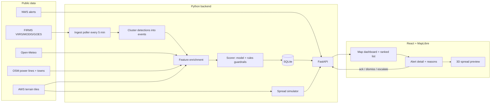

# Firewatch Confirmation Layer — Build Plan

Weekend MVP for [Firewatch 2026](https://wsuinnovationworks.com/) (WSU Innovation Works × Lockheed Martin Skunk Works, Nov 6–8, Woolsey Hall).

Loop we are building: **satellite hotspot → enrich → ML confidence score → map alert → 3D spread preview → operator action**.

---

## 1. What the judges asked for (from the RFP)

The [challenge brief](https://wsuinnovationworks.com/firewatch/firewatch-2026-rfp.pdf) shapes several decisions in this plan:

- **Detect → Confirm → Respond, as one system.** Our product is the *Confirm* layer, plus a *Respond* preview. The pitch must show how the pieces talk to each other.
- **A real customer:** a Kansas rural fire district or the state wildfire agency (Kansas Forest Service). The original spec's "utility operator" becomes a secondary persona (power-line proximity is a feature and an overlay, not the main story).
- **False alarms are a named problem:** "Dust, controlled burns, and haze look like smoke. A system that cries wolf gets switched off." Suppressing Flint Hills prescribed burns and industrial heat sources is our core value.
- **Tell the customer what it costs, how long it takes to stand up, and what it does when it fails.** These get their own slides (section 11).
- **Ground rules:** public data only, civil use, no assumption of unlimited power or connectivity, buildable by a small team in a weekend.

Kansas context worth using in the pitch: the 2017 Starbuck fire (Clark County, ~626,000 acres) and the 2016 Anderson Creek fire (Barber County) were wind-driven grass fires. Kansas terrain is mostly flat, so **wind dominates spread**; slope matters mainly in the Flint Hills and Red Hills. Flint Hills prescribed burning concentrates in March–April and produces a large share of the state's satellite detections.

## 2. Schedule we are planning against (Central time)

| When | Event | What we need ready |
|---|---|---|
| Fri 5:30–9 pm | Kickoff + first work session | Skeleton running end to end on sample data |
| Sat 9 am–12:30 pm | Build | Real enrichment, trained model v1, 3D preview v1 |
| Sat 12:30–1:30 pm | Design review with Lockheed engineers | Working loop + architecture + cost/failure story |
| Sat 2 pm | 8 finalists announced | — |
| Sat 2:30–8 pm | Finalist build | Polish, evaluation numbers, live mode, demo script |
| Sun 11 am | Final slides due in app | Code frozen by 10 am |
| Sun 11:30 am | Finalist pitches | 5-minute demo rehearsed |

## 3. Data sources (all public, verified)

| Need | Source | Key? | Notes |
|---|---|---|---|
| Hotspots (polar) | NASA FIRMS Area API: `VIIRS_SNPP_NRT`, `VIIRS_NOAA20_NRT`, `VIIRS_NOAA21_NRT`, `MODIS_NRT` | Free `MAP_KEY` | `/api/area/csv/{KEY}/{SOURCE}/{w,s,e,n}/{days}`; 5000 transactions / 10 min. US Ultra Real-Time data arrives <60 s after overpass, but only a few overpasses per day. |
| Hotspots (geostationary) | FIRMS `GOES_NRT` | Same key | ~2–3 km pixels, ~30 min latency, scans every 5–10 min. Gives repeat looks between polar passes. Provisional data. |
| Historical hotspots (training) | FIRMS yearly country CSVs (VIIRS/MODIS, US) | None | e.g. `https://firms.modaps.eosdis.nasa.gov/data/country/viirs-snpp/2023/viirs-snpp_2023_United_States.csv` (~31 MB). Download 2016–2024, filter to the Kansas bounding box. SP data includes a `type` field (2 = static land source), useful for negatives. |
| Weather, live + historical | [Open-Meteo](https://open-meteo.com/) forecast and archive APIs | None | Wind speed/direction/gusts, RH, temperature, precipitation, CAPE, weather code. Same variables for training and serving, which avoids train/serve skew. 10k calls/day free. |
| Fire weather alerts (live only) | NWS `api.weather.gov/alerts` | None (User-Agent header) | Red Flag Warnings for display. For the model we compute our own grassland fire danger proxy so historical and live features match. |
| Lightning | Proxy: Open-Meteo thunderstorm weather codes (95–99) and CAPE over prior 24 h | None | Stretch: GOES GLM flashes from NOAA's AWS open data bucket. |
| Terrain | AWS Terrain Tiles (Terrarium PNG, `elevation-tiles-prod`) | None | Drives MapLibre 3D terrain in the browser and slope for the spread model on the backend. |
| Infrastructure | OpenStreetMap via Overpass: `power=line` (≥115 kV), `power=substation`, `place=town` | None | Pull once for Kansas, cache as GeoJSON. HIFLD Open shut down in 2025; an archived copy exists if needed. |
| Labels | NIFC WFIGS Incident Locations (ArcGIS REST) | None | Verified: 891 Kansas incidents, **669 wildfire (`WF`) and 222 prescribed (`RX`)**, with discovery time, size, and point of origin. Records start in 2014. |

Kansas bounding box: `-102.05,36.99,-94.59,40.00`.

## 4. Architecture



Key design choice: **alerts are per event, not per pixel.** Detections within ~2 km and 12 h are clustered into one event. A dispatcher should see "one fire, seen 4 times by 3 satellites," not 40 dots. Multi-pass and cross-sensor agreement then becomes a strong confirmation feature.

### Stack

- **Backend / ML:** Python 3.11+, FastAPI, pandas, numpy, scikit-learn, XGBoost, SQLite, APScheduler for the poller, httpx.
- **Frontend:** React + Vite + TypeScript, MapLibre GL JS (no token), deck.gl for overlays. Basemap from CARTO Dark Matter; Esri World Imagery for the 3D view. Mapbox is an option if someone already has a token, but it isn't required.
- **3D:** the same MapLibre map with terrain enabled and pitched to 60°, so the 2D dashboard and 3D preview share one library. Cesium was rejected because it needs an Ion token and is a second stack to learn. Three.js from scratch was rejected because terrain draping would take too long.
- **Decided:** React frontend (not Streamlit). Detailed specs live in [DESIGN.md](DESIGN.md).
- **Hosting:** local + ngrok for the demo; Render or Railway free tier as a stretch.

### Repo layout

```
backend/
  app/
    main.py              FastAPI app, routes
    config.py            env: FIRMS_MAP_KEY, MODE=live|sample, BBOX
    db.py                SQLite schema: detections, events, alerts, actions
    ingest/firms.py      poll FIRMS sources, dedupe
    ingest/weather.py    Open-Meteo current + archive
    ingest/nws.py        Red Flag Warnings
    features/cluster.py  detections -> events
    features/enrich.py   build feature vector per event
    features/terrain.py  elevation/slope from terrain tiles
    features/infra.py    distance to power lines, substations, towns, static sources
    scoring/rules.py     baseline + guardrails
    scoring/model.py     load model, predict, per-feature contributions
    sim/spread.py        arrival-time grid + isochrones
  data/                  cached GeoJSON layers, sample events, model artifact
ml/
  build_dataset.py       FIRMS history + WFIGS labels + weather -> training table
  train.py               train, calibrate, evaluate, export model
  report.md              metrics and feature importance for the pitch
frontend/
  src/
    api.ts
    Dashboard.tsx        map + filters + ranked list
    AlertDetail.tsx      score, reasons, actions, history
    Spread3D.tsx         terrain, wind, animated spread, controls
docs/PLAN.md
```

### API

| Method | Path | Purpose |
|---|---|---|
| GET | `/alerts?min_score=&status=&since=` | Ranked events for the map and list |
| GET | `/alerts/{id}` | Detections, features, score, top reasons, action history |
| POST | `/alerts/{id}/actions` | `{action: ack \| dismiss \| escalate, note, operator}`; timestamped and logged |
| GET | `/alerts/{id}/simulate?minutes=60&wind_speed=&wind_dir=` | Spread isochrones as GeoJSON; optional wind override |
| GET | `/layers/{name}` | Power lines, substations, static sources |
| GET | `/health` | Last successful pull and data age per source (drives "degraded" banners) |
| POST | `/ingest/run` | Manual trigger, useful in the demo |

`MODE=sample` serves frozen fixtures through the exact same pipeline, so the demo never depends on a live overpass or the venue Wi-Fi.

## 5. ML scorer

### What the score means

The score is **not** "is this pixel hot." FIRMS already answers that. Our score is the probability that **this event is an uncontrolled wildfire that warrants a response**, scaled 0–100. That framing is what separates us from raw FIRMS:

| Event type | Example | Desired outcome |
|---|---|---|
| Static heat source | Refinery flare (El Dorado, McPherson, Coffeyville), ethanol plant | Monitor (suppressed) |
| Prescribed / ag burn | Flint Hills pasture burn in April, calm wind, moderate humidity | Monitor or Investigate |
| Threatening wildfire | Red-flag day, gusty south wind, low humidity, near a town or transmission line | Escalate |

Recommendation thresholds, tunable per district: **Escalate ≥ 70, Investigate 40–69, Monitor < 40.**

### Features (per event)

- **Detection:** max/sum fire radiative power, brightness, sensor confidence, pixel size (scan × track), day/night, local hour.
- **Confirmation:** number of detections, number of distinct satellites, minutes since first seen, growth in FRP or footprint between passes.
- **Weather:** wind speed, gusts, direction, relative humidity, temperature, precipitation in the prior 72 h, computed grassland fire danger proxy.
- **Lightning proxy:** thunderstorm weather codes or high CAPE in the prior 24 h.
- **Context:** day of year (prescribed-burn season), Flint Hills flag, elevation and slope, distance to nearest transmission line, substation, and town, distance to known static heat source.

Static heat sources are derived ourselves: 1 km grid cells with detections on many distinct days across many months of the historical record (plus FIRMS `type = 2` where present).

### Labels

1. **Wildfire (positive):** FIRMS event within ~3 km and −12 h/+48 h of a WFIGS `WF` incident.
2. **Prescribed burn (negative):** matched to a WFIGS `RX` incident.
3. **Static source (negative):** in the static-source mask.
4. **Unmatched events:** excluded from the primary training set. Kansas rural fires are often not entered in IRWIN, so "unmatched" doesn't mean "not a fire."

If the matched set is too small by Saturday 10 am, augment with clearly labeled synthetic events generated from rules (for example, red-flag weather + rapid growth = wildfire). The pitch will say so plainly.

### Model and explainability

- **v0 (Friday):** hand-weighted rules producing a 0–100 score, so the UI has something real to rank.
- **v1 (Saturday morning):** XGBoost classifier with a logistic regression baseline, calibrated probabilities, and a **temporal split** (train ≤ 2022, test 2023–2024) so we don't leak the same fire into train and test.
- **Reasons:** XGBoost's built-in per-prediction contributions (`pred_contribs`) give the top 3 drivers per alert, e.g. "+18 gusts 45 mph, +12 RH 14%, −9 inside Flint Hills burn season." No extra SHAP dependency needed.
- **Guardrails stay as rules:** an event touching a transmission line or within 1 km of a town is never below Investigate. Deterministic overrides are easier to defend to a dispatcher than model weights.
- **Report:** ROC-AUC, precision in the top 10 alerts per day, false-alarm reduction versus "alert on every FIRMS pixel," and feature importance chart.

**Pitch stat to compute:** for matched Kansas wildfires, compare first satellite detection time against the WFIGS discovery time. Report the result honestly, whether satellite detection comes before or after the reported discovery.

## 6. 3D spread preview

Goal: an intuitive "where could this go in the next 30–60 minutes" picture. Not a physics model, and labeled as such on screen.

**Model (backend, `sim/spread.py`):**

1. Build a ~12 × 12 km grid at ~60 m (about 200 × 200 cells) around the event, with slope from the terrain tiles.
2. Head-fire rate of spread from a grassland model driven by wind speed and dead-fuel moisture (estimated from temperature and RH). The CSIRO grassland model (Cheney et al. 1998) is the reference; check constants before using.
3. Elliptical fire shape: flank and back spread derived from a wind-based length-to-breadth ratio.
4. Slope adjustment: rate of spread roughly doubles per 10° upslope.
5. Compute fire arrival time per cell with a direction-aware Dijkstra over 16 neighbors (40k cells runs in well under a second in numpy + heapq).
6. Return isochrones every 5 minutes as GeoJSON polygons (contours of the arrival-time grid) plus the wind vector and assumptions used.

**Frontend (`Spread3D.tsx`):**

- MapLibre with Terrarium terrain, satellite imagery, pitched camera flying to the event.
- Isochrones draped on terrain and colored by time; animated growth from 0 to 60 minutes.
- Wind shown as animated particles or arrows (deck.gl).
- Power lines, substations, and towns overlaid, with "reaches the 345 kV line in about 35 min" callouts when an isochrone intersects an asset.
- Controls: time scrub slider (client-side, instant), wind speed and direction override (re-calls `/simulate`, target < 500 ms), reset to observed.

## 7. Dashboard and alert actions

- Map of events colored by recommendation, sized by score; Monitor events hidden by default behind a "show suppressed" toggle.
- Ranked list with score, top reasons, county, age, and source count.
- Filters: minimum score, status (new / acknowledged / escalated / dismissed), time window.
- Detail panel: score breakdown, detection timeline, weather snapshot, nearest assets, **Open 3D preview** button, action buttons with a note field.
- Every action is written to SQLite with timestamp, operator name, and note, and shown in the alert's history. This feeds the "learn from dispatcher feedback" story.
- Data freshness banner from `/health`: "FIRMS last updated 7 min ago" or "Weather unavailable, scoring in degraded mode."

## 8. Sample mode (demo insurance)

Freeze 8–10 events to JSON, each with detections, weather, and expected outcome, so the full pipeline runs offline:

| Event | Expected result | Why it's in the demo |
|---|---|---|
| Starbuck fire ignition, Mar 2017, Clark County | Escalate | Real Kansas catastrophe, extreme wind |
| Anderson Creek fire, Mar 2016, Barber County | Escalate | Red Hills terrain shows slope effect |
| Dec 15, 2021 wind event fires, central Kansas | Escalate | Winter fire, very high gusts |
| 2–3 Flint Hills April prescribed burns | Monitor / Investigate | The false-alarm story |
| Refinery or ethanol plant hotspot | Monitor | Static source suppression |
| Synthetic ignition beside a 345 kV line | Escalate (guardrail) | Utility persona |
| Synthetic low-FRP single detection, humid day | Monitor | Low-confidence contrast |

Exact dates and coordinates are confirmed from FIRMS archive and WFIGS during data prep. A "replay" button streams these events in over ~60 seconds so the map fills up live during the pitch.

## 9. Team workstreams

Assumes 4–6 people. Non-engineering work is half the score per the RFP.

| Workstream | Owns | First deliverable (Fri night) |
|---|---|---|
| Data & ingestion | FIRMS, Open-Meteo, OSM layers, sample fixtures, historical download | Kansas hotspots for the last 5 days in SQLite; power lines GeoJSON |
| ML | Labels, training table, model, report | Rules v0 scorer; WFIGS ↔ FIRMS matching script |
| Backend + simulation | FastAPI, clustering, `/simulate` | API serving sample alerts; spread grid prototype |
| Frontend | Dashboard, detail panel, 3D view | Map rendering sample alerts from the API |
| Customer, cost & pitch | Dispatcher workflow, cost model, failure modes, deck, demo script | One-page customer profile (Kansas rural fire district) |

## 10. Milestones and cut lines

**M1 — Friday 9 pm (must):** repo runs locally with one command per side; sample events flow API → map; rules v0 scores; FIRMS key works for a live Kansas pull; historical CSV download started.

**M2 — Saturday 12:30 pm, design review (must):** real enrichment (weather, distances, terrain); XGBoost v1 with reasons; 3D view with animated isochrones; actions logged. Architecture diagram plus cost and failure slide ready.

**M3 — Saturday 8 pm (high):** wind override and time scrub; evaluation report with temporal split; live mode polling every 5 min; health and degraded banners; 5-minute demo rehearsed once.

**M4 — Sunday 10 am:** code frozen, slides submitted by 11 am.

**Cut first if behind:** GOES source, lightning, NWS banner, hosting, multiclass model. **Never cut:** sample mode, reasons on each alert, 3D animation, actions.

## 11. Cost, stand-up, and failure (the slides the RFP explicitly asks for)

**Cost:** all data is free and public. One small cloud VM (~$10–25/month) covers the whole state, all 105 counties. A rural district needs only a browser; no fiber, sensors, or full-time operator.

**Stand-up:** about a day: set the district boundary, load local assets (towns, lines, critical facilities), set alert contacts, and tune thresholds against last season's events.

**Failure behavior (fail visible, never silent):**

| Failure | Behavior |
|---|---|
| FIRMS down or delayed | Banner with data age; GOES still feeds repeat looks; unscored hotspots still shown as "unscored" |
| Weather API down | Score with detection + context features only; alert marked "degraded confidence" |
| Cloud cover / no overpass | Shown as a coverage gap, not "no fire"; 911 calls remain the primary path |
| Field connectivity poor | Alerts are small text payloads (SMS/email-ready); dashboard is optional |
| Model wrong | Human always decides; guardrail rules near towns and lines; dismiss/escalate actions logged for retraining |

## 12. Demo script (under 5 minutes)

1. **The problem (30 s):** Kansas grass fires; 911 calls come late; raw FIRMS for Kansas on a spring day is dozens of dots, mostly prescribed burns.
2. **Ingest (30 s):** hit replay; events stream onto the map.
3. **Confirm (60 s):** ranked list. The Starbuck-like event scores 91 with reasons; a Flint Hills burn scores 22; a refinery scores 5. Toggle "show suppressed" to show what we filtered.
4. **Respond preview (90 s):** open 3D; spread animates toward a town and a transmission line; change the wind direction and watch the forecast swing.
5. **Act (30 s):** escalate with a note; show the logged history.
6. **Why trust it (60 s):** evaluation numbers, feature importance, cost/stand-up/failure slide.

## 13. Positions on the spec's open questions

- **Primary customer (decided):** Kansas rural fire district dispatch, with the Kansas Forest Service as the statewide operator. Utilities are a secondary persona, served by the same alerts plus the asset overlay.
- **Satellite latency and gaps:** stated honestly. Polar orbiters pass a few times a day; GOES fills gaps at coarse resolution. This layer complements 911 calls, not replaces them.
- **Thin labels:** temporal split, a simple model, honest synthetic augmentation, and rules guardrails.
- **Thresholds dispatchers trust:** start at 70/40, show calibration, let each district tune them, and log every override.
- **Human review:** always in the loop. The system ranks and explains; people decide.

## 14. Setup checklist (before or at kickoff)

- [ ] Request a FIRMS `MAP_KEY` (free, instant by email): https://firms.modaps.eosdis.nasa.gov/api/map_key/
- [ ] Add every teammate as a collaborator on the GitHub repo
- [ ] Start downloading FIRMS yearly US VIIRS/MODIS CSVs (~30 MB each; keep them out of git)
- [ ] Pull Kansas OSM power lines, substations, and towns via Overpass, save as GeoJSON
- [ ] Confirm Python 3.11+ and Node 20+ on every laptop
