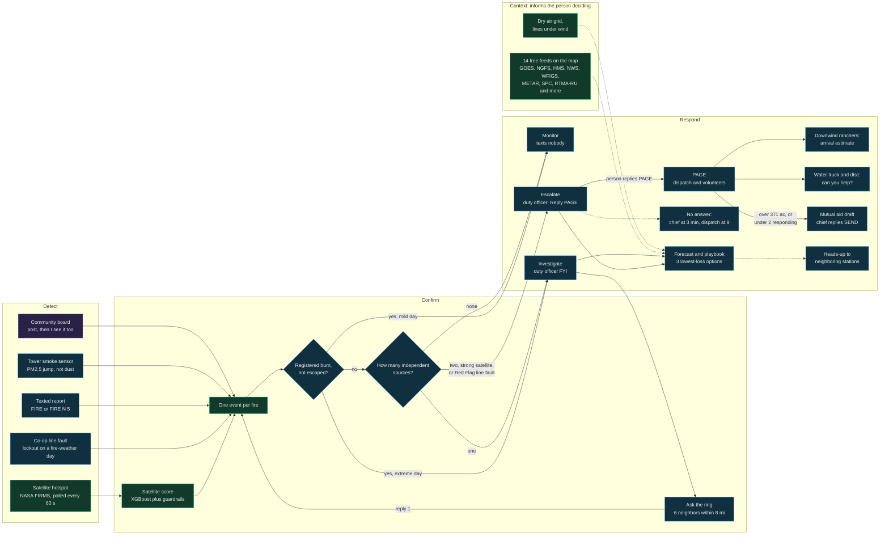
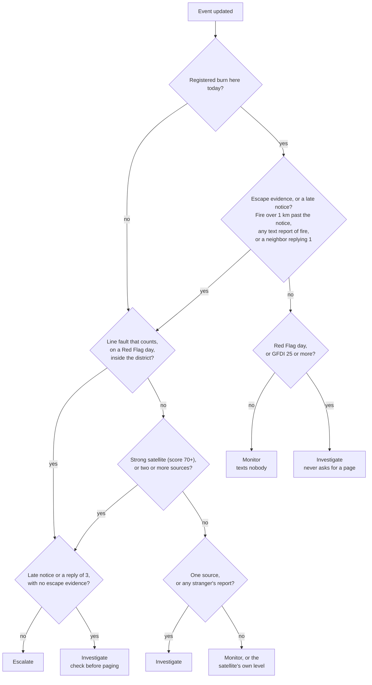
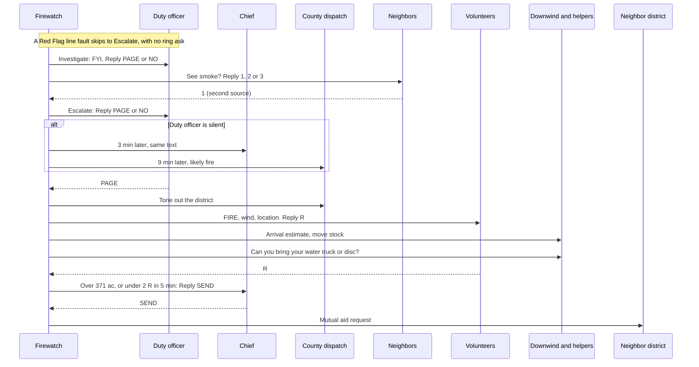
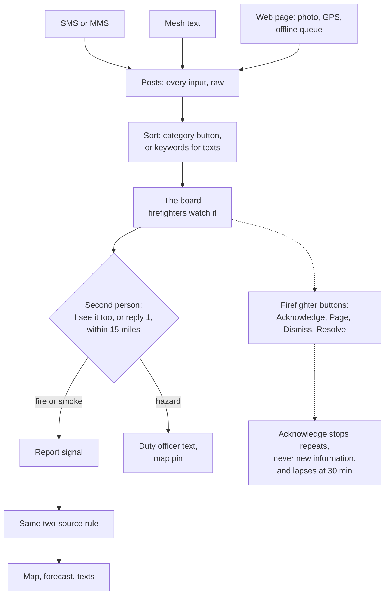
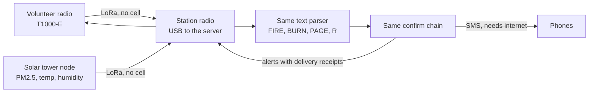

# Firewatch system flows

The README diagram stays the short version. This file is the long version: every flow across every branch, plus the community board. For the pitch, open [system-map.html](system-map.html) in a browser. It is the one-screen version, built with Archify from `system-map.architecture.json`.

Everything here follows the code, not the older docs. Where the two disagree, the list at the end says so.

**Status colors used below**

| Color | Meaning |
|---|---|
| Green | Live: runs on real data today |
| Blue | Simulated: built, but only run in replay or against fakes |
| Purple, dashed | Building: community board work under way |
| Gray, dashed | Planned: documented only |

## 1. The whole system

## 2. Confirm: how a level is decided

This is `decide_level` in `backend/app/confirm.py`. The order matters.

**What counts as one independent source**

| Input | Counts when | Note |
|---|---|---|
| Satellite | Score 40 or more | 70 or more is strong and escalates alone. Under 40 does not count. |
| Line fault | Lockout, over 1 km from a town, GFDI 12 or more | A momentary trip does not count. On a Red Flag day, inside the district, it escalates alone, unless a registered burn with no escape evidence covers it. |
| Registered contact's report | Always | One source per person. |
| Neighbor reply 1 | Always | One source per person. Reply 2 is logged and lowers nothing. |
| Smoke sensors | Rule passes | All sensors together are one source. |
| NOAA NGFS | Labeled wildland, seen in two scans, no registered burn covers it | Same source class as a satellite, never strong, so alone it reaches Investigate. |
| Stranger's report | Never a full source | Weak. Reaches Investigate, never Escalate. |

## 3. Respond: from the first text to mutual aid

The expected-loss playbook sits beside this on the dashboard (`andrew` branch). It ranks options for the person deciding. A person still chooses, and `PAGE` by text works with or without it.

## 4. Community board (building)

These rules come from the board plan. The bearing parser (`where.py`), the wider ring, posts, the keyword sorter, the confirm logic, the unconfirmed-post timer and the send limits exist on `michael-board`. The acknowledge hold is in. The board page and member approval do not exist yet.

Two members reach Escalate. Two strangers stay at Investigate, so a person looks before anything pages. The crowd can raise an item, and only the station can lower it.

## 5. No cell bar: the mesh path

The field side needs no cell bar. The station side still needs its server, its radio, and internet for SMS and satellite data. A radio with no roster contact counts as a stranger, so it reaches Investigate at most. Mesh and sensors have only run against simulated radios and packets.

## Which branch holds what

No single branch runs the whole chain yet. Merging `michael` and `michael-board` today conflicts in seven files, including `confirm.py` and `scenario.py`.

| Piece | `main` | `andrew` | `michael` | `michael-board` |
|---|---|---|---|---|
| Core chain, ML score, replay | Yes | Yes | Yes | Yes |
| Mesh bridge, tower sensors | Yes | No | No | Yes |
| Free data feeds | No | Yes, older copy | Yes | Yes |
| NGFS feed, packet scenarios, alert load | No | No | Yes | Yes |
| Bearing parser, wider ring, ring scenarios | No | No | No | Yes |
| Playbook, forecast v2, fire-day model | No | Yes | No | No |
| Red Flag rule, evidence-only burn escape, NGFS signal | No | No | Yes | No |
| Community board posts and page | No | No | No | No, in build |

`isak`, `preston` and `shane` have nothing beyond `main`.

## Where the code differs from older docs

| Doc says | Code does |
|---|---|
| README Detect box lists GOES | FIRMS is the only satellite feed the model scores. GOES is context on the map, and NGFS can count as the satellite source. |
| `DESIGN.md`: voice call to dispatch at 6 min | Text to dispatch at 9 min |
| `DESIGN.md`: reply 3 registers a burn | Reply 3 drops Escalate to Investigate |
| `DESIGN.md`: helpers reply 1 | Helpers reply R |
| `DESIGN.md`: downwind includes anyone within 2 miles | Downwind means contacts the fire reaches within the forecast window |
| README and `main`: ask 3 neighbors within 3 miles | 6 neighbors within 8 miles on `michael-board`, because the packet says nobody is within 4 miles |
| README: first truck T+40, 220 vs 520 acres | Forecast v2 on `andrew`: first truck T+38, 329 vs 954 acres (spread model estimate) |
| README: registered burns are suppressed | True on a mild day. On a Red Flag day or at GFDI 25 or more, a burn with no escape evidence goes to Investigate, and never Escalate. |
| README: escalation needs two independent signals | A line fault on a Red Flag day, inside the district, escalates on one source |
