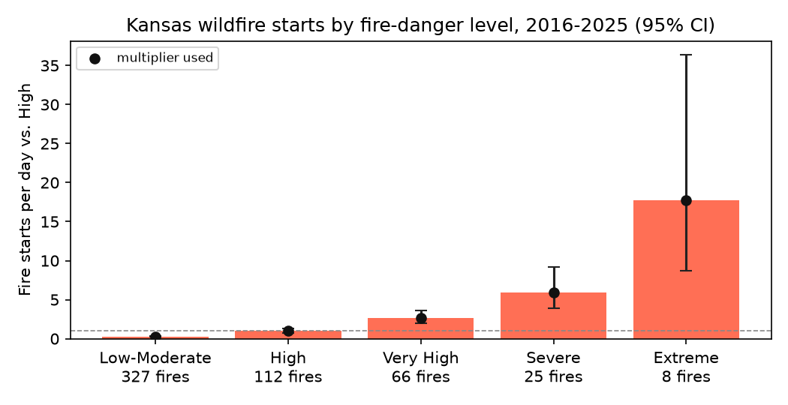
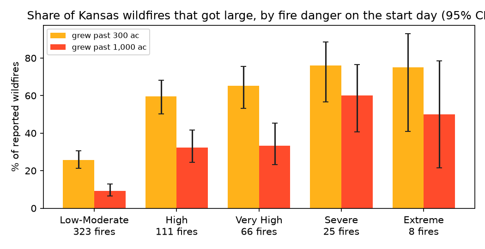

# Fire-day model v1

Generated 2026-11-07T03:07:14+00:00 by `backend/ml/fire_day.py`. Model file: `backend/data/model/fire_day.json`.

This model answers two questions about the **day**, not the individual fire:

1. **Ignition:** on a day at a given fire-danger level, how many more wildfires start than on a High day? The answer replaces the hand-set "danger multiplier" in the recommendation model (see [How Firewatch recommends actions](../RECOMMENDATIONS.md)).
2. **Consequence:** of the fires that started at that level, what share grew past 300 and 1,000 acres? It's shown next to the spread forecast as a historical check, but not used in the expected loss.

## Data

| | |
|---|---|
| Fires | NIFC WFIGS Incident Locations, POOState = US-KS, IncidentTypeCategory = WF. Downloaded 669; used **538** (skipped: 124 outside 2016-2025, 7 outside Kansas box). |
| Period | 2016-01-01 to 2025-12-31 (discovery date, Central time) |
| Weather | Open-Meteo historical archive (daily Tmax, min RH, max 10 m wind), on a 1° grid over the Kansas box (21 points). Each fire takes its nearest grid point's weather on its discovery date. |
| Fire danger | McArthur grassland fire danger index (the app's `fire_weather.gfdi`) from daily max temperature, min humidity and max wind, with the app's seasonal grass-curing table, banded as the app bands it. |
| Causes in the data | FireCause: Human: 479, Undetermined: 29, Natural: 23, blank: 5, Unknown: 2. FireCauseGeneral: blank: 533, Debris/Open Burning: 2, Lightning: 1, Other Human Cause: 1, Utilities: 1. |

## Method

**Exposure.** Every grid point on every day is one point-day, banded by that day's fire danger. Points are evenly spaced, so a band's share of point-days is its share of Kansas land-time.

**Ignition rate.** For each band, divide the fires that started on that band's days by the band's point-days. Then divide by the same rate for High days to get the relative rate (RR). The 95% interval treats both counts as Poisson: log-normal, with standard error √(1/k + 1/k₀).

**Multiplier used by the app.** The RR, with two guards:
- a band with fewer than 5 fires uses the band below's rate
- the multiplier never decreases as danger rises, since small counts can't show that more danger means fewer fires

High is fixed at 1.

**Large fires.** The share of each band's fires (those with a reported size) at or above 300 and 1,000 acres, with Wilson 95% intervals.

## Results

### Ignition: fire starts per day, relative to High

| Danger | GFDI seen | Point-days (share) | Fires | Fires per 10k point-days | RR | 95% CI | Multiplier used |
|---|---|---|---|---|---|---|---|
| Low-Moderate | 0.1–12.0 | 68,545 (89.3%) | 327 | 47.71 | 0.27 | 0.22–0.34 | **0.27** |
| High | 12.0–25.0 | 6,456 (8.4%) | 112 | 173.48 | 1.0 | 0.77–1.30 | **1.0** |
| Very High | 25.0–50.0 | 1,444 (1.9%) | 66 | 457.06 | 2.63 | 1.94–3.57 | **2.63** |
| Severe | 50.0–99.1 | 242 (0.3%) | 25 | 1033.06 | 5.95 | 3.86–9.19 | **5.95** |
| Extreme | 101.4–200.9 | 26 (0.0%) | 8 | 3076.92 | 17.74 | 8.66–36.34 | **17.74** |



Adjustments made before use:
- None.

### Consequence: share of fires that got large

| Danger on start day | Fires with a size | ≥ 300 ac (share, 95% CI) | ≥ 1,000 ac (share, 95% CI) |
|---|---|---|---|
| Low-Moderate | 323 | 83 (26%, 21%–31%) | 30 (9%, 7%–13%) |
| High | 111 | 66 (60%, 50%–68%) | 36 (32%, 24%–42%) |
| Very High | 66 | 43 (65%, 53%–76%) | 22 (33%, 23%–45%) |
| Severe | 25 | 19 (76%, 57%–88%) | 15 (60%, 41%–77%) |
| Extreme | 8 | 6 (75%, 41%–93%) | 4 (50%, 22%–78%) |



## From fire starts per day to odds per line fault

The RR above counts fire starts per day of land. The recommendation model needs something else: the chance that **one line fault** starts a fire. On a windy, dry day both of these rise:

> fire starts per day from lines = line faults per day × chance each fault ignites

The RR measures their product. Public data can't split it (co-op outage logs would), so the app gives each factor half of the increase in log terms:

> per-fault multiplier = RR ^ `danger_exponent`, default 0.5

| Danger | RR (per day) | Per-fault multiplier (^0.5) | Lockout's starting P(fire) at the 3% base rate |
|---|---|---|---|
| Low-Moderate | 0.27 | 0.52 | 1.6% |
| High | 1.0 | 1.00 | 3.0% |
| Very High | 2.63 | 1.62 | 4.9% |
| Severe | 5.95 | 2.44 | 7.3% |
| Extreme | 17.74 | 4.21 | 12.6% |

**Does the exponent matter?** On the Cottonwood Creek scenario (an Extreme day), the starting P(fire) for the lockout is 3% at exponent 0, 13% at 0.5 and 53% at 1. **The recommendation is the same at every point under all three:**
- minute 0: heads-up downwind and wait for the neighbors
- minute 8, after a neighbor sees smoke: page
- minute 9: request mutual aid now

Only the stated confidence changes. The exponent is a district setting (`decision.danger_exponent`) and is listed under "How this is decided" in the app.

## How the app uses it

- `app/decision.py` loads `danger_multiplier` from the model file. If the file is missing, it falls back to hand-set per-fault values (Low-Mod 0.3, High 1, Very High 1.5, Severe 2, Extreme 3). The line-fault base rate is multiplied by the per-fault multiplier above.
- The large-fire share for today's band is shown on the alert ("On days like this, X% of reported Kansas wildfires grew past 1,000 ac"). It isn't part of the expected loss: the spread forecast already gives this fire's likely acres from its own wind, fuel and terrain, and adding the historical share would count the weather twice.

## Limits (read before quoting a number)

- **Reporting bias.** WFIGS records only fires that reached a federal or state incident system. Kansas fire departments respond to thousands of fires a year that never appear in it. Bigger fires are likelier to be reported, and fires on bad days are likelier to be big, so the RR at high danger is probably **overstated**. Absolute rates (fires per point-day) mean nothing; only the ratios are used.
- **Not power-line specific.** The cause fields are almost all "Human" or blank, so the RR is for all causes. The app applies it to line faults on the assumption that weather raises line-fault ignitions at least as much as all ignitions, which the Plains megafires suggest. It can't be checked with public data, and co-op outage records would be needed.
- **Coarse weather.** A 1° grid with daily extremes (max temperature, min humidity, max wind) that don't happen at the same hour. Daily-extreme GFDI runs higher than an afternoon reading, so bands shift up for everyone. That affects numerator and denominator alike, so ratios hold up better than levels.
- **Curing is a seasonal table,** not observed greenness. Drought years and green springs are treated alike.
- **Our GFDI is the Australian McArthur index,** not the NWS Grassland Fire Danger Index that Kansas forecasters publish. The bands have the same names but different scales.
- **Small counts** at the extreme end: see the intervals. The multiplier guards keep a noisy band from producing a nonsensical value; they don't make it precise.

## Rebuild

```bash
cd backend
.venv/bin/pip install -r requirements-ml.txt
.venv/bin/python -m ml.fire_day     # first run downloads ~21 weather series (cached in ml/data/fire_day/)
```
