# Scorer v1 training run: research report

**Model:** `xgb-v1` (`backend/data/model/xgb_v1.json`, trained 2026-11-06 23:59 UTC by `ml/train.py`)
**Analyses:** `backend/ml/analyze.py`, numbers in `backend/ml/analysis.json`, figures in `figures/scorer-v1/`
**Data:** 1,913 feature snapshots of 1,114 Kansas fire events, 2016–2025

## Summary

The v1 scorer separates reported wildfires from prescribed burns reasonably well, but less well than its headline number suggests. Most of the remaining error traces back to one design choice: how the training data labels unreported spring fires in the Flint Hills.

1. **Headline accuracy holds up, with wide error bars.** On the held-out years (2023–2025), ROC-AUC for wildfire vs all burns is 0.837, with a 95% interval of 0.77–0.90. Against *reported* prescribed burns only, the stricter test, it is 0.72 (0.62–0.82). The test set has 61 wildfires and 41 reported burns, so differences of a few points are noise.
2. **XGBoost and logistic regression are effectively tied.** Logistic regression is ahead on the test years (0.872 vs 0.837), but XGBoost is ahead on leave-one-year-out across 2016–2022 (0.846 vs 0.793). The bootstrap interval for the test-year gap includes zero. XGBoost clearly beats the rules scorer against reported burns: +0.12 ROC-AUC, interval +0.01 to +0.23.
3. **The weak Flint Hills labels teach the model "Flint Hills means burn."** All 400 weak negatives sit inside the Flint Hills in March–April by construction, and `in_flint_hills` became the model's strongest feature, worth about ±1 log-odds. As a result, real Flint Hills wildfires are scored low (the five worst-scored test wildfires are all April 2023 Flint Hills fires). Reported prescribed burns just outside the region are scored high (all eight top false alarms).
4. **Dropping the weak negatives improves the strict metric on both views:** against reported burns, 0.72 → 0.81 on the test years and 0.775 → 0.818 leave-one-year-out. The cost is the ability to quiet unreported Flint Hills spring burns (0.89 → 0.68). That job may be better done by burn notices and the existing suppression rule than by the model.
5. **Tuning won't fix this.** Across a 12-setting grid over depth and boosting rounds, leave-one-year-out ROC-AUC varies by at most 0.04, and no setting beats v1 by more than 0.006. Ten random seeds move the test ROC-AUC by less than 0.01.
6. **At the deployed thresholds,** 87% of test wildfires reach Investigate or higher within 24 hours, and 61% reach Escalate. However, 59% of reported prescribed burns also reach Investigate or higher, and 20% reach Escalate. The heat-source guardrail is doing real work: without it, 44% of industrial heat-source snapshots would be at Investigate or higher.

## 1. What was trained

| Item | Setting |
|---|---|
| Task | Wildfire (1) vs burn (0) for a satellite-detected fire event |
| Positives | Events matched to an NIFC WFIGS wildfire (`WF`) within 3 km and −12 h/+48 h of reported discovery |
| Negatives | Events matched to a WFIGS prescribed fire (`RX`), plus unreported Flint Hills fires in March–April ("weak" negatives), down-weighted so all weak negatives together count as much as the reported burns |
| Evaluation only | Events within 1 km of a persistent industrial heat source (refineries, plants) |
| Rows | Up to 3 snapshots per event in its first 24 h (first pass, second pass, last pass) |
| Features | 27: satellite (fire radiative power, detections, passes), weather (wind, gusts, humidity, rain, fire danger index), terrain, distance to towns and power lines, `in_flint_hills`, time of year |
| Model | `XGBClassifier`, depth 3, 300 rounds, learning rate 0.05, subsample 0.8, class-balanced |
| Calibration | Platt scaling on grouped out-of-fold margins, to an even wildfire/burn prior |
| Split | Train 2016–2022 (942 rows); test 2023–2025 (636 rows, 396 of them wildfire or burn) |
| Deployed | Refit on all 1,338 wildfire and burn rows; Platt a = 0.822, b = 0.070 |

## 2. Data

No rows were dropped as degraded: every snapshot had weather and terrain.

| Kind | Events | Rows | In Flint Hills | March–April | Median gust (km/h) | Median humidity (%) | Median distance to town (km) | Median max fire power (MW) |
|---|---|---|---|---|---|---|---|---|
| Reported wildfires | 224 | 455 | 32% | 75% | 40.7 | 33.5 | 8.7 | 19.0 |
| Reported prescribed burns | 90 | 181 | 27% | 71% | 28.6 | 40.0 | 6.6 | 14.5 |
| Unreported Flint Hills spring fires | 400 | 702 | 100% | 100% | 32.0 | 37.0 | 8.2 | 8.0 |
| Industrial heat sources | 400 | 575 | 36% | 16% | 20.7 | 70.0 | 2.9 | 1.2 |

Two things in this table matter for everything that follows:

- **Among reported fires, the Flint Hills barely separates wildfires from burns** (32% vs 27% inside). The region only becomes predictive once the weak negatives are added, and they are 100% inside the region by definition.
- **Reported prescribed burns are scarce:** 90 events in ten years, with none in 2020, one in 2017, and two in 2018. Wildfires average about 22 per year.

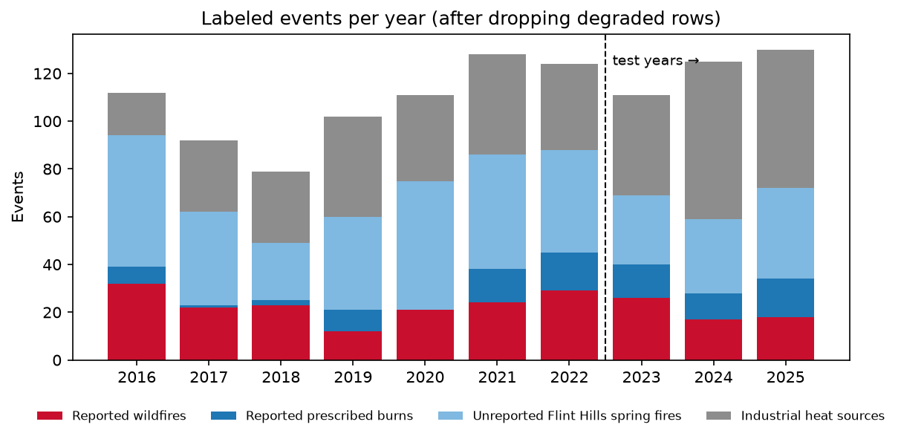

## 3. Headline results, with uncertainty

The confidence intervals come from 2,000 bootstrap resamples of the 200 test-year events. All snapshots of an event are resampled together, so repeated looks at one fire don't count as independent evidence.

| Scorer | Wildfire vs all burns | 95% interval | Wildfire vs reported burns | 95% interval |
|---|---|---|---|---|
| xgboost (v1) | 0.837 | 0.77–0.90 | 0.720 | 0.62–0.82 |
| logistic regression | 0.872 | 0.81–0.92 | 0.784 | 0.69–0.86 |
| rules-v0 | 0.787 | 0.72–0.85 | 0.603 | 0.50–0.70 |

| Comparison (paired bootstrap) | All burns: difference (95% interval) | Reported burns: difference (95% interval) |
|---|---|---|
| xgboost − logistic | −0.03 (−0.08 to +0.01) | −0.06 (−0.14 to +0.01) |
| xgboost − rules-v0 | +0.05 (−0.02 to +0.12) | +0.12 (+0.01 to +0.23) |

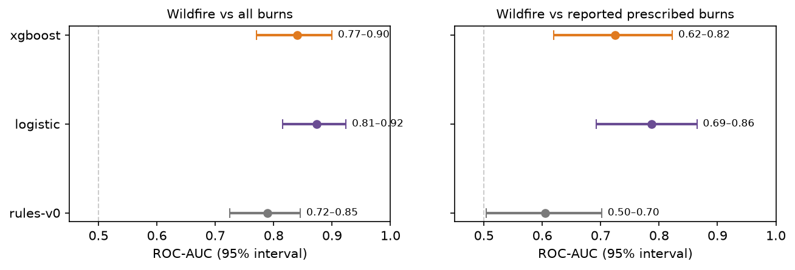

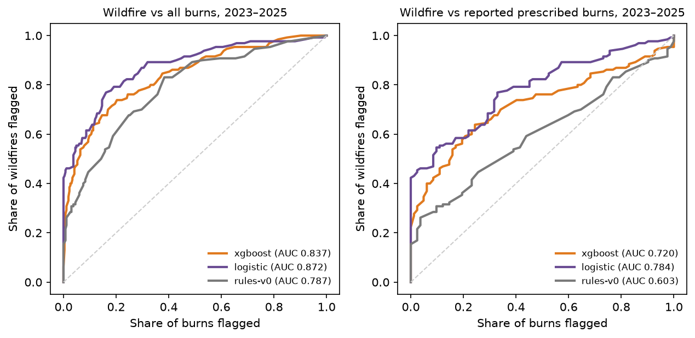

**Snapshot timing.** Scoring at the first pass (0.851) is as good as the overall number, so the model doesn't need to wait for more passes. The last-pass snapshot is weaker (0.723 on 70 rows), and that matters because the app rescores events as passes arrive.

| Snapshot | Rows | xgboost | logistic | rules-v0 |
|---|---|---|---|---|
| First pass | 200 | 0.851 | 0.883 | 0.791 |
| Second pass | 126 | 0.873 | 0.903 | 0.814 |
| Last pass within 24 h | 70 | 0.723 | 0.785 | 0.781 |

## 4. Stability across years

For 2016–2022, each year is scored by a model trained on the other six training years (leave-one-year-out). For 2023–2025, each year is scored by the model trained on 2016–2022.

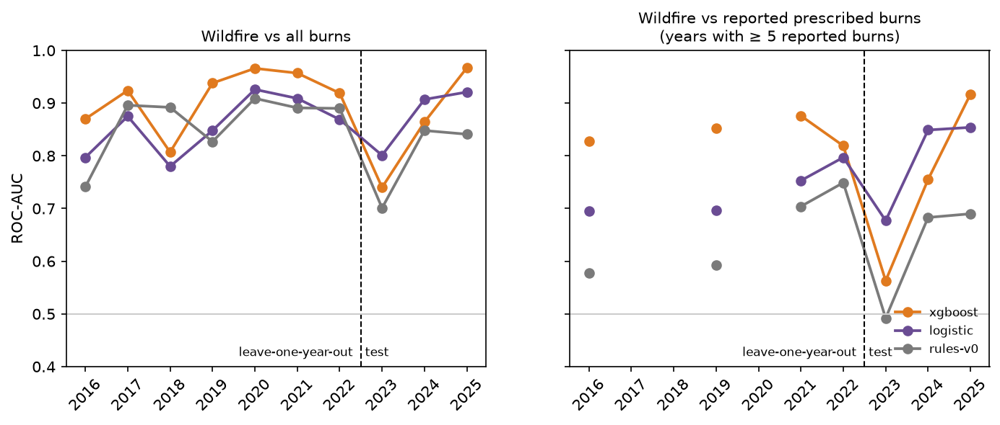

- **2023 is the outlier,** and it drives the gap between the cross-validation numbers (about 0.89 against all burns) and the test numbers (0.84). Against reported burns, XGBoost scores 0.56 in 2023, close to chance, and then 0.76 in 2024 and 0.92 in 2025.
- **Which model wins depends on the period.** Against all burns, XGBoost is ahead in all seven training years and in 2025; logistic regression is ahead in 2023 and 2024. With about 15–30 wildfires and 0–16 reported burns per year, per-year ROC-AUC moves by ±0.1 from sampling alone.
- **2023 is unusual for a specific reason** (next section): several April wildfires inside the Flint Hills, exactly where the training labels say spring fires are burns.

## 5. The Flint Hills labeling problem

### What the model learned

`in_flint_hills` is the deployed model's largest feature by a factor of two. On average it contributes **−0.99 log-odds inside** the Flint Hills and **+1.01 outside**: a two-log-odds swing from a single yes/no flag. Region and season proxies reinforce it (`elevation_m` has a sharp spike at about 330 m, the Flint Hills band, and `doy_cos`). Among reported fires the flag carries almost no information (32% of wildfires vs 27% of burns are inside), so the model learned it from the weak negatives.

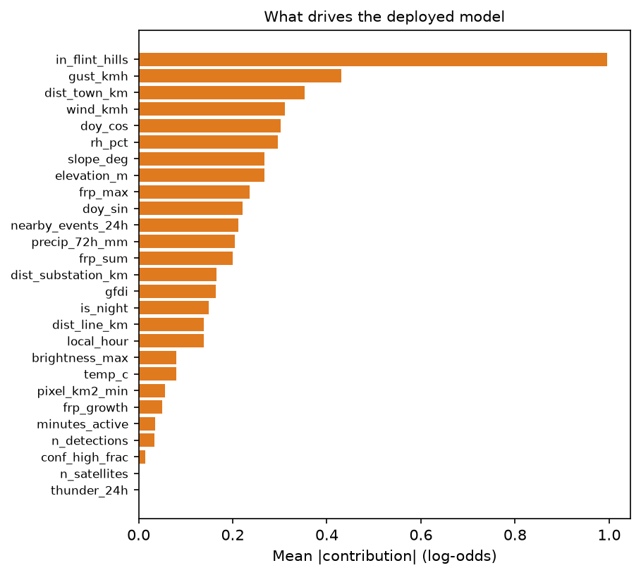

### The errors it causes

These are the lowest-scoring test wildfires and highest-scoring test prescribed burns, using each event's highest score within 24 h:

| Wildfire (missed) | County | Acres | Date | Score | In Flint Hills | Largest contributions (log-odds) |
|---|---|---|---|---|---|---|
| North Pole | Wabaunsee | 600 | 2023-04-11 | 10 | yes | `in_flint_hills` −1.42, `local_hour` +0.50, `rh_pct` −0.41 |
| Deep Creek | Riley | 350 | 2023-03-04 | 10 | yes | `in_flint_hills` −1.05, `dist_town_km` −0.54, `rh_pct` −0.46 |
| Indian Hills | Riley | 500 | 2023-04-07 | 30 | yes | `in_flint_hills` −1.43, `rh_pct` +0.65, `precip_72h_mm` +0.39 |
| Otter Creek | Geary | 700 | 2023-04-10 | 35 | yes | `in_flint_hills` −0.82, `frp_max` +0.64, `rh_pct` +0.61 |
| Wagstaff | Wabaunsee | 2,000 | 2023-04-12 | 38 | yes | `in_flint_hills` −1.24, `frp_max` +0.66, `pixel_km2_min` +0.57 |
| Deerhead East | Barber | 450 | 2024-05-07 | 30 | no | `in_flint_hills` +1.09, `doy_cos` −0.83, `rh_pct` +0.80 |

North Pole also matched a second event the day before, which scored 17.

| Prescribed burn (false alarm) | County | Acres | Date | Score | In Flint Hills | Largest contributions (log-odds) |
|---|---|---|---|---|---|---|
| South 19th RX | Coffey | 692 | 2023-04-21 | 93 | no | `in_flint_hills` +1.65, `rh_pct` +0.63, `dist_line_km` −0.52 |
| North Burgess RX | Lyon | 85 | 2024-03-20 | 91 | no | `in_flint_hills` +1.11, `wind_kmh` +1.10, `pixel_km2_min` +0.74 |
| Troublesome RX | Coffey | 80 | 2025-05-15 | 82 | no | `wind_kmh` +1.10, `in_flint_hills` +0.99, `doy_cos` −0.79 |
| Sargent RX | Coffey | 684 | 2023-04-23 | 80 | no | `in_flint_hills` +1.27, `elevation_m` +0.94, `gust_kmh` −0.45 |
| Burgess RX | Lyon | 400 | 2025-03-26 | 78 | no | `in_flint_hills` +1.37, `rh_pct` +0.50, `elevation_m` +0.36 |
| Coreopis RX | Linn | 98 | 2023-04-21 | 75 | no | `in_flint_hills` +1.26, `rh_pct` +0.73, `gust_kmh` +0.53 |

The pattern is consistent. Wildfires inside the Flint Hills lose about one log-odds for being there. Prescribed burns just east of the region (Coffey, Lyon, and Linn counties, which have regular managed burning) gain about one log-odds for being outside it.

The same split shows up in the dispatcher-facing outcomes. These are test events, at the highest level reached within 24 h, after guardrails:

| Group | Events | xgboost: Investigate+ | xgboost: Escalate | logistic: Investigate+ | logistic: Escalate |
|---|---|---|---|---|---|
| Wildfires outside the Flint Hills | 34 | 94% | 74% | 85% | 74% |
| Wildfires inside the Flint Hills | 27 | 78% | 44% | 81% | 59% |
| Prescribed burns outside | 28 | 64% | 29% | 61% | 18% |
| Prescribed burns inside | 13 | 46% | 0% | 23% | 0% |

### Label-design experiment

To test this directly, the model was retrained with the same features, hyperparameters, and split under five negative-label designs. Each design is scored on the same rows: the full 2016–2022 leave-one-year-out benchmark and the 2023–2025 test set.

| Design | vs reported burns (leave-one-year-out) | vs reported burns (test) | Inside Flint Hills (test) | Outside Flint Hills (test) | vs unreported Flint Hills fires (test) |
|---|---|---|---|---|---|
| **v1:** weak negatives, reduced weight | 0.775 | 0.720 | 0.664 | 0.849 | 0.889 |
| Weak negatives, full weight | 0.736 | 0.632 | 0.580 | 0.817 | 0.910 |
| No weak negatives | 0.818 | 0.813 | 0.789 | 0.828 | 0.675 |
| No weak negatives, no `in_flint_hills` | **0.822** | **0.825** | 0.788 | 0.839 | 0.684 |
| Weak negatives, no `in_flint_hills` | 0.746 | 0.730 | 0.655 | 0.801 | 0.818 |

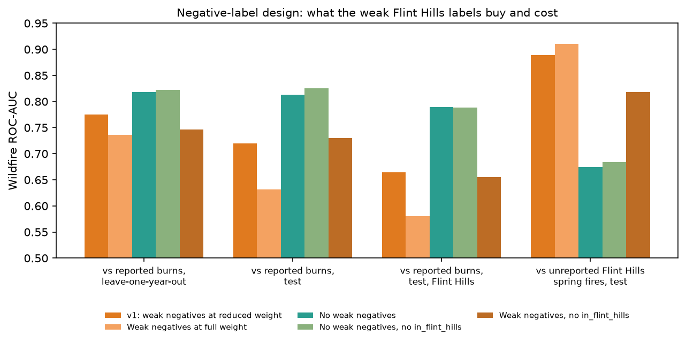

What this shows:

- **More weight on the weak negatives makes the strict metric worse.** Full weight is worse than v1, and v1 is worse than none. The weak labels trade accuracy on real, reported burns for accuracy on the weak labels themselves.
- **Removing only the flag doesn't help** (0.730 test, 0.746 leave-one-year-out). With the weak negatives still in, the model apparently rebuilds the region from elevation and season: Flint Hills wildfires still score poorly (0.655). The problem is the labels, not the feature.
- **Without weak negatives, the model can't recognize unreported Flint Hills spring burns** (0.68). In operation that means more Investigate alerts during burn season. This analysis doesn't measure how many.
- **"Wildfire vs all burns" is partly circular.** The weak negatives are *defined* by region and season, which are model inputs, so a model that learns the definition scores well on them. That is why v1 looks best on the all-burns metric, and why the reported-burns metric is the one to trust.

## 6. What carries the signal

Ablations retrain v1 with feature groups removed. Bars show leave-one-year-out (2016–2022) and test (2023–2025) ROC-AUC.

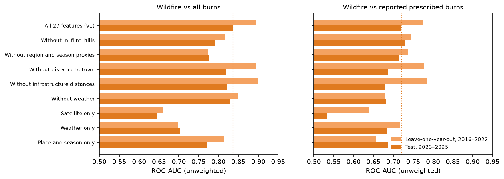

| Features | vs all burns (leave-one-year-out) | vs all burns (test) | vs reported burns (leave-one-year-out) | vs reported burns (test) |
|---|---|---|---|---|
| All 27 (v1) | 0.894 | 0.837 | 0.775 | 0.720 |
| Satellite only (11) | 0.660 | 0.646 | 0.639 | 0.534 |
| Weather only (7) | 0.699 | 0.703 | 0.717 | 0.683 |
| Place and season only (9) | 0.814 | 0.772 | 0.656 | 0.687 |
| Without weather | 0.850 | 0.828 | 0.679 | 0.682 |
| Without region and season proxies | 0.773 | 0.776 | 0.737 | 0.714 |
| Without distance to town | 0.893 | 0.820 | 0.777 | 0.688 |
| Without infrastructure distances | 0.900 | 0.822 | 0.785 | 0.679 |

- **Satellite features alone barely separate wildfires from burns** (0.53 on the test years against reported burns). A wildfire and a prescribed burn look alike to VIIRS. The distinguishing information is in the conditions: wind, gusts, and humidity.
- **Weather carries most of the legitimate signal** against reported burns. Removing it costs about 0.04–0.10.
- **Infrastructure distances disagree between the two views:** removing them slightly helps leave-one-year-out but hurts the test years. Distance to town partly measures *who reports fires* (see section 10), so treat it with suspicion either way.

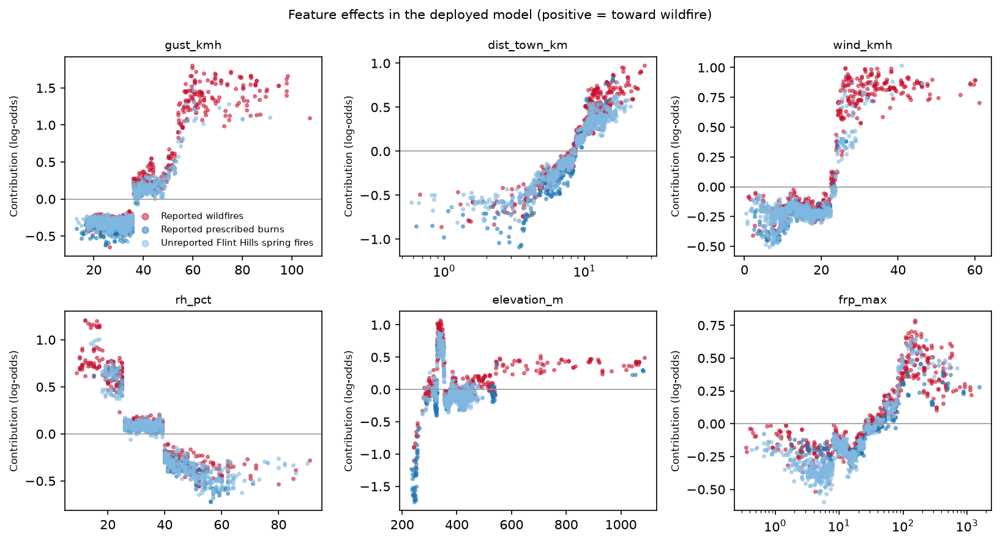

The learned effects are physically sensible where they should be. Wildfire likelihood rises steeply above about 35 km/h gusts and 22 km/h sustained wind, and below about 25% humidity. It also rises with fire power above about 20 MW. Two effects are artifacts rather than physics: the spike in the elevation curve, and wildfire likelihood rising with distance from town.

## 7. Operating point: thresholds, guardrails, and calibration

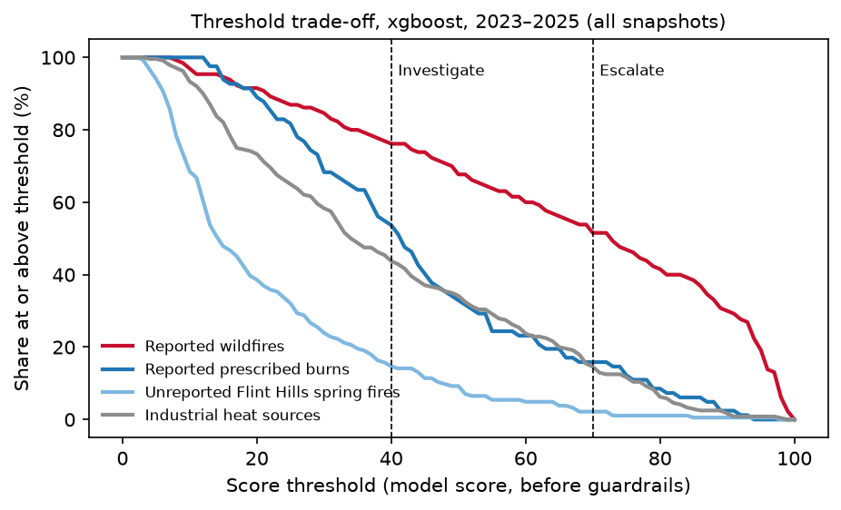

Share of test snapshots at or above each model score, before guardrails:

| Threshold | Reported wildfires | Reported prescribed burns | Unreported Flint Hills fires | Industrial heat sources |
|---|---|---|---|---|
| 30 | 85% | 68% | 24% | 58% |
| **40 (Investigate)** | **76%** | **54%** | **15%** | **44%** |
| 50 | 68% | 33% | 9% | 34% |
| 60 | 60% | 23% | 5% | 24% |
| **70 (Escalate)** | **52%** | **16%** | **2%** | **15%** |
| 80 | 42% | 9% | 1% | 6% |

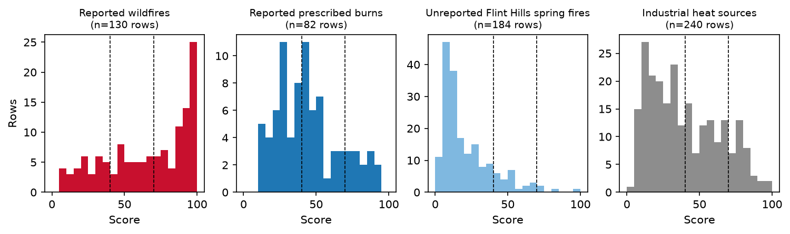

**Event-level outcomes.** Alerts fire when an event's level *rises*, so what a dispatcher experiences is the highest level each event reaches in its first 24 hours, after guardrails:

| Kind (test events) | xgboost: Investigate+ | xgboost: Escalate | logistic: Investigate+ | logistic: Escalate | rules-v0: Investigate+ | rules-v0: Escalate |
|---|---|---|---|---|---|---|
| Reported wildfires (61) | 87% | 61% | 84% | 67% | 66% | 20% |
| Reported prescribed burns (41) | 59% | 20% | 49% | 12% | 51% | 0% |
| Unreported Flint Hills fires (98) | 22% | 4% | 16% | 2% | 14% | 0% |
| Industrial heat sources (166) | 1% | 1% | 1% | 1% | 0% | 0% |

**Guardrails.** The heat-source cap lowered 103 of 240 test heat-source snapshots to Monitor. The model on its own would have put 44% of them at Investigate or higher, so the guardrail, and the heat-source layer it depends on, are essential rather than a safety net. The near-town floor raised 7 unreported Flint Hills snapshots and no wildfires or reported burns.

**Fire size.** Wildfire detection at Investigate or higher doesn't depend much on final size: 92% for under 100 acres (13 events), 83% for 100–999 acres (35), and 92% for 1,000 acres or more (13). Escalation rises somewhat with size (54%, 60%, 69%).

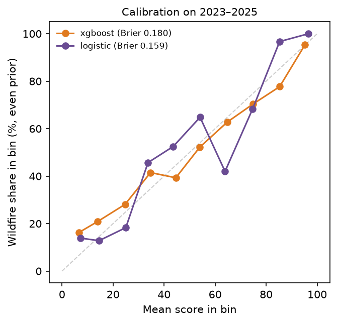

**Calibration.** This uses test snapshots, reweighted to the even wildfire/burn prior the scores are calibrated to. XGBoost scores track observed wildfire rates reasonably: Brier score 0.180, expected calibration error 0.05. Scores under 10 are slightly too low (observed rate 16%), and scores in the 80s are slightly too high (observed 78%). Logistic regression has a better Brier score (0.159) but is less consistent from bin to bin. In neither case is a score a real-world probability: wildfires are far rarer among all detections than the even prior assumes.

## 8. Training sensitivity

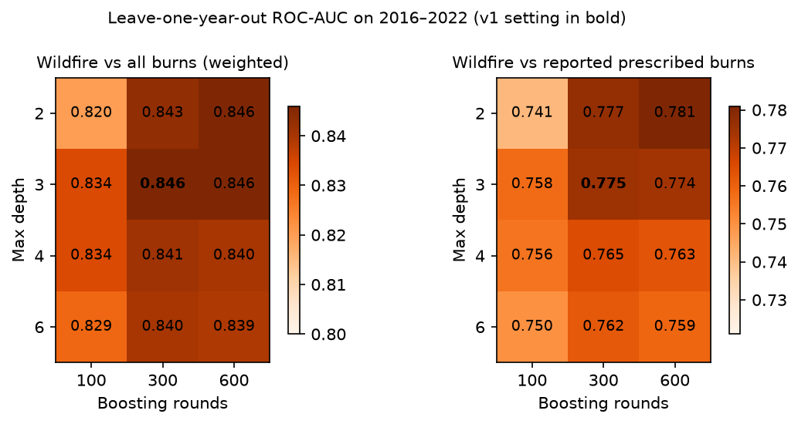

- **Hyperparameters:** across max depth 2–6 and 100–600 rounds, leave-one-year-out ROC-AUC ranges over 0.820–0.846 (all burns, weighted) and 0.741–0.781 (reported burns). v1 (depth 3, 300 rounds) is tied for best on the first and within 0.006 of best on the second. Shallow models with more rounds do as well as anything, which fits a small, noisy dataset.
- **Seeds:** ten random seeds give test ROC-AUC 0.828–0.838 (all burns) and 0.700–0.722 (reported burns), standard deviation under 0.01. Run-to-run noise is negligible next to the bootstrap intervals.

## 9. Detection lead time

This compares, for 209 matched wildfires (all years), the first satellite detection against WFIGS's reported discovery time.

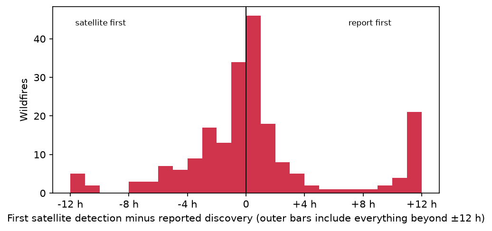

| Statistic | Value |
|---|---|
| Median (detection minus discovery) | +8 min |
| 25th–75th percentile | −104 min to +90 min |
| Satellite first | 47% |
| Satellite more than 1 h first | 31% |
| Satellite more than 6 h later | 14% |
| Median, fires under 100 acres (50) | −59 min |
| Median, fires of 1,000 acres or more (64) | +13 min |

Satellites see about a third of reported wildfires more than an hour before the recorded discovery. Small fires are seen earlier relative to their report than large ones, likely because large fires get reported quickly by many people. The +12 h bar collects fires first seen by satellite more than 12 h after discovery. Discovery times in WFIGS are often entered after the fact, so treat this as indicative.

## 10. Threats to validity

- **Labels reflect reporting, not the fire.** WFIGS records the fires that someone reported and classified. Wildfires near people are more likely to be reported, so `dist_town_km` partly measures reporting. Unreported wildfires are absent from the data entirely.
- **The weak negatives are circular** with region and season features (section 5). The "wildfire vs all burns" numbers flatter any model that learns the labeling rule.
- **Some weak negatives are probably escaped burns, which are wildfires.** The 10 km / 3-day exclusion around reported wildfires removes some of them, not all.
- **The heat-source layer was derived from all ten years,** including the test years. The heat-source results (99% at Monitor) are therefore optimistic.
- **The test set is small:** 61 wildfire and 41 reported-burn events, about 40% of them from 2023. One unusual season can move results by 0.1.
- **The model was refit on all years for deployment,** so no held-out estimate exists for the shipped model itself. The numbers here describe the same recipe trained on 2016–2022.
- **The label-design comparison** was suggested by looking at test-year errors. The leave-one-year-out check over 2016–2022 points the same way, which reduces but doesn't remove that bias.

## 11. Recommendations

1. **Make "wildfire vs reported prescribed burns" the primary metric** in `ml/train.py` and `report.md`, with bootstrap intervals. Keep "vs all burns" as a secondary number, labeled as partly circular.
2. **Train a v2 candidate without the weak negatives and without `in_flint_hills`.** It is the best design on both evaluation views (0.822 leave-one-year-out, 0.825 test). Before adopting it, measure the Flint Hills spring alert volume it would produce, by replaying a March–April season. Then decide whether burn notices (`BURN` texts) and the `likely_prescribed` suppression can absorb it. Those mechanisms know which burns are registered, which the model never can.
3. **Don't choose between XGBoost and logistic regression on these numbers.** They are within noise. Keep XGBoost for its per-feature reasons unless logistic regression wins clearly on the v2 recipe.
4. **Don't spend effort on hyperparameter tuning.** The best grid setting beats v1 by under 0.01.
5. **Rebuild the heat-source layer from training years only** for evaluation, so the guardrail's measured effect is honest. The guardrail is essential (44% of heat-source snapshots would otherwise be at Investigate or higher).
6. **Investigate the weak last-pass snapshot** (0.72), since rescoring uses it. Possible fixes are features that summarize the whole event instead of the latest pass, or never letting a rescore lower the level within 24 h.
7. **Get more reported burns.** Ninety in ten years is the binding constraint. Options include Kansas burn-permit records, neighboring states' WFIGS data (Oklahoma and Nebraska share the tallgrass burn season), and Firewatch's own burn notices once the app is in use.

## Appendix: reproducing

```bash
cd backend
.venv/bin/python -m ml.download          # FIRMS + WFIGS (once)
.venv/bin/python -m ml.build_dataset     # events, labels, features -> ml/data/dataset.csv
.venv/bin/python -m ml.train             # model, meta.json, report.md
.venv/bin/python -m ml.analyze           # this report's numbers and figures (~2 min)
```

**Metric conventions.**

- **ROC-AUC** is the probability that a random wildfire snapshot outscores a random burn snapshot.
- **"vs all burns"** counts weak negatives at full weight on the test years, matching `report.md`. The leave-one-year-out "weighted" variant applies the training weights, matching `meta.json`.
- **Event-level outcomes** use each event's highest level within its first 24 h, after guardrails, at Investigate ≥ 40 and Escalate ≥ 70.
- **Bootstrap intervals** resample events (2,000 draws, seed 7) and report the 2.5th and 97.5th percentiles.
