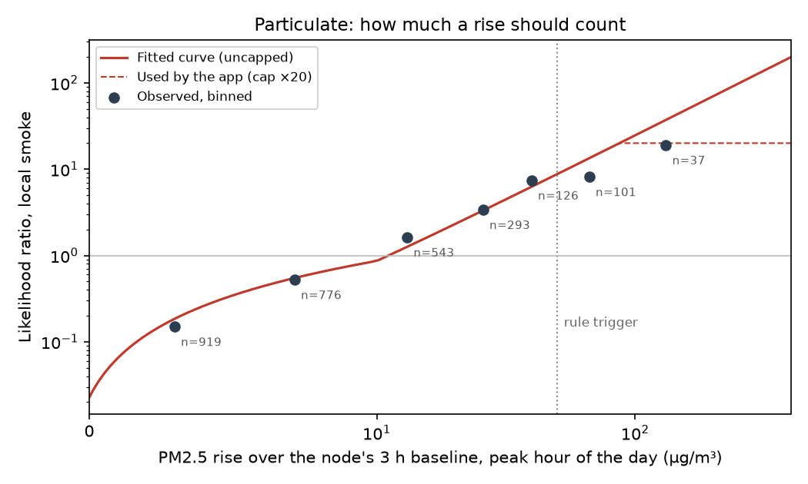
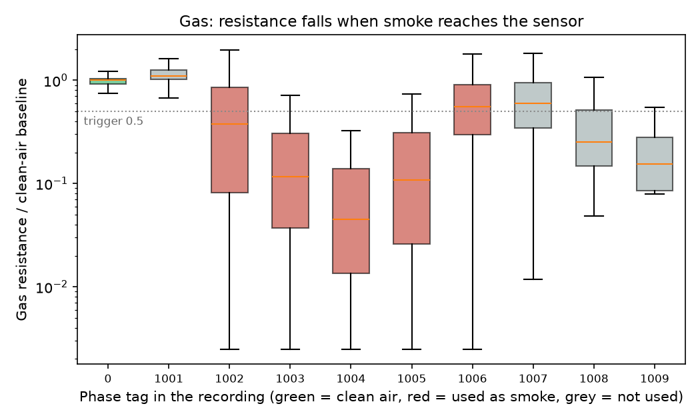

# Sensor smoke model v1

Generated 2026-11-08T00:00:00+00:00 by `backend/ml/smoke_sensor.py`. Model file: `backend/data/model/smoke_sensor.json`.

The tower smoke rule ([DESIGN 5.8](../DESIGN.md)) decides whether a reading is smoke. Until now, a reading that passed counted ×15 toward P(fire), an assumption. This model measures that weight from open data, and adds a second, weaker weight for the gas sensor on bare nodes:

- **Particulate:** the PM2.5 rise over the node's own baseline becomes a likelihood ratio for a fire near the sensor. A bigger rise counts for more, up to ×20.
- **Gas:** the drop in metal-oxide gas resistance against the node's own baseline becomes a likelihood ratio, capped at ×3. Gas alone never opens an event or counts as a source. It only adds weight to an event something else started.

The rules engine still decides *whether*: the PM2.5 trigger, the dust check and the regional-haze check are unchanged. The satellite scorer, these two curves and the people signals are separate models whose likelihood ratios multiply in `decision.probability`. All of one node's sensors together count once.

## Why not one joint model

No open dataset pairs satellite detections, ground sensors and fire labels for the same events. Each dataset below answers one question, so each becomes its own calibrated likelihood ratio, and the existing odds model combines them. That is the same structure the decision model already uses for every other kind of evidence.

## Data

| | Particulate | Gas |
|---|---|---|
| Source | Flint Hills 2022 prescribed-fire campaign, Colorado State University: [PurpleAir PM2.5](https://doi.org/10.5061/dryad.9p8cz8wqd) and [daily smoke designations](https://doi.org/10.5061/dryad.4mw6m90h7) (both CC0) | [Dataset Smoke Detection](https://doi.org/10.17632/48j7mm8k56.1), University of Cagliari (CC BY 4.0) |
| Sensors | 36 PurpleAir (Plantower PMS5003, the same sensor family as our PMSA003I), eastern Kansas | 5 nodes of Bosch BME688/BME690 dev kits, 100 m from the burns |
| Period | 2022-03-01 to 2022-05-31, hourly | 2021-02 and 2025-02 sessions, 52 hours of recordings |
| Unit | sensor-day: the hour with the largest rise that day | single gas reading |
| Label | expert designation: **local** smoke (code 1 or 3) vs smoke-free (0) or transported haze only (2). Counts: 0: 874, 1: 134, 2: 1217, 3: 570 | phase tag: clean air (0) vs phases 1002–1006 |
| Rows used | 2,795 sensor-days, 704 local | 98,571 readings, 74,694 smoke |

The Flint Hills designations are exactly the distinction the app needs: smoke from a fire near the sensor vs regional haze from fires far away. They're the study authors' call for each monitor and day, published with their GeoHealth paper: a careful reference, not ground truth for every hour.

## Particulate

**Features.** The same as the app computes live: PM2.5 now, minus the median of the node's previous 3 hours. The day's peak hour is used because that's the reading most likely to cross the trigger. On a clean day, it's the reading that would cause a false alarm.

**The current rule, measured.** A PM2.5 rise of 50 or more catches 15.1% of local-smoke days and fires on 1.5% of the others. Its likelihood ratio is **×9.8** (95% CI 5.6–19.8, resampling whole days). The assumed ×15 was close. The app now uses the measured value for any sensor signal without a model weight.

| Rise threshold (µg/m³) | Local days caught | Other days flagged | Likelihood ratio | 95% CI |
|---|---|---|---|---|
| ≥ 10 | 77.3% | 26.6% | 2.9 | 2.4–3.5 |
| ≥ 20 | 50.0% | 9.8% | 5.1 | 3.7–7.1 |
| ≥ 30 | 32.7% | 4.8% | 6.8 | 4.6–10.1 |
| ≥ 50 | 15.1% | 1.5% | 9.8 | 5.6–19.8 |
| ≥ 75 | 7.4% | 0.5% | 14.0 | 5.1–74.9 |
| ≥ 100 | 4.5% | 0.2% | 19.0 | 5.6–91.1 |

The table above is the trade a district makes if it lowers `smoke_pm25_rise`. For example, 20 µg/m³ catches three times as many local-smoke days, at about 6× the false flags.

**How much a given rise should count.** These are the likelihood ratios for each band of rise, not cumulative:

| Rise (µg/m³) | Sensor-days | Local | Likelihood ratio |
|---|---|---|---|
| < 5 | 919 | 44 | 0.15 |
| 5–10 | 776 | 116 | 0.52 |
| 10–20 | 543 | 192 | 1.62 |
| 20–35 | 293 | 156 | 3.38 |
| 35–50 | 126 | 90 | 7.43 |
| 50–100 | 101 | 74 | 8.14 |
| ≥ 100 | 37 | 32 | 19.01 |

A logistic curve in ln(1 + rise) fits these bands (AUC 0.823, 95% CI 0.784–0.856). The app reads the weight off the curve: 20 µg/m³: ×2.29 · 50 µg/m³: ×8.77 · 100 µg/m³: ×20 · 150 µg/m³: ×20 · 250 µg/m³: ×20. It caps the weight at ×20 for two reasons. Above about 50 µg/m³ the curve runs ahead of the observed bands. And live readings are single samples, not hourly means, so they spike higher than anything in the training data.

**Other features didn't help.** Each variant is a logistic regression scored by leave-one-week-out cross-validation. Recall is shown at the rule's false-flag rate (1.5%) and at 5%:

| Model | AUC | Recall at rule's false-flag rate | Recall at 5% false flags |
|---|---|---|---|
| PM2.5 rise (shipped) | 0.809 | 14.9% | 30.5% |
| + PM2.5 level and baseline | 0.805 | 10.7% | 26.0% |
| + previous hour's rise | 0.810 | 13.4% | 32.0% |
| + sensors 15-60 km away | 0.807 | 15.2% | 29.3% |
| + relative humidity | 0.811 | 16.1% | 37.1% |

The rise alone carries the signal. Sensors 15–60 km away (the regional-haze idea) add nothing measurable here, partly because most sensors have only a few neighbors in that ring. The regional-haze check stays a hard rule, not a model feature. Humidity improves recall at 5% false flags, most likely because burn days are dry. That makes it a fire-weather signal, and the decision model already weighs fire weather, so counting it again through the sensor would double it. Humidity is left out.

## Gas

**What the data shows.** Resistance falls when smoke reaches the sensor, by 2–20× at the strongest phases:

| Phase tag | Readings | Median R/R0 |
|---|---|---|
| 0 | 23877 | 1.00 |
| 1001 | 11762 | 1.10 |
| 1002 | 10146 | 0.38 |
| 1003 | 23786 | 0.12 |
| 1004 | 12504 | 0.05 |
| 1005 | 10905 | 0.11 |
| 1006 | 17353 | 0.56 |
| 1007 | 17701 | 0.60 |
| 1008 | 3323 | 0.25 |
| 1009 | 13 | 0.15 |

The dataset doesn't document its phase tags. From the recordings, 0 is the first ~37 minutes in clean air, and the tags then run in time order. In 1001 resistance hasn't moved yet, and 1002–1006 show the drop. 1007–1009 come at the end. Resistance partly recovers in 1007 and drops again in the short 1008–1009, and the data doesn't say why. Only 0 (clean) and 1002–1006 (smoke) are used. 1001 and 1007–1009 are left out.

**Feature.** ln(R/R0): the reading over the node's own clean-air baseline, for each sensor and heater step. Our BME680 telemetry reports one heater step at a temperature we don't know, so the absolute resistance doesn't transfer, but the relative drop does. Humidity and temperature changes are left out: in this dataset they track time since the start of each session (the air warmed up while the burns went on), not smoke.

**Results.** Leave-one-node-out AUC is 0.902 (NODE1 0.97, NODE2 0.96, NODE3 0.83, NODE4 0.92, NODE5 0.88).

| R/R0 at or below | Smoke readings caught | Clean readings flagged | Likelihood ratio in the experiment |
|---|---|---|---|
| ≤ 0.9 | 90.0% | 21.7% | 4.1 |
| ≤ 0.7 | 82.3% | 10.1% | 8.1 |
| ≤ 0.5 | 74.6% | 4.9% | 15.2 |
| ≤ 0.3 | 61.7% | 1.9% | 32.1 |

The app's trigger is R/R0 ≤ 0.5 on **two readings in a row**, which catches 70.6% of smoke readings and flags 3.6% of clean ones in the experiment. The weight comes from a logistic curve in ln(R/R0), read at the smaller of the two drops (R/R0 0.5: ×1.36 · R/R0 0.4: ×2.48 · R/R0 0.3: ×3) and capped at ×3. The table above is cumulative: everything at or below a ratio. The curve gives the weight of one exact ratio, which is why it's lower at 0.5.

**Why the cap is so low.** The experiment's clean air is ~37 minutes per session from 2 sessions, so its false-flag rates can't speak for a grassland node over weeks. Over weeks, dew and humidity swings, vehicle exhaust, feedlots and heater warm-up after a power cycle all move a metal-oxide sensor. Until a supervised burn trial ([sensors/README.md](../../sensors/README.md)) measures field false alarms:

- gas evidence is capped at ×3;
- it never opens an event and never counts as a second source;
- on a node with a particulate sensor, the gas weight is raised to `sensor_gas_weight` (0.5) before it multiplies the PM2.5 weight, so a full ×3 adds ×1.7, because both sensors see the same plume.

## How the app uses it

- `app/sensor_model.py` loads `smoke_sensor.json` and turns a rise or a ratio into a likelihood ratio.
- `app/sensors.py` stores gas resistance and pressure from `environmentMetrics` alongside PM2.5. When the PM2.5 trigger fires, the signal carries the particulate weight, plus the gas weight if the gas is also down. A bare node's gas drop attaches only to an open event within 8 km.
- `app/decision.py` multiplies the odds by that weight, once for all sensors. A signal without a weight (no model file, a manual signal) uses `lr_sensor_smoke`, now the rule's measured ×9.8. A district can override `lr_sensor_smoke`, `lr_sensor_pm_max`, `lr_sensor_gas_max` and `sensor_gas_weight` under `"decision"` in `settings.json`.

## Limits

- **One season, one place.** Spring 2022 in eastern Kansas is mostly prescribed-burn smoke in the Flint Hills. Wildfire smoke on a windy winter day may look different at the sensor: faster, thinner plumes.
- **Daily labels.** A designation covers the whole day, but the feature is one hour, so a local-smoke day whose plume missed the peak-rise hour counts against the model. The ratios are probably conservative.
- **Hourly vs live readings.** Training uses hourly means. The app uses single readings, which spike higher, and the cap absorbs part of that.
- **Gas.** Two sessions, five nodes, a 100 m standoff, Mediterranean vegetation, and a dev-kit heater profile, not Meshtastic's. Treat it as evidence that a resistance drop means smoke, not as a measured false-alarm rate.
- **Refit when outcomes exist.** Once Firewatch logs sensor signals against confirmed fires and burns, refit both curves on the district's own nodes.
