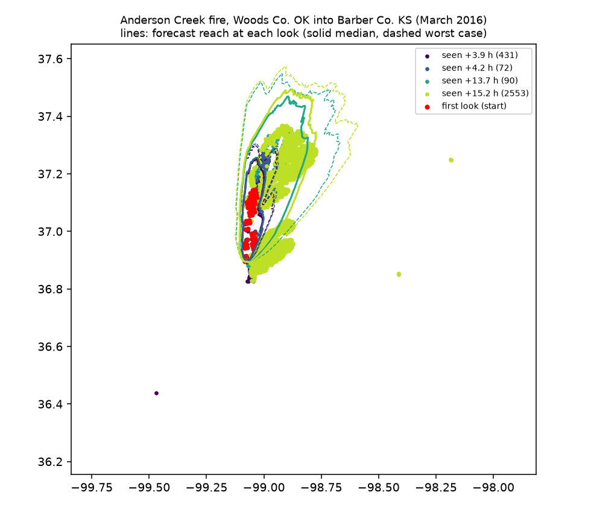
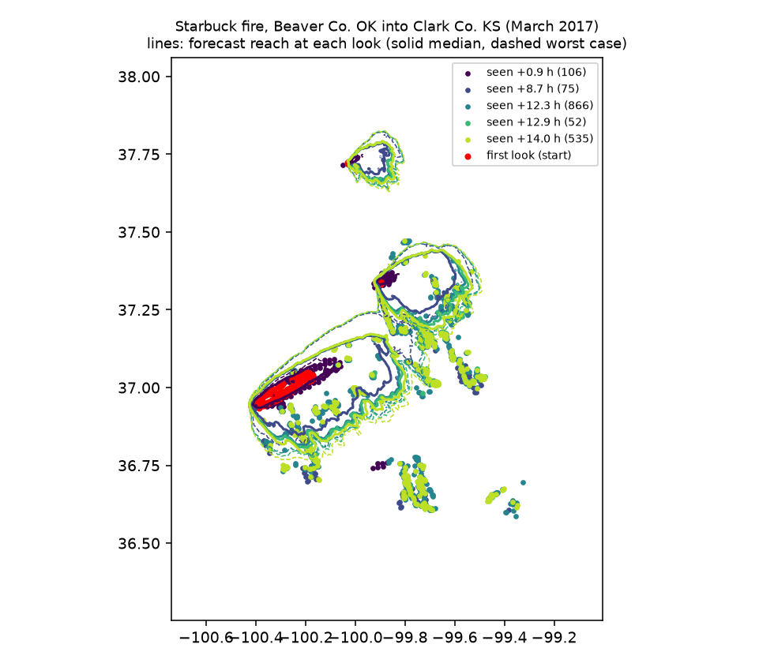

# Spread forecast back-test v1

Generated 2026-11-07T03:50:36+00:00 by `backend/ml/backtest.py`. Raw results: [spread-backtest-v1.json](spread-backtest-v1.json).

**Question:** if Firewatch had started forecasting from a real fire's first satellite look, would it have put fire where the later satellite looks found it, and about as far out as the fire actually ran?

## Method

1. **Fires.** Large Plains grass fires with real NASA FIRMS archive detections (VIIRS 375 m, MODIS 1 km): Anderson Creek 2016 and Starbuck 2017. The December 15, 2021 outbreak was examined but not scored; see below.
2. **Start (t0).** The first satellite look with detections in the study area. Every cluster of at least 5 pixels (pixels ≤ 4 km apart) is burning, and the forecast starts from all of them as established fire.
3. **What's scored:** every detection in the study area at every later look within 16 h. It's area-level, not fire-level, decided without the forecast. A fire that starts after t0 counts as a miss, so the scores are conservative.
4. **Weather.** The Open-Meteo archive's hourly values at the fire for the 13 hours after t0. That's the real weather, so this tests the fire model, not a weather forecast. The ensemble's ±15% wind / ±15° direction spread stands in for forecast error.
5. **Forecasts:**
   - **v2** (current): hourly wind, NLCD/CDL fuel map, terrain, 24-member ensemble
   - **v1** (original): one run, the first hour's wind held constant, everything treated as grass
6. **Scores, at each later look:**
   - **Reached:** the share of detected pixels where the forecast had fire by then. Median for v2, worst case (10th-percentile arrival) for v2, and the single run for v1. A detected pixel is burning at that moment, so the fire got there no later than the look.
   - **Reach:** the distance from the start pixels that covers 90% of the look's detections, against the same measure over the forecast's burned cells at that time. It's 90% rather than the farthest pixel because on multi-fire days the farthest detection is often a different fire.

## Overall

Across 4780 later detections: v2's median forecast had fire at **55%** of them, v2's worst case at **70%**, and v1 at **29%**.

## What it showed (v1 run, 2026-11-07; update this section when the model changes)

1. **v2 places fire where satellites later found it far more often than v1:** 55% vs 29% of later detections (median forecast), 70% with the worst case. The biggest gain is Anderson Creek's next-afternoon look, **70% vs 25%**, where the fuel map and the changing wind both matter.
2. **Anderson Creek's reach was inside the forecast range.** At 14–15 h the fire had reached 22–24 km; v2's range (90th to 10th percentile of runs) was 14–41 km, with the median about 30% long. At +4 h, overnight, v2 was too slow (6 km vs 12 km), but its worst case matched.
3. **Starbuck was under-predicted by about 2×:** reach seen 50–57 km at 9–14 h, v2 22–26 km, and even the worst case was under. Part is the scoring: separate fires to the south, not connected to any starting cluster (see the map), count as misses. Part is real:
   - the archive's wind drops to ~8 km/h overnight and humidity recovers, so the model slows the fire, while the real fire kept running behind the cold front
   - the ensemble's spread (±15% wind) is too narrow to cover that
4. **What to change next (not done yet):**
   - widen the ensemble on frontal nights, or add a member that uses gusts instead of sustained wind
   - check the moisture function's overnight recovery
   - calibrate on more fires using GOES 5-minute fire data (2018 and later), which would give dozens of looks per fire instead of 3–5

**For the pitch:** on Anderson Creek, the forecast put fire where satellites found it 15 hours later 70–81% of the time, against 25% for a simple constant-wind estimate. On Starbuck it ran too slow overnight, and that's the next calibration target.

## By fire

### Anderson Creek fire, Woods Co. OK into Barber Co. KS (March 2016)

Started from the 2016-03-23 04:34Z look: 58 pixels in 1 cluster(s) (modis), largest at 37.0381, -99.0577. Weather over the window: wind 22–40 km/h, from 185° at the start to 214° at the end; minimum RH 12%. Fuel: NLCD 2021 (30 m) + USDA CDL 2024 cropland (partial). Grid 502 m.

| Later look | Pixels | v2 had fire there (median) | v2 (worst case) | v1 | Fire's reach seen (km) | v2 reach p90–p50–p10 (km) | v1 reach (km) |
|---|---|---|---|---|---|---|---|
| 2016-03-23 08:28Z (+3.9 h) | 431 | 63% | 80% | 59% | **12.1** | 2.1–6.1–11.1 | 5.8 |
| 2016-03-23 08:49Z (+4.2 h) | 72 | 57% | 85% | 51% | **12.6** | 2.2–6.6–12.1 | 6.6 |
| 2016-03-23 18:13Z (+13.7 h) | 90 | 82% | 84% | 51% | **21.8** | 13.7–27.8–36.7 | 28.9 |
| 2016-03-23 19:48Z (+15.2 h) | 2553 | 70% | 81% | 25% | **24.1** | 17.4–31.8–40.7 | 32.8 |



### Starbuck fire, Beaver Co. OK into Clark Co. KS (March 2017)

Started from the 2017-03-06 19:22Z look: 289 pixels in 3 cluster(s) (viirs-snpp), largest at 37.0028, -100.2668. Weather over the window: wind 8–49 km/h, from 238° at the start to 327° at the end; minimum RH 6%. Fuel: NLCD 2021 (30 m) + USDA CDL 2024 cropland (partial). Grid 707 m.

| Later look | Pixels | v2 had fire there (median) | v2 (worst case) | v1 | Fire's reach seen (km) | v2 reach p90–p50–p10 (km) | v1 reach (km) |
|---|---|---|---|---|---|---|---|
| 2017-03-06 20:16Z (+0.9 h) | 106 | 40% | 57% | 39% | **9.4** | 1.7–3.2–4.9 | 3.8 |
| 2017-03-07 04:03Z (+8.7 h) | 75 | 7% | 13% | 7% | **57.0** | 13.8–21.9–24.2 | 37.7 |
| 2017-03-07 07:43Z (+12.3 h) | 866 | 25% | 46% | 26% | **55.4** | 16.4–23.9–26.8 | 49.5 |
| 2017-03-07 08:18Z (+12.9 h) | 52 | 19% | 46% | 17% | **49.7** | 16.9–24.5–27.3 | 51.2 |
| 2017-03-07 09:23Z (+14.0 h) | 535 | 34% | 55% | 24% | **53.7** | 17.8–25.5–28.5 | 54.9 |



## Not scored

- **trego-dec-2021:** Wind-event fire near WaKeeney, Trego Co. KS (Dec 15, 2021). Downed lines started several separate fires across Trego, Ellis and Russell counties after the first satellite look (Hays Post, KCUR). Overnight detections 50-110 km downwind can't be told apart from new ignitions, so scoring it would measure ignitions, not spread.

## How to read this, and its limits

- **"Reached" rewards over-prediction.** A forecast that burns the whole map scores 100%. That's why head run is reported next to it: a good forecast reaches the detections *and* has a head run close to the farthest one. A worst-case reach far beyond the observed head means the warning area was too big.
- **Satellites look rarely.** Polar orbiters pass a few times a day, so most later looks are 8–12 hours after the start, overnight. Fire that burned and went out between looks isn't seen. The head run seen is the farthest *active* fire at that look, a lower bound on how far the fire had run.
- **No suppression** in the model. Crews, dozer lines and roads stop real fires; the model's fire never stops except at water, towns and green fields.
- **Hindcast weather.** This uses the archive's actual weather, not the forecast that was available on the day, so real-time accuracy will be somewhat worse.
- **Two fires scored.** These are big, wind-driven Plains fires, the kind Firewatch is for, but they're a small sample. Calibrating the fuel multipliers and ensemble spread needs more fires (Michael's WFIGS list, Dec 2021 outbreak, 2024–2026 GOES data at 5-minute looks).

## Rebuild

```bash
cd backend && .venv/bin/python -m ml.backtest
```
