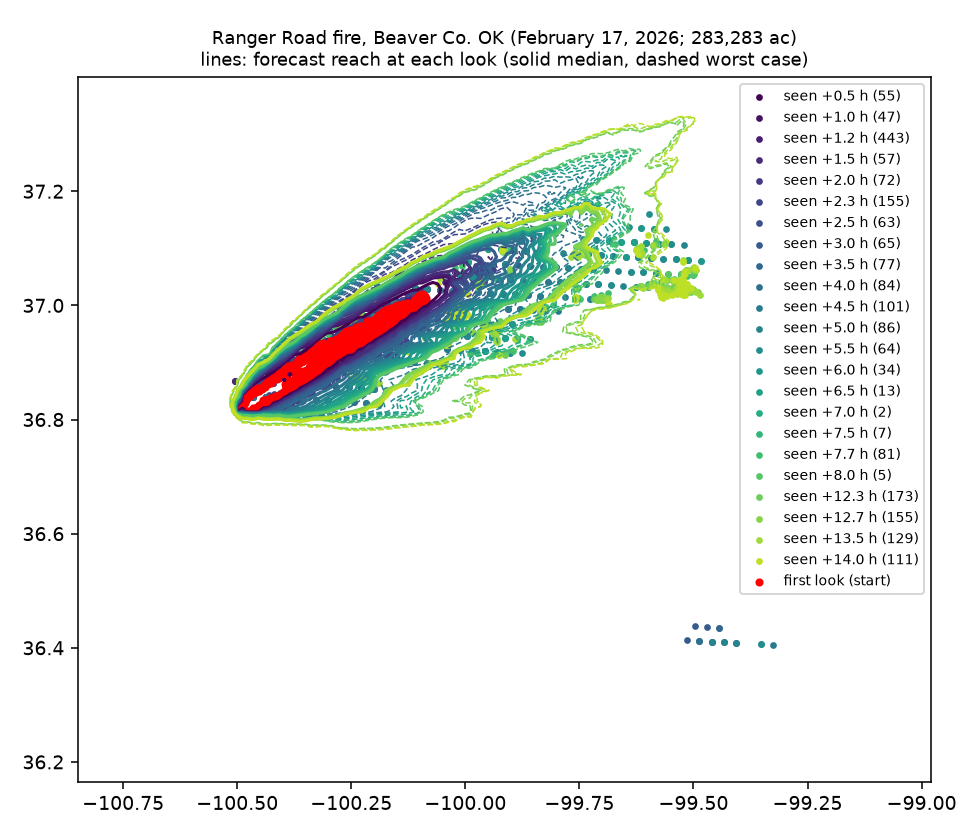

# Spread forecast back-test v1

Generated 2026-11-07T05:36:43+00:00 by `backend/ml/backtest.py`. Raw results: [spread-backtest-v1.json](spread-backtest-v1.json).

**Question:** if Firewatch had started forecasting from a real fire's first satellite look, would it have put fire where the later satellite looks found it, and about as far out as the fire actually ran?

## Method

1. **Fires.** Large Plains grass fires with real NASA FIRMS archive detections (VIIRS 375 m, MODIS 1 km): Anderson Creek 2016 and Starbuck 2017. The December 15, 2021 outbreak was examined but not scored; see below.
2. **Start (t0).** The first satellite look with detections in the study area. Every cluster of at least 5 pixels (pixels ≤ 4 km apart) is burning, and the forecast starts from all of them as established fire.
3. **What's scored:** every detection in the study area at every later look within 16 h. It's area-level, not fire-level, decided without the forecast. A fire that starts after t0 counts as a miss, so the scores are conservative.
4. **Weather.** The Open-Meteo archive's hourly values at the fire for the 13 hours after t0. That's the real weather, so this tests the fire model, not a weather forecast. The ensemble's ±15% wind / ±15° direction spread stands in for forecast error.
5. **Forecasts:**
   - **v2** (current): hourly wind, NLCD/CDL fuel map, terrain, 24-member ensemble
   - **v1** (original): one run, the first hour's wind held constant, everything treated as grass
6. **Scores, at each later look:**
   - **Reached:** the share of detected pixels where the forecast had fire by then. Median for v2, worst case (10th-percentile arrival) for v2, and the single run for v1. A detected pixel is burning at that moment, so the fire got there no later than the look.
   - **Reach:** the distance from the start pixels that covers 90% of the look's detections, against the same measure over the forecast's **active front** (cells that caught fire in the hour before the look). Satellites see active flame, not the burned-out interior, so comparing against the whole forecast footprint would understate the forecast's reach. It's 90% rather than the farthest pixel because on multi-fire days the farthest detection is often a different fire.
7. **Ranger Road 2026** isn't in the yearly archive yet. Its detections come from the FIRMS area API, plus GOES-19 fire pixels (2 km) every 30 minutes for the first 8 hours, scored separately. A first-hour check starts a new fire at the reported discovery time at the upwind end of the first look; that ignition point is assumed, since WFIGS has no coordinates.

## Overall

Across 6027 later polar-orbiter detections (VIIRS 375 m, MODIS 1 km): v2's median forecast had fire at **59%** of them, v2's worst case at **77%**, and v1 at **34%**. On 832 GOES pixels (2 km, every 30 min): v2 median 41%, worst case 66%, v1 37%.

## What it showed (run of 2026-11-07, with the extreme-day runs; update this section when the model changes)

1. **v2 places fire where satellites later found it far more often than v1:** 59% vs 34% of later polar-orbiter detections (median forecast), **77% with the worst case**. On GOES pixels every 30 minutes: 41% median, 66% worst case, vs 37% for v1. The biggest gain is Anderson Creek's next-afternoon look, 75% vs 25%, where the fuel map and the changing wind both matter.
2. **On extreme-wind days the grassfire formula alone runs 2–4× too slow.** Starbuck and Ranger Road ran at about 20% of their 80–90 km/h gusts. Testing ruled out the fuel map (Ranger Road's path was 97% grass) and curing.
   - The fix: 6 of the 24 runs spread at 20% of gust speed on dry, gusty days (spread.GUST_RULE_*).
   - Ranger Road: the worst case at +12–14 h now reaches 53–57 km against 49–51 km seen. Before the fix it was 43–44 km.
   - Starbuck: closer (36–41 km against 50–57) but still short. Part of the gap is separate fires to the south that count as misses.
   - The median is barely changed, by design.
3. **On a moist night (Anderson Creek) the forecast runs long:** 41 km median vs 24 km seen at 15 h. The extreme-day rule doesn't apply there, and the best-case runs (29 km) are closest.
4. **Ranger Road's first hour is still under-called:** 1,306 ac (median) to 3,387 ac (upper) against the packet's 15,000 ac. GOES saw nothing of the fire until 1–2 hours after its reported discovery.
5. **Data note:** in this run 8 land-cover tiles at the far edges of the Starbuck and Ranger Road map areas failed to download and were filled in as grass (the fuel line in each section says so).
6. **Next:** more fires with GOES 5-minute data (2018 and later) to calibrate the main formula, instead of only widening the worst case.

**For the pitch:** started from the first satellite look of three real Plains fires, the forecast's range contained 77% of where satellites found fire over the next 15 hours, against 34% for a simple estimate. Where it fell short, on extreme-wind days, we found out why and changed it.

## By fire

### Anderson Creek fire, Woods Co. OK into Barber Co. KS (March 2016)

Started from the 2016-03-23 04:34Z look: 58 pixels in 1 cluster(s) (modis), largest at 37.0381, -99.0577. Weather over the window: wind 22–47 km/h, from 185° at the start to 236° at the end; minimum RH 10%. Fuel: NLCD 2021 (30 m) + USDA CDL 2024 cropland (partial). Grid 1022 m.

| Later look | Pixels | v2 had fire there (median) | v2 (worst case) | v1 | Fire's reach seen (km) | v2 reach p90–p50–p10 (km) | v1 reach (km) |
|---|---|---|---|---|---|---|---|
| 2016-03-23 08:28Z (+3.9 h) | 431 | 66% | 81% | 59% | **12.1** | 5.8–10.6–14.7 | 9.5 |
| 2016-03-23 08:49Z (+4.2 h) | 72 | 61% | 85% | 51% | **12.6** | 4.2–10.6–16.7 | 10.6 |
| 2016-03-23 18:13Z (+13.7 h) | 90 | 81% | 82% | 51% | **21.8** | 22.4–35.8–44.2 | 38.8 |
| 2016-03-23 19:48Z (+15.2 h) | 2553 | 75% | 83% | 25% | **24.1** | 29.1–40.9–50.9 | 43.6 |


### Starbuck fire, Beaver Co. OK into Clark Co. KS (March 2017)

Started from the 2017-03-06 19:22Z look: 289 pixels in 3 cluster(s) (viirs-snpp), largest at 37.0028, -100.2668. Weather over the window: wind 8–49 km/h, from 238° at the start to 273° at the end; minimum RH 6%. Fuel: NLCD 2021 (30 m) + USDA CDL 2024 cropland (partial); some tiles unavailable, assumed grass. Grid 1054 m.

| Later look | Pixels | v2 had fire there (median) | v2 (worst case) | v1 | Fire's reach seen (km) | v2 reach p90–p50–p10 (km) | v1 reach (km) |
|---|---|---|---|---|---|---|---|
| 2017-03-06 20:16Z (+0.9 h) | 106 | 45% | 71% | 39% | **9.4** | 2.2–3.5–6.4 | 3.8 |
| 2017-03-07 04:03Z (+8.7 h) | 75 | 7% | 19% | 7% | **57.0** | 18.1–25.5–36.1 | 50.8 |
| 2017-03-07 07:43Z (+12.3 h) | 866 | 23% | 60% | 26% | **55.4** | 20.5–30.6–39.1 | 67.5 |
| 2017-03-07 08:18Z (+12.9 h) | 52 | 17% | 73% | 17% | **49.7** | 20.9–31.0–40.4 | 72.1 |
| 2017-03-07 09:23Z (+14.0 h) | 535 | 32% | 68% | 24% | **53.7** | 22.5–31.5–40.7 | 78.9 |


### Ranger Road fire, Beaver Co. OK (February 17, 2026; 283,283 ac)

Started from the 2026-02-17 19:17Z look: 888 pixels in 1 cluster(s) (viirs_noaa20_sp, viirs_snpp_sp), largest at 36.9158, -100.2935. Weather over the window: wind 8–56 km/h, from 235° at the start to 258° at the end; minimum RH 14%. Fuel: NLCD 2021 (30 m) + USDA CDL 2024 cropland (partial); some tiles unavailable, assumed grass. Grid 1034 m.

| Later look | Pixels | v2 had fire there (median) | v2 (worst case) | v1 | Fire's reach seen (km) | v2 reach p90–p50–p10 (km) | v1 reach (km) |
|---|---|---|---|---|---|---|---|
| 2026-02-17 19:46Z (+0.5 h) GOES | 55 | 56% | 67% | 53% | **3.5** | 1.4–1.7–2.2 | 1.5 |
| 2026-02-17 20:16Z (+1.0 h) GOES | 47 | 62% | 79% | 55% | **3.5** | 1.6–2.2–4.3 | 1.8 |
| 2026-02-17 20:27Z (+1.2 h) | 443 | 79% | 91% | 71% | **2.4** | 3.5–3.6–7.5 | 3.2 |
| 2026-02-17 20:46Z (+1.5 h) GOES | 57 | 74% | 88% | 61% | **3.6** | 3.7–5.4–10.7 | 5.5 |
| 2026-02-17 21:16Z (+2.0 h) GOES | 72 | 56% | 88% | 51% | **10.5** | 4.6–7.8–15.5 | 8.2 |
| 2026-02-17 21:36Z (+2.3 h) | 155 | 56% | 85% | 52% | **7.6** | 4.5–9.4–17.6 | 10.1 |
| 2026-02-17 21:46Z (+2.5 h) GOES | 63 | 60% | 84% | 62% | **4.7** | 5.6–10.8–18.7 | 10.9 |
| 2026-02-17 22:16Z (+3.0 h) GOES | 65 | 43% | 66% | 37% | **24.6** | 6.9–13.7–22.0 | 13.4 |
| 2026-02-17 22:46Z (+3.5 h) GOES | 77 | 29% | 64% | 23% | **17.9** | 7.5–16.5–25.0 | 16.0 |
| 2026-02-17 23:16Z (+4.0 h) GOES | 84 | 26% | 61% | 25% | **26.3** | 10.3–17.7–28.2 | 18.4 |
| 2026-02-17 23:46Z (+4.5 h) GOES | 101 | 28% | 56% | 22% | **38.2** | 9.7–18.6–31.0 | 21.0 |
| 2026-02-18 00:16Z (+5.0 h) GOES | 86 | 27% | 50% | 23% | **45.5** | 11.0–21.2–33.8 | 23.4 |
| 2026-02-18 00:46Z (+5.5 h) GOES | 64 | 23% | 44% | 22% | **49.0** | 12.4–22.2–36.2 | 26.1 |
| 2026-02-18 01:16Z (+6.0 h) GOES | 34 | 44% | 56% | 47% | **46.5** | 12.3–23.4–37.9 | 28.5 |
| 2026-02-18 01:46Z (+6.5 h) GOES | 13 | 46% | 77% | 38% | **38.2** | 14.0–24.5–39.6 | 31.2 |
| 2026-02-18 02:16Z (+7.0 h) GOES | 2 | 50% | 100% | 0% | **27.0** | 14.2–24.5–41.2 | 33.7 |
| 2026-02-18 02:46Z (+7.5 h) GOES | 7 | 29% | 71% | 14% | **46.6** | 17.3–25.6–42.3 | 36.2 |
| 2026-02-18 02:57Z (+7.7 h) | 81 | 48% | 72% | 37% | **46.6** | 17.4–25.8–43.0 | 37.2 |
| 2026-02-18 03:16Z (+8.0 h) GOES | 5 | 20% | 20% | 0% | **52.0** | 17.6–27.4–43.8 | 38.7 |
| 2026-02-18 07:37Z (+12.3 h) | 173 | 57% | 83% | 35% | **49.3** | 21.8–34.5–53.0 | 60.9 |
| 2026-02-18 07:58Z (+12.7 h) | 155 | 56% | 79% | 38% | **49.8** | 21.8–35.2–53.1 | 62.7 |
| 2026-02-18 08:47Z (+13.5 h) | 129 | 53% | 69% | 40% | **51.4** | 19.8–36.9–56.5 | 66.9 |
| 2026-02-18 09:17Z (+14.0 h) | 111 | 52% | 62% | 45% | **51.2** | 22.2–35.5–54.5 | 69.7 |

**First hour.** A new fire started at the reported discovery time (17:19Z) at the upwind end of the first look (36.8131, -100.5016; assumed ignition), wind 42 km/h from 227°:
- size at 60 minutes, forecast p10 / median / p90: **816 / 1,306 / 3,387 ac**, against the packet's **15,000 ac**
- reach at the first satellite look (19:17Z, 118 min after discovery): seen 37.3 km; forecast 3.5–9.9–13.1 km (p90–p50–p10 runs)



## Not scored

- **trego-dec-2021:** Wind-event fire near WaKeeney, Trego Co. KS (Dec 15, 2021). Downed lines started several separate fires across Trego, Ellis and Russell counties after the first satellite look (Hays Post, KCUR). Overnight detections 50-110 km downwind can't be told apart from new ignitions, so scoring it would measure ignitions, not spread.

## How to read this, and its limits

- **"Reached" rewards over-prediction.** A forecast that burns the whole map scores 100%. That's why head run is reported next to it: a good forecast reaches the detections *and* has a head run close to the farthest one. A worst-case reach far beyond the observed head means the warning area was too big.
- **Satellites look rarely.** Polar orbiters pass a few times a day, so most later looks are 8–12 hours after the start, overnight. Fire that burned and went out between looks isn't seen. The head run seen is the farthest *active* fire at that look, a lower bound on how far the fire had run.
- **No suppression** in the model. Crews, dozer lines and roads stop real fires; the model's fire never stops except at water, towns and green fields.
- **Hindcast weather.** This uses the archive's actual weather, not the forecast that was available on the day, so real-time accuracy will be somewhat worse.
- **Two fires scored.** These are big, wind-driven Plains fires, the kind Firewatch is for, but they're a small sample. Calibrating the fuel multipliers and ensemble spread needs more fires (Michael's WFIGS list, Dec 2021 outbreak, 2024–2026 GOES data at 5-minute looks).

## Rebuild

```bash
cd backend && .venv/bin/python -m ml.backtest
```
